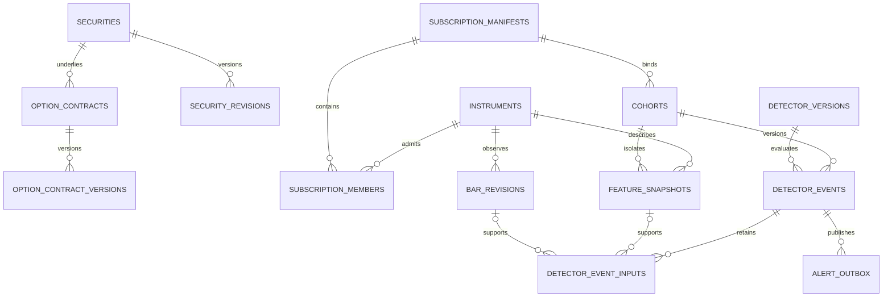

# Advanced Real-Time Implementation Plan

Status: tracked offline implementation is in progress. No operational authorization
is granted by this document.
Date: 2026-10-03.
Parent: [Three-tier system design specification](ADVANCED_REALTIME_PREFLIGHT_DESIGN.md).

## 1. Decisions and Boundaries

Confirmed for this work package:

- Develop and test initially on the current Windows-native machine.
- Recommend later deployment options without requiring Docker, Linux, or Redis
  for the initial implementation.
- Preserve acknowledged ingestion across process restart. Loss of the only host
  or disk may require repair; replicated zero-loss recovery is not required now.
- Build a separate database/schema, migrate deliberately, then cut over.
- Implement and verify offline contracts, schemas, fake transports and local replay
  under the implementation tracker. Production migrations, service changes, provider
  probes, retained-data operations and publication remain separately authorized.

Inherited scope: 400 stocks; 50 fixed option underlyings initially, potentially
100; regular trading hours; bounded contract-level quote subscriptions; current
strategies plus new aggression detectors; live execution disabled. Retain the
parent design's 500 ms p95 / 1,000 ms p99 last-required-receipt-to-committed-alert
targets as unverified acceptance goals, not measured capabilities.

Recommended initial architecture: native Python processes, a dedicated SQLite WAL
event journal on local disk, incremental partition-owned state, and a separate
PostgreSQL database for control, materialization, evidence, and serving. Redis
Pub/Sub is not required. The journal choice is conditional on a bounded benchmark;
it must not be made faster by weakening the agreed durability requirement.

Three-tier refinement: capture raw WebSocket messages before off-loop decoding;
run the strict whale-size/prior-OI proxy with causal NBBO and per-model earnings
gates; target native Charles Schwab Individual Trader API orders behind independent
risk, OAuth and account gates. Cover iron condors, four-leg iron butterflies and
standard three-leg 1:2:1 butterflies. This extends the plan, not runtime authority.
Sub-millisecond targets apply to local raw-byte handoff, not guaranteed disk flush.

## 2. Redis and Queue Decision

| Mechanism | Useful role | Decision |
| --- | --- | --- |
| In-process bounded queue / process IPC | Short-lived buffering and wakeups between local components | Use where needed, but never as the only record of accepted events |
| Redis Pub/Sub | Best-effort notification or cache invalidation with authoritative re-read | Optional later; unsuitable for the primary market-data path because disconnected consumers cannot replay or acknowledge messages |
| Redis Streams | Retained events, consumer groups, pending entries and replay | A possible broker adapter, not equivalent to Pub/Sub; requires explicit persistence, retention, recovery and Windows deployment decisions |
| SQLite WAL journal | Single-host retained log, sequential consumers, crash recovery | Initial benchmark candidate matching Windows-native and process-restart requirements |
| PostgreSQL work queue and outbox | Durable low-frequency bar/analysis jobs and committed alert delivery | Use for semantic work, not every raw quote |
| Kafka / Redpanda | Partitioned durable transport across independent services/hosts | Scale-out candidate when measured traffic or recovery requirements justify it |

Redis is not a prerequisite for event-driven processing. A retained log decouples
ingestion from consumers; the queue's important properties are bounded buffering,
replay, checkpointing, ordering, durability and backpressure, not its brand.

If Redis Streams is chosen later, establish its exact acknowledged-write guarantee.
Snapshot-only persistence or periodic AOF fsync does not automatically guarantee
survival of every acknowledged event. Consumer acknowledgement is not a disk flush;
replication acknowledgement alone is not proof of fsynced persistence. Define and
test the selected version/configuration against the same failure model.

Streams retention must not trim records still required by pending consumers or
unarchived offsets. A consumer group load-balances work; it does not broadcast
every event to every member. Independent consumers needing the complete stream
require separate groups and independent progress. Pub/Sub offers neither contract.

For stateful feature workers, do not let multiple Redis consumers race on one
unpartitioned stream: delivery is load-balanced, not sticky to underlying identity.
Use explicit shard keys with one fenced owner per shard, recover pending work
before advancing new work, and preserve durable checkpoint order. Pending-message
claiming alone does not make parallel processing causally ordered.

Do not add both Redis and a second durable broker in the initial deployment. For
alerts, PostgreSQL's transactional outbox plus polling is sufficient; LISTEN/NOTIFY
or Pub/Sub may reduce wakeup latency, but a missed notification must remain harmless.

Technical references reviewed for this decision:
[Pub/Sub delivery](https://redis.io/docs/latest/develop/pubsub/),
[Streams and consumer groups](https://redis.io/docs/latest/develop/data-types/streams/),
[Redis persistence](https://redis.io/docs/latest/operate/oss_and_stack/management/persistence/),
and [SQLite synchronous settings](https://www.sqlite.org/pragma.html#pragma_synchronous).
These establish documented semantics, not measured capacity on this machine.

## 3. Database Boundary and Ownership

Prefer a separate database on the existing PostgreSQL server initially. Provisional
name: `stocks_realtime_v1`. The name and server resources require approval before
creation. A separate database provides an explicit connection/role boundary and
clean rollback; it does not isolate CPU, disk or host failure on a shared server.

Within the new database use `ref` for local canonical references and `rt` for
real-time platform data. A `compat` namespace may expose deliberately selected
legacy-shaped read views. Do not copy the entire old schema as the new canonical
model or create a parallel history that silently competes with the existing API.

| Concern | Current database | New database |
| --- | --- | --- |
| Current serving authority before cutover | Unchanged | Shadow-only, explicitly identified |
| Existing bars, references, alerts and manifests | Immutable source of retained history | Import only approved slices with their original IDs, hashes and clocks |
| New Advanced market stream | No new writes required | New journal metadata, materialization and detector cohorts |
| Compatibility | Existing readers remain intact | Explicit adapters to existing domain contracts and response schemas |
| Credentials | Existing configuration stays intact | Separate DSN and least-privilege migration/ingest/compute/reader roles |
| Rollback | Continue serving original cohorts | Stop new publication and retain new evidence for diagnosis |

PostgreSQL cannot enforce ordinary foreign keys or provide one local transaction
across two databases. Copy required canonical references into the new database
before admitting dependent events. Do not put cross-database joins or source reads
in the detector hot path. Avoid introducing FDW or distributed transactions for
this cutover.

Preserve existing security UUIDs and option contract IDs when importing. Advance
destination sequences above imported identifiers. During coexistence, designate one
catalog writer and replicate approved revisions; independent sequences in two writable
catalogs can collide. Freeze catalog allocation for final ownership transfer. If a
second independent catalog becomes necessary later, use explicit origin-scoped ID
mapping rather than assuming bigint IDs are globally unique.

Reference imports retain original observed/recorded times and add `imported_at`
separately. Source and target database labels are provenance, not permission to
change original availability. Historical imports cannot be relabelled as newly
observed live data, and new locally derived results record their actual creation.

### 3.1 Existing Owners to Reuse

| Current owner | Implementation treatment |
| --- | --- |
| [Canonical schema](../backend/migrations/000_canonical_schema.sql) | Source contracts for immutable bars and versioned catalog; not a script to apply blindly to the new database |
| [Quote monitoring schema](../backend/migrations/059_option_advanced_quote_monitoring.sql) | Preserve quote/monitor domain semantics; add explicit current validity rather than treating last valid quote as live |
| [Finalized-bar materializer](../backend/equity/materialization.py) | Reuse pure analysis functions and declared intervals through an adapter; do not invoke the full pandas pipeline on every tick |
| [Materialization tests](../backend/tests/test_equity_evidence_materialization.py) | Preserve finalized-bar, session-hour, early-close, source and hash behavior |
| [Equity stream adapter](../backend/equity/polygon_stream.py) | Keep minute aggregates and add separately typed trade/quote ingestion |
| [Options data contract](../backend/options/data/base.py) | Retain Developer capability checks and snapshot batches; add Advanced events without pretending a tick is a complete chain |
| [Dual-origin models](../backend/options/dual_origin.py) | Reuse O1/O2/O3/S1/S2 contracts through versioned causal views; do not infer aggressor side from participation |
| [Stock forward decisions](../backend/research/stock_idea_forward.py) | Preserve per-strategy state, completed-bar entry rules and prospective policy identity |
| [Migration planner](../backend/scripts/apply_pending_migrations.py) | Reuse target confirmation and planning discipline; its existing canonical-baseline assumption requires a separate new-database migration lineage |

## 4. Proposed PostgreSQL Models

Notation: `uuid` denotes an opaque durable identity; `hash` means a checked
64-character SHA-256 digest; all wall clocks are `timestamptz`; provider integer
timestamps also retain their original unit. Required identifiers, versions, hashes
and clocks are NOT NULL unless stated otherwise. These are data definitions for
review, not executable DDL. Use the minimum groups needed for each delivery phase.

Core relationships, with auxiliary checks and projections omitted:

### 4.1 Canonical References

| Table | Essential columns | Keys and invariants |
| --- | --- | --- |
| `ref.securities` | `security_id uuid`, `asset_type text`, `created_at`, `source_origin text` | PK `security_id`; mutable display ticker is not identity |
| `ref.security_revisions` | `revision_id uuid`, `security_id uuid`, `ticker text`, `exchange text`, `calendar_id text`, `effective_from`, nullable `effective_to`, `observed_at`, `payload_hash`, `imported_at` | PK revision; FK security; unique source revision identity; validate nonoverlapping canonical effective periods where required |
| `ref.option_contracts` | `contract_id bigint`, `underlying_security_id uuid`, `contract_ticker text`, `first_observed_at`, `source_origin text` | PK contract; FK underlying; provider/ticker identity must be unique in its declared namespace |
| `ref.option_contract_versions` | `version_id bigint`, `contract_id bigint`, `call_put text`, `expiration date`, `strike numeric(20,8)`, `exercise_style text`, `multiplier numeric(20,8)`, `deliverables jsonb`, `eligibility text`, `effective_from`, nullable `effective_to`, `observed_at`, `payload_hash` | PK version; FK contract; preserve adjusted terms and unsupported-contract exclusions; midpoint pricing does not broaden eligibility |
| `rt.instruments` | `instrument_id bigint`, `asset_class text`, nullable `security_id uuid`, nullable `contract_id bigint` | PK instrument; exactly one security/contract FK according to asset class; unique partial indexes on each non-null source ID |

`rt.instruments` supplies one compact internal key for the event stream without
replacing security/contract identity. Resolve its underlying and catalog version
once at admission, not through SQL for every event. Contract ticker and terms are
not reconstructed by splitting an option symbol when the catalog is available.

### 4.2 Preflight, Membership and Stream Control

| Table | Essential columns | Keys and access path |
| --- | --- | --- |
| `rt.capability_profiles` | `profile_id uuid`, `config_hash`, `schema_hash`, `account_alias text`, `capabilities_hash`, `checked_at`, `expires_at`, `status text` | PK profile; checks bind actual account/product/endpoint observations, not just plan name |
| `rt.capability_checks` | `profile_id uuid`, `check_name text`, `scope_key text`, `verdict text`, `reason_codes text[]`, `observed_at`, `expires_at`, `evidence jsonb` | PK `(profile_id, check_name, scope_key)`; FK profile; sanitized bounded evidence |
| `rt.subscription_manifests` | `manifest_id uuid`, `manifest_hash`, `session_date date`, `effective_at`, `profile_id uuid`, `stock_count int`, `option_underlying_count int`, `quote_contract_count int`, `allocation_policy_hash` | PK manifest; unique content hash; approved counts match members; admission also checks account limits |
| `rt.subscription_members` | `manifest_id uuid`, `instrument_id bigint`, `channel text`, `priority smallint`, `purpose text`, nullable `catalog_version_id bigint` | PK `(manifest_id, instrument_id, channel)`; FK instrument/manifest/catalog version; store actual contracts, not only underlying names |
| `rt.cohorts` | `cohort_id uuid`, `cohort_hash`, `manifest_id uuid`, `configuration_hash`, `model_bundle_hash`, `valuation_hash`, `effective_at`, `mode text`, `created_at` | PK cohort; unique canonical hash; immutable SHADOW/ALERT study identity; references to cohort below are actual FKs |
| `rt.worker_leases` | `resource_key text`, `owner_id uuid`, `owner_epoch bigint`, `lease_until`, `updated_at` | PK resource; row-locked compare/update for takeover; monotonically increasing epoch fences a connection, shard or cohort publisher |
| `rt.action_authorizations` | `authorization_id uuid`, `cohort_id uuid`, `account_id uuid`, `action text`, `policy_hash`, `approved_at`, `effective_at`, `expires_at`, nullable `revoked_at` | Explicit paper/live authorization; default deny; FK account defined in Section 4.7; append reviewed approval/revocation evidence |
| `rt.stream_sessions` | `session_id uuid`, `provider text`, `feed text`, `manifest_id uuid`, `owner_epoch bigint`, `started_at`, nullable `ended_at`, `status text`, nullable `failure_code text` | PK session; lineage for accepted events; one fenced owner for each admitted connection |
| `rt.stream_gaps` | `gap_id uuid`, `session_id uuid`, nullable `instrument_id bigint`, `channel text`, `gap_start`, nullable `gap_end`, `journal_generation uuid`, `shard_id int`, `last_durable_offset bigint`, `reason text`, `recovery_status text`, nullable `repair_reference uuid` | PK gap; partial index for unresolved gaps; noncontiguous provider sequence alone is not a gap |
| `rt.archive_segments` | `segment_id uuid`, `journal_generation uuid`, `shard_id int`, `first_offset bigint`, `last_offset bigint`, `row_count bigint`, `first_event_at`, `last_event_at`, `uri text`, `checksum`, `schema_version text`, `verified_at` | PK segment; unique log-generation/shard/offset range; validate nonoverlap, checksum and archived coverage before journal truncation |
| `rt.readiness_current` | `scope_type text`, `scope_id text`, `capability text`, `epoch bigint`, `owner_epoch bigint`, `profile_id uuid`, `status text`, `reasons text[]`, `checked_at`, `lease_until`, `watermark jsonb` | PK scope/capability; small bounded control projection; lease and epoch rechecked at publication |

Store readiness transitions separately from its heartbeat-updated projection when
a state/reason changes. Do not create an immutable history row every 500 ms.
Capability checks use PASS/FAIL/UNAVAILABLE/EXPIRED/NOT_APPLICABLE; aggregate
readiness uses READY/DEGRADED/BLOCKED, qualified by scope. Missing dependent legs
block their package, not all unrelated instruments.

Use database time for lease checks, validate epochs inside publication transactions,
and reject renewal/takeover using an older epoch. The journal writer must also reject
append requests from expired/stale feed owners; a database fence alone cannot stop
an old process from sending socket traffic. Acquisition/release of a provider
connection requires lifecycle supervision as well as durable ownership metadata.

### 4.3 Current Market State and Final Bars

| Table | Essential columns | Keys and access path |
| --- | --- | --- |
| `rt.quote_current` | `provider text`, `instrument_id bigint`, `source_session date`, nullable `source_sequence bigint`, `event_time_raw bigint`, `event_time_unit text`, `event_at`, `received_at`, nullable `bid/ask numeric(20,8)`, nullable `bid_size/ask_size bigint`, nullable `bid_exchange/ask_exchange int`, `quality text`, `reason_codes text[]`, `session_id uuid`, `journal_generation uuid`, `shard_id int`, `source_offset bigint`, `payload_hash` | PK `(provider, instrument_id)`; guarded update within source ordering scope; invalid latest update replaces readiness, not history |
| `rt.trade_current` | Same instrument/source clocks and offset identity; `price numeric(20,8)`, `size numeric(28,8)`, `exchange int`, `conditions int[]`, `eligibility text`, `payload_hash` | PK `(provider, instrument_id)`; latest received decoded trade with its eligibility, not silently the last eligible trade |
| `rt.bar_revisions` | `bar_revision_id uuid`, `security_id uuid`, `instrument_id bigint`, `interval text`, `session_date date`, `session_scope text`, `adjustment_basis text`, `bar_start`, `bar_end`, `open/high/low/close numeric(20,8)`, `volume numeric(28,8)`, nullable `vwap numeric(20,8)`, `source_kind text`, `availability_mode text`, `is_final boolean`, `observed_at`, `created_at`, `source_revision_ids uuid[]`, nullable `supersedes_revision_id uuid`, `payload_hash`, nullable `imported_at` | PK revision UUID initially; canonical series/window/source-revision identity includes session scope and adjustment basis; B-tree `(instrument_id, interval, bar_end DESC)` |
| `rt.bar_current` | `instrument_id bigint`, `interval text`, `bar_start`, `session_scope text`, `adjustment_basis text`, `bar_revision_id uuid` | PK full canonical bar identity; FK immutable revision; update only under declared canonical/reconciliation policy |

Quote quality is GOOD, ONE_SIDED, LOCKED, CROSSED, STALE or INVALID with reasons;
GOOD requires positive usable prices/sizes and permitted conditions. Missing sides
remain null, not zero. A separately retained last-good quote can serve historical
display but cannot satisfy current readiness. Raw invalid events stay in the log.

Provider timestamps are evidence, not a reason to overwrite original clocks to
make a constraint pass. Clock anomalies quarantine current use. Internal validated
decision times and their source availability enforce causality separately.

Retain the current bar finality/availability rules and supported intervals. The
existing canonical definition includes session scope and adjustment basis; omitting
either from uniqueness would incorrectly merge different series. Do not add trade
volume to provider minute aggregates or fabricate missing zero-volume bars.

### 4.4 Feature Materialization and Work

| Table | Essential columns | Keys and access path |
| --- | --- | --- |
| `rt.feature_definitions` | `bundle_hash`, `bundle_version text`, `feature_schema_version text`, `dependency_spec jsonb`, `policy_hash`, `code_hash` | PK bundle hash; immutable registered dependency/cadence/coverage contract |
| `rt.feature_current` | `instrument_id bigint`, `bundle_hash`, `cohort_id uuid`, `generation bigint`, `source_cutoff`, `computed_at`, `valid_until`, `quality text`, `state_hash`, `values jsonb`, `input_watermarks jsonb` | PK `(instrument_id, bundle_hash, cohort_id)`; bounded schema-validated values; no cross-cohort state mixing |
| `rt.flow_feature_current` | Same instrument/bundle/cohort/generation key; `window_ms int`, `buy_premium numeric(28,8)`, `sell_premium numeric(28,8)`, `unknown_premium numeric(28,8)`, `trade_count bigint`, nullable `signed_delta numeric(28,8)`, nullable `classified_fraction double precision` | Typed extension for fast flow predicates; include window in identity; missing Greeks or an empty denominator is unavailable, not zero |
| `rt.feature_snapshots` | `snapshot_id uuid`, `instrument_id bigint`, `bundle_hash`, `cohort_id uuid`, `generation bigint`, `source_cutoff`, `computed_at`, `state_hash`, `values jsonb`, `input_watermarks jsonb` | Immutable decision-referenced generation; FK bundle/instrument; unique content plus lineage identity |
| `rt.consumer_checkpoints` | `consumer_name text`, `cohort_id uuid`, `journal_generation uuid`, `shard_id int`, `owner_epoch bigint`, `committed_offset bigint`, `checkpoint_id uuid`, `state_codec text`, `state_hash`, `state_payload bytea`, `committed_at` | PK consumer/cohort/log/shard; snapshot payload and offset updated atomically; version-matched bounded restore state |
| `rt.materialization_jobs` | `job_id uuid`, `dedup_key hash`, `job_kind text`, `instrument_id bigint`, `cohort_id uuid`, `source_revision_id uuid`, `bundle_hash`, `status text`, `available_at`, nullable `lease_owner text`, `lease_epoch bigint`, nullable `lease_until`, `attempts int` | Unique dedup key; partial index on pending available time; claim bounded batches with `FOR UPDATE SKIP LOCKED` |

Feature current rows are serving/checkpoint projections, not mandatory writes for
every input tick. Dirty state is held in memory and flushed in bounded batches.
The typed flow extension avoids parsing large JSON documents for common ranking
queries. Other bundle values stay small and validated; introduce typed columns
only for real query/constraint needs, not every possible indicator.

Bar/slow-analysis jobs bind immutable source revisions. A worker must not claim
one generation and then read whatever happens to be current. Lease takeover uses
fencing; job completion, output persistence and progress are one transaction.

### 4.5 Detector Evidence and Delivery

| Table | Essential columns | Keys and access path |
| --- | --- | --- |
| `rt.detector_versions` | `detector_hash`, `detector_id text`, `version text`, `code_hash`, `policy_hash`, `valuation_hash`, `requirements jsonb`, `output_kind text` | PK detector hash; immutable requirements include coverage, timing, feature bundle and allowed action |
| `rt.detector_events` | `event_id uuid`, `dedup_key hash`, `cohort_id uuid`, `detector_hash`, `instrument_id bigint`, `trigger_identity text`, `trigger_at`, `decision_at`, `valid_until`, `disposition text`, nullable `direction smallint`, `reason_codes text[]`, `readiness_epoch bigint`, `evidence_hash`, `payload_schema text`, `payload jsonb` | PK event; unique stable dedup key; B-tree instrument/decision time and detector/decision time |
| `rt.detector_event_inputs` | `event_id uuid`, `input_role text`, `input_key text`, `source_kind text`, nullable `feature_snapshot_id uuid`, nullable `bar_revision_id uuid`, nullable `catalog_version_id bigint`, nullable `oi_baseline_id uuid`, nullable `earnings_revision_id uuid`, nullable journal coordinates, `input_hash`, `available_at`, `received_at`, `retained_input jsonb` | PK event/role/key; exact causal source links; one checked source kind per input; retain decision-critical payload beyond raw TTL |
| `rt.detector_state` | `detector_hash`, `cohort_id uuid`, `state_key text`, `revision bigint`, `state_schema text`, `state_hash`, `state_payload jsonb`, `updated_at` | PK detector/cohort/state key; episode, window and dedup state restored consistently with consumer checkpoint |
| `rt.alert_current` | `alert_id uuid`, `cohort_id uuid`, `event_id uuid`, `lifecycle text`, `as_of`, `valid_until`, `projection_schema text`, `projection jsonb` | PK alert; FK committed event; bounded latest/history compatibility read path |
| `rt.alert_outbox` | `outbox_id uuid`, `event_id uuid`, `destination text`, `message_kind text`, `created_at`, `next_attempt_at`, `attempts int`, nullable `lease_until`, nullable `delivered_at`, `payload jsonb` | Unique event/destination/message kind; partial pending index; at-least-once delivery with receiver dedup |

Retain domain-specific option plans/evaluations and stock evidence through adapters
with exact schemas; the common envelope is not a replacement for their financial
contracts. Port only required domain tables or immutable payloads after inventory,
and expose one authoritative serving route per cohort. Income/Momentum categories
remain presentation, not new detector identities.

Start detector events unpartitioned to enforce global dedup simply. Partition by
decision/session date only after volume measurements justify it; PostgreSQL unique
constraints on a partitioned table must include its partition key. A later change
must preserve global logical dedup with deterministic date identity or a separate
small dedup ledger, and migrate foreign keys deliberately.

Historical evidence FKs restrict deletion. Validate that referenced snapshots,
models, input instruments and subscription membership belong to the decision's
cohort and dependency graph; a UUID FK alone does not enforce those semantics.
Use composite keys/constraints where practical and transaction-level contract
validation for cross-row rules. Do not cascade-delete decision history on expiry.

Coverage counters summarize NO_MATCH, NOT_EVALUATED, UNAVAILABLE and failures by
strategy/instrument/window; do not persist one giant evidence row for every tick
that does not match. Persist state transitions, actual decisions, and required
recovery checkpoints instead.

### 4.6 Write Rules and Performance

- Current quote/feature flushes begin with a 50-100 ms maximum interval and a byte/
  row cap. Benchmark both cap and cadence; neither is a guaranteed achievable SLO.
- Prefer bounded batch upserts; guard stale generations and source ordering. Use
  `COPY` for reviewed imports, not row-at-a-time historical migration.
- Keep current tables unpartitioned with few indexes. Avoid indexing every update
  timestamp or JSON field; preserve PostgreSQL HOT-update opportunities.
- Add B-tree indexes for actual point/history readers, BRIN only on large append
  histories, and partial indexes for pending jobs/outbox/unresolved gaps.
- Keep raw quote/trade ticks out of PostgreSQL by default. Current projections,
  sparse samples, exact decision evidence and durable work are its responsibilities.
- Set independent pool/statement/lock budgets for realtime writes, readers and
  historical imports. Research must not consume the feed's durability budget.
- Pre-create required partitions under the maintenance role. Writers cannot create
  schema objects on a tick path; missing schema fails preflight.
- Retain exact price scale, premium units, multiplier, condition and valuation
  policy. Floating point may be used for validated indicators, not durable cash
  accounting or unchecked financial identity.

### 4.7 Seed, Earnings and Schwab Execution Extensions

Add these models only in the corresponding later work packages. Use the common
worker leases, cohort identities and immutable event-input envelope rather than
duplicating their mechanisms. New schema dependencies do not enable execution.

| Table | Essential columns | Keys and invariants |
| --- | --- | --- |
| `ref.oi_baselines` | `baseline_id uuid`, `contract_id bigint`, `settlement_session date`, `open_interest bigint`, `source text`, `date_basis text`, `observed_at`, `received_at`, `payload_hash` | PK baseline; FK exact contract; nonnegative observed OI; unique source/contract/session/revision hash; missing data is not zero |
| `ref.earnings_revisions` | `revision_id uuid`, `security_id uuid`, `event_key text`, `event_date date`, nullable `announced_at timestamptz`, `event_timezone text`, `time_precision text`, `status text`, `source text`, `observed_at`, `received_at`, `valid_until`, `payload_hash` | PK revision; retain cancellations/reschedules; select only revisions known at decision; date-only event is not precise midnight |
| `ref.earnings_coverage` | `coverage_id uuid`, `security_id uuid`, `window_start date`, `window_end date`, `source text`, `verdict text`, `checked_at`, `valid_until`, `evidence_hash` | Coverage/no-event/nonapplicability requires evidence; missing revision alone cannot mean no earnings |
| `rt.seed_manifests` | `seed_id uuid`, `cohort_id uuid`, `session_date date`, `manifest_hash`, `status text`, `created_at`, `effective_at`, `reference_members jsonb` | Immutable bounded references and completeness; publish a validated generation atomically, never a partly populated cache |
| `rt.earnings_assessments` | `assessment_id uuid`, `cohort_id uuid`, `security_id uuid`, `contract_id bigint`, nullable `earnings_revision_id uuid`, `coverage_id uuid`, `profile_hash`, `expiration_date date`, `entry_at`, `planned_exit_at`, nullable `days_from_expiry int`, nullable `near_expiry bool`, nullable `holding_overlap bool`, `verdict text`, `assessed_at`, `valid_until` | Immutable policy result; UNKNOWN timing/coverage yields UNAVAILABLE, not a false-clear pair of booleans; pin source and re-evaluate before submission |
| `rt.whale_assessments` | `event_id uuid`, `trade_input_key text`, nullable `oi_baseline_id uuid`, `trade_size bigint`, `trade_price numeric(20,8)`, `multiplier int`, `premium_notional numeric(28,8)`, nullable `exceeds_prior_oi bool`, `aggressor_side text`, `position_creation_status text`, `policy_hash` | FK detector event; standard multiplier 100; qualifying path requires >=100000 notional and strict size > known OI; missing baseline stays unknown; position creation stays UNVERIFIED |
| `rt.broker_accounts` | `account_id uuid`, `broker text`, `account_alias text`, `account_hash_secret_ref text`, `authorization_ref text`, `permissions_hash`, `checked_at`, `status text` | PK account; explicit Schwab account selection; keep account hash/credentials out of ordinary logs; verified permissions before use |
| `ref.broker_contract_mappings` | `mapping_id uuid`, `broker text`, `contract_id bigint`, `catalog_version_id bigint`, `broker_symbol text`, `broker_terms_hash`, `verified_at`, `valid_until` | Match option type/expiry/strike/multiplier/deliverables; not a ticker-prefix rewrite; preserve symbol padding |
| `rt.trade_intents` | `intent_id uuid`, `event_id uuid`, `account_id uuid`, `authorization_id uuid`, `dedup_key hash`, `structure text`, `package_count int`, `net_direction text`, `limit_price numeric(20,8)`, `earnings_assessment_id uuid`, `risk_policy_hash`, `created_at`, `valid_until`, `state text`, `request_hash` | Unique logical intent; FK evidence/account/action/earnings; positive count and net limit; immutable requested package, explicit state transitions |
| `rt.trade_intent_legs` | `intent_id uuid`, `leg_index smallint`, `contract_id bigint`, `catalog_version_id bigint`, `mapping_id uuid`, `instruction text`, `ratio int`, `quantity int`, `quote_input_key text` | PK intent/leg; unique intent/contract; quantity = ratio * package_count; all legs coherent and admitted; iron butterfly has distinct contracts but shared middle strike |
| `rt.risk_reservations` | `reservation_id uuid`, `intent_id uuid`, `account_id uuid`, `capital_reserved numeric(28,8)`, `worst_case_loss numeric(28,8)`, `exposure jsonb`, `policy_hash`, `created_at`, `state text` | Unique intent; serialize admission on account risk state; UNKNOWN submission retains risk; never release solely on worker lease expiry |
| `rt.execution_controls` | `scope_type text`, `scope_id text`, `epoch bigint`, `entries_enabled bool`, `reason text`, `changed_at`, `authorization_ref uuid` | PK scope; explicit global/account/model/instrument kill controls; checked at reservation and submission; monitoring remains independent |
| `rt.broker_orders` | `order_record_id uuid`, `intent_id uuid`, `attempt_id uuid`, `account_id uuid`, nullable `broker_order_id text`, `request_hash`, `request_payload jsonb`, `state text`, `owner_epoch bigint`, `token_generation bigint`, `submitted_at`, nullable `acknowledged_at` | Unique attempt; unique account/broker-order when known; SUBMITTING is persisted before network send; internal IDs are not assumed API idempotency keys |
| `rt.broker_order_events` | `order_event_id uuid`, `order_record_id uuid`, `event_kind text`, `broker_state text`, `broker_event_identity text`, `broker_at`, `received_at`, `payload_hash`, `payload jsonb` | Append-only normalized lifecycle evidence, including cancel/replace links; idempotent repeated broker observations |
| `rt.broker_fills` | `fill_id uuid`, `order_record_id uuid`, `leg_index smallint`, `broker_execution_key text`, `quantity numeric(28,8)`, `price numeric(20,8)`, `fees numeric(20,8)`, `executed_at`, `received_at`, `source_hash` | Unique account/order/execution/leg identity under verified broker semantics; corrections append adjustment evidence; actual fills only |
| `rt.broker_positions_current` | `account_id uuid`, `contract_id bigint`, `long_quantity numeric(28,8)`, `short_quantity numeric(28,8)`, `reconciled_at`, `source_hash`, `quality text` | PK account/contract for option projection; assignments also update existing equity-position representation; fills/order state reconcile to broker truth |
| `rt.oauth_status` | `authorization_ref text`, `generation bigint`, `secret_ref text`, `issued_at`, `expires_at`, `authorization_started_at`, nullable `reauthorize_by`, `status text`, `owner_epoch bigint`, `updated_at` | PK authorization; metadata only; no access/refresh/client-secret values; encrypted store remains authoritative across crash |

For unknown earnings, nullable `near_expiry`/`holding_overlap` cannot be treated as
false. Missing OI requires a null baseline/comparison and an unavailable gate, not
an observed zero. For unknown broker event/execution timestamps or fees, use nullable
fields and quality codes rather than inventing values. References in this section
must preserve cohort/account/instrument consistency, not only UUID existence.

Financial transactions have explicit boundaries: Tier 2 evidence + intent + legs;
Tier 3 account-risk check + reservation + state; order-attempt record before HTTP;
then broker acknowledgement/events/fills + reservation/position reconciliation.
Database transactions never span a broker request or an OAuth refresh. Use stable
identities and reconciliation rather than claiming distributed exactly-once delivery.

Token encryption/atomic replacement is performed by the single credential owner;
the normal platform schema cannot decrypt or carry token values. Seed and OAuth
daemons have separate ownership, schedules and request budgets. Broker order history
is never deleted by market-tick retention policies; retention follows separate
account/audit obligations and approved archival rules.

## 5. Journal Model and Commit Boundaries

The journal is a transport store, not another analytical database. Use one writer
per SQLite file, WAL mode, `synchronous=FULL`, short transactions, bounded readers,
and supported local filesystem storage. Do not locate WAL files on a network share
or a folder synchronized by a consumer cloud-drive client. Never acknowledge only
an in-memory enqueue.

FULL is a conservative fsynced-commit baseline, stronger than process-crash-only
recovery requires. SQLite WAL with NORMAL can survive application-process crashes
but has a different OS-crash/power-loss contract. This plan does not silently switch
between those acceptance semantics to obtain a faster benchmark. Filesystem and
storage must honor flushes; this remains a single-host design.

The refined journal has two logical records, not normalized JSON work in the
receive callback:

- Raw message: `raw_offset INTEGER PRIMARY KEY AUTOINCREMENT`, journal generation,
  stream session, message number, feed identity, receipt UTC/monotonic clock, byte
  length, raw JSON `BLOB`, checksum computed by the writer, and schema version.
  Unique session/message number; a message can contain many trade/quote events.
- Normalized event: monotonic event offset, underlying shard, canonical instrument,
  event kind, source session/sequence/time/unit, raw message ID and array index,
  normalizer version, compact typed fields and quality. Unique raw-message/index/
  normalizer identity; no duplicated raw body per tick.

Store journal generation and codec metadata once per file where possible. Encode
UUIDs/clocks explicitly using supported SQLite storage types. A high-water allocator
prevents offset reuse after retention; raw/event offsets and provider sequences are
different namespaces. Persist decoder output and progress in one file transaction
initially. If files are later split, use idempotent replay; SQLite WAL transactions
are not assumed atomic across multiple attached database files.

Only quarantined normalized records may lack instrument identity; raw messages need
not have one. Persist immutable feed/channel/session metadata so decoding archived
records does not depend on a mutable connection record. Archive raw ranges and their
normalizer/version lineage; retention protects both decoder and analytical consumers.

Hash underlying identity into a fixed number of logical shards, provisionally 8,
so a stock and all admitted options share a feature owner. One initial journal
writer may serialize several logical shards; add files/writers only after measured
contention, with stable generation/shard identities. Changing shard count requires
a versioned barrier, checkpoint transfer and replay, not an unannounced modulo change.

### 5.1 Ingestion Acceptance

1. One `asyncio`/`websockets` receiver per connection obtains raw bytes via
  `recv(decode=False)`, stamps receipt/message identity and performs bounded
  `put_nowait` handoff. No parsing, hashing, disk/DB call or strategy work there.
2. A dedicated bridge/writer batches raw messages and commits their WAL transaction;
  blocking IPC and flushes stay off the event-loop thread. Byte/age/row limits
  apply at library, handoff, bridge and journal boundaries.
3. Only after commit acknowledge local durable acceptance and signal the decoder.
  The decoder parses/validates once, resolves preloaded subscription/instrument
  maps, and commits normalized events plus progress. Quarantine malformed or
  unresolvable input; never fabricate an instrument or discard without evidence.
4. Consumers read committed normalized offsets; lost wakeups do not lose accepted
  messages. Provider reconnect dedup remains separate from local frame dedup.
  The upstream WebSocket has no application-level replay guarantee merely because
  the local writer acknowledged a message.

Full handoff revokes readiness and requests controlled disconnect with gap evidence;
it never silently evicts older ticks. Gateway processes reconnect independently with
keepalive, bounded full-jitter backoff, auth/subscription classification, new stream
session identity and dependency warmup as specified in Tier 1. Sub-millisecond local
handoff and durable commit latency are measured separately.

### 5.2 Materialize and Detect

1. Restore a version-matched checkpoint and read after its committed normalized offset.
2. Apply ordered events to bounded quote rings, trade windows and incremental state;
   tolerate documented cross-feed disorder with causal as-of checks.
3. Evaluate only dirty eligible detectors. Fast feature updates and fast detectors
   share a shard process initially, avoiding an extra broker hop per event.
4. In one PostgreSQL transaction, verify owner/readiness epochs, persist referenced
   input/feature snapshots and detector state, insert deduplicated events, update
   current alerts, enqueue outbox messages, and advance the corresponding durable
   checkpoint. No-output batches still advance recoverable state/progress.
5. After commit, advance the consumer's journal retention acknowledgement. If that
   acknowledgement is lost, read the PostgreSQL checkpoint and safely resume; do
   not publish duplicate logical alerts.

Feature computation may speculate in memory, but no published output may refer to
an input beyond the raw and normalized committed high-water marks. A checkpoint must include
the state needed to resume every event up to its offset. Do not store an advanced
offset with an earlier state snapshot; either checkpoint them together or replay
from the earlier snapshot without claiming those offsets fully recoverable.

The transaction unit is a bounded input/output batch, not one transaction per raw
event. Benchmark checkpoint serialization separately; prefer small per-shard or
dirty-instrument state and a versioned codec rather than copying the full universe
state on every commit. If several logical shards share global file offsets, retain
the highest fully scanned range for each shard, including empty ranges, so inactive
symbols do not pin retention forever. Never advance over unprocessed relevant input.

If PostgreSQL commit status is unknown after disconnect, query the stable batch/
checkpoint/event identity before retrying. There is no distributed transaction
between SQLite and PostgreSQL; idempotency plus conservative retention supplies
recovery. Delivery remains at-least-once, not an end-to-end exactly-once claim.

### 5.3 Archive and Retention

Archive complete ranges to compressed files with a temp-write, flush, atomic
finalization and checksum verification. Retain manifests with row count and offset
coverage in PostgreSQL. Only truncate a journal range after archive verification
and all required consumer/checkpoint watermarks permit it. Removing a dead consumer
from retention protection is an explicit operator action, not an automatic timeout.

Use the parent's proposed two-hour-plus-recovery journal window and seven-session
raw archive only after storage/licensing approval. Pin decision evidence separately
before raw expiry. Raw retention must not delete input still needed for pending
jobs, replay or referenced decisions. SQLite WAL checkpointing and segment rotation
need their own I/O budget; deleting rows alone does not instantly shrink files.

## 6. Ingestion and Materialization Engines

Separate logical responsibilities, not necessarily one process per class:

| Component | Input -> output | Isolation and readiness |
| --- | --- | --- |
| Preflight controller | Config/schema/retained checks -> profiles, manifests, readiness | Passive first; active provider probes separately authorized |
| Feed gateway and raw writer | Admitted Stocks/Options channels -> bounded raw bytes -> committed message batches | One fenced feed owner; network loop never parses JSON or waits on writer/strategy/broker |
| Decoder/normalizer | Committed raw messages -> validated, durably partitioned events | Parse once off-loop; exact raw/index/version lineage; quarantine and subscription checks |
| Fast materializer | Committed trade/quote events -> rolling state and dirty feature generations | Stable underlying ownership; bounded memory and CPU; source alignment checked locally |
| Bar finalizer | Provider aggregate revisions -> immutable canonical bar revisions + durable jobs | Preserve finality/session boundaries; REST reconciliation is a separate authorized lane |
| Slow materializer | Final bars/reference context -> trend, levels, surfaces and coherent option views | Existing pure functions; separate CPU pool and durable leased jobs |
| Detector runner | Coherent features and readiness -> evidence/state/outbox transaction | Fast incremental runner plus slower completed-bar runner; one failed model cannot stall every ticker |
| Archive worker | Committed ranges -> verified archive manifests | Low-priority I/O, explicit backlog and disk limits |
| Reader/delivery worker | Committed projections/outbox -> API and push messages | No analysis/provider fetch on request; receiver dedup and visible as-of/coverage |
| Local mock worker | Manual portal request + retained coherent alert inputs -> mock disposition/order/fills | No broker credentials/network; unsupported inputs become `MOCK_UNAVAILABLE`; never automatic |
| Schwab execution worker | Authorized trade intent -> risk reservation -> native order -> reconciled ledger | Separate process/pool and account fencing; never blind-retry unknown submissions |
| Token refresh daemon | Encrypted OAuth generation -> renewed generation and nonsecret readiness | Single refresh owner; schedule before actual expiry, normally around minute 27; never block market evaluation |
| Reference services (P4) | Licensed catalog/OI/earnings/calendar/rates -> immutable detection seed generations | Before detectors/portal; independent source budgets; prior-session OI and known-at earnings |
| Broker seed daemon | Approved account hashes, permissions, broker symbols, working orders/positions -> immutable broker generation | After portal/mock work; independent of OAuth refresh; canonical contract reconciliation required |

Dependency ordering matters more than how many worker processes exist. Start with
bounded gateways, a journal writer, a small shard-worker pool, a slow-analysis pool,
and an outbox/archive lane. Determine actual counts from measured CPU and event rate;
do not launch one process or connection for every ticker or strategy.

The bar finalizer commits bar revisions, canonical pointers and dependent jobs in
one PostgreSQL transaction. Slow jobs publish immutable feature generations and
completion together. Cross-shard context, such as SPY/QQQ regimes, binds an explicit
known revision/watermark rather than reading an unsynchronized mutable global value.

Full option-chain snapshots remain slow/bootstrap context. The live quote budget
is contract-specific and cannot be widened implicitly by materialization. Admission
checks all legs and required strikes. A partial set of tick updates is not a complete
`RawOptionBatch`; the new event-to-coherent-view adapter must say what is covered.

Warmup is per feature dependency. Mid-session cumulative volume needs a qualified
baseline without snapshot/trade double-counting. A bounded trade-burst detector can
warm independently of daily volume/OI or a 30-minute trend. Missing quotes, solver
failure, or gap recovery must not turn unavailable context into a neutral score.

## 7. Strategy Detector Engine

Use a versioned registry of required feature bundles, cohort/membership, minimum
coverage, timing/skew, warmup, trigger cadence, output schema and allowed actions.
Registration must validate that enabled dependencies are available before workers
subscribe. The registry selects existing strategy functions; it is not a rewrite of
all models or a second strategy identity system.

| Family | Initial integration | Contract to preserve |
| --- | --- | --- |
| Stock acceptance/failure/resumption; daily/swing/discovery | Adapter from new canonical bar and feature repositories | Completed-bar timing, frozen levels, availability, independent model state and watch-only discovery |
| O1 | Coherent session activity/OI and stock-context adapter | Nondirectional activity remains nondirectional; dated OI and exact identity required |
| O2 | Slow coherent surface/IV bundle under Advanced | Required strike/expiry coverage; initial Developer fallback disables O2 globally and retains coverage diagnostics only |
| O3 | Exact activity plus range/credit-package context | All required legs, valuation policy and its distinct direction rules |
| S1/S2 | Stock-origin event plus matched option participation | Same-episode and exact-contract dependencies; missing confirmation blocks only dependent signals |
| New P1 aggressive premium burst | Trade-at-NBBO classification and bounded premium/count baseline | UNKNOWN side retained; no institutional identity or opening/closing inference |
| New P1 persistent flow with stock confirmation | Repeated classified windows, versioned delta and stock response | Evidence consistent with positioning, not proof of beneficial owner or guaranteed return |

Whale requirements in Tier 2 are a new `whale_tick_v1` contract: standard USD
premium `trade_size * trade_price * 100 >= 100000`, strict individual
`trade_size > prior_session_open_interest`, and causal trade-time NBBO side.
Persist `PRINT_EXCEEDS_PRIOR_OI` with position creation UNVERIFIED; this never
proves a new position or institutional ownership. Unknown OI/side cannot authorize
an aggression-qualified trade, although raw observations may still be retained.

Earnings policy is per versioned model: conservative profiles exclude upcoming
earnings within inclusive +/-7 calendar days of expiry or inside the planned hold;
aggressive profiles may propose qualified defined-risk packages only with a valid
event/thesis/stress assessment. Missing calendar coverage fails closed for these
new entries, and monitoring/exits continue. Recheck revised earnings before sending.

Add sweep-like clustering and IV/skew challengers only after these paths have
qualified data/latency. Do not classify multi-leg flow as independent outright bets
without condition-aware ambiguity handling. Intraday OI remains unavailable unless
actually supplied and qualified; trade volume is not a substitute.

A decision's stable dedup key binds detector version, cohort, trigger/episode,
policy/valuation and causal source identity. Process IDs, retries, readiness
heartbeats and later delivery timestamps do not create new logical decisions.
Later confirmations update a versioned lifecycle or create a linked new event per
existing rules; corrections append superseding evidence rather than editing history.

Only selected evidence goes to the durable alert transaction. The inference score
is not a calibrated probability until independently evaluated. Execution stays
disabled; any future broker service independently rechecks validity, quotes, risk,
permissions and idempotent order state.

Iron butterfly requires its own domain structure: four distinct contracts with
equal short strike, unlike the current global distinct-strike rule. Keep current
condor and standard butterfly validations intact. Use `IRON_CONDOR` and `BUTTERFLY`
broker tags for their qualified mappings; the four-leg iron butterfly's proposed
`CUSTOM` mapping remains blocked until authenticated Schwab contract validation.
All examples and lifecycle/OAuth constraints are specified in Tier 3 of the parent.

### 7.1 Portal Projection and Manual Local Mock Action

Complete portal projection before implementing mock execution. A realtime publication
worker owns screening, equity, Stock Alerts and Options Alerts projections plus the
transactional outbox. API requests read committed projections only and expose source
tier, as-of/watermark, coverage, readiness, policy/cohort and unavailable reasons.
Preserve existing rendering and response contracts while starting new realtime-only
history at the reviewed platform switch.

The subsequent manual mock action is available from an execute icon on every option
alert. Visibility is not qualification: clicking validates exact legs, coherent
retained quotes, earnings, package economics and mock-risk inputs. Eligible alerts
enter a local deterministic quote/slippage/fee/fill lifecycle; ineligible or
unsupported alerts persist `MOCK_UNAVAILABLE` reasons. No provider or broker request
is made and `execution_permission` remains false.

Model the external boundary as a `BrokerPreviewTransport`, but keep the Schwab
implementation blocked until authenticated documentation proves a nonplacing preview
endpoint. Public/secondary documentation currently establishes order placement but
does not establish preview support. Local payloads are schema candidates, not broker
acceptance evidence. Detection reference seeds remain in P4/M2; broker account/symbol,
OAuth, risk and position seeds remain after portal projection with M10/M11.

## 8. Migration and Cutover Work Packages

Each work package requires approval to implement; runtime/provider actions require
separate bounded authorization even after code is written.

| Package | Implement later | Acceptance gate |
| --- | --- | --- |
| M0: Contracts and journal benchmark | Typed event envelope, fake feed, bounded SQLite transport, source identity and replay fixtures | Windows-native process-crash recovery and measured 400-stock/50-underlying traffic envelope; no paid fetch required |
| M1: New database baseline | Reviewed minimal `ref`/`rt` schema, separate migration lineage, explicit DSN/roles, passive preflight | Disposable-database clean bootstrap and upgrade; wrong target/schema/profile rejected; no current DB writes |
| M2: Fresh reference and context bootstrap | Bounded provider-neutral bootstrap contracts for the canary; corporate actions, earnings/OI/calendars, Treasury and catalog seed generations; no old-database copy | Synthetic fixtures first; later authorized fresh-source counts, identities, clocks, completeness and restartable generations |
| M3: Ingestion/current state | Authorized canary then admitted feed set, gaps, archive and latest-state writers | No false continuity or stale current quote; quote budget enforced; restart safe |
| M4: Materialization adapter | Final bars, incremental features, dependency jobs and checkpoints | Existing materialization regressions and equivalent-input parity; no partial-bar or cross-policy mixing |
| M5: Detector shadow | Current model adapters and separate new P1 cohorts | Source/gate parity where policies match; declared changed semantics; no publication or broker action |
| M6: Whole-portal projection and prospective cutover | Screening/equity/Stock/Options compatibility repositories, outbox, explicit new dataset selection and publisher fencing | Visible source/readiness/coverage, one publisher per cohort, latest/history/as-of contracts and reverse-routing rehearsal; no mock/broker action required |
| M7: Expansion and deployment | 100-underlying depth decision, scale-out transport adapter if justified | Re-pass provider capacity, coverage, latency and recovery gates; no silent contract rotation |
| M8: Portal manual local mock contracts | Manual request/disposition ledger, versioned coherent-quote slippage/fee/fill policy and all-alert execute-icon response contract | Qualified alerts simulate; unsupported/incomplete alerts produce `MOCK_UNAVAILABLE`; all actions manual; no broker credentials/network |
| M9: Broker-shaped fake lifecycle and payload candidates | Native payload builders, fake broker attempts/events/fills, risk reservation and UNKNOWN reconciliation using only local transports | JSON/ratio/payoff fixtures; crash-around-send, partial fill/cancel/replace and duplicate-risk tests; no live requests or claimed broker validation |
| M10: Broker OAuth/seed daemon isolation | Single credential owner, encrypted atomic generations, broker account/symbol seed generations, expiry-aware refresh and supervisor contracts after portal/mock work | Fake OAuth rotation, lost response, expiry/revocation, stale owner, no token leakage; slow broker seed/refresh cannot stall market evaluation |
| M11: Separately approved broker qualification | Current authenticated Schwab schema/permissions, symbol/tag validation, local paper study, then explicitly authorized limited connectivity/live canary | Iron-butterfly mapping verified or remains blocked; risk/kill/manual reauth/reconciliation runbooks tested; no inferred account or order-size approval |

The current-database migration planner assumes the old `000_canonical_schema`
baseline. The realtime implementation uses its separately named baseline, ledger and
guarded runner. Never satisfy either guard by falsely marking another baseline
applied. New realtime migrations are validated only in explicitly authorized
disposable targets until production database application is separately approved.

Bootstrap references first from fresh approved sources, then an authorized bounded
lookback of bars/context actually needed for warmup. Copy no alerts, outbox rows,
detector checkpoints or completed history from the old database. Persist immutable
source request/receipt manifests so fresh bootstrap generations can be resumed and
verified without rewriting original observations.

Source deltas use a consistent snapshot and explicit high-water/correction policy;
timestamps alone cannot guarantee detection of every changed old row. Where no
reliable change ledger exists, use bounded repeated reconciliation or a brief
authorized quiescence for the affected writers before final transfer. Validate
triggers, role grants and sequences as well as row counts.

At cutover: approve a future effective time, fence the old publisher for the chosen
cohort, transfer source/catalog ownership, verify final checkpoints and warmed
dependencies, route only the approved new dataset, then monitor. Do not flip the
existing shared database environment variable as an implicit platform-wide switch.

Rollback routes readers back to the original cohort and disables the new publisher.
New evidence remains immutable for review. A delayed source cannot inherit Advanced
readiness, and any new simulated/live positions would require their own continuity
plan before rollback. M0-M10 do not authorize live trading; M11 is a future separate
approval boundary, not standing permission to submit an order.

## 9. Deployment and Validation

| Stage | Deployment | What it does and does not guarantee |
| --- | --- | --- |
| Initial | Native Windows Python/PostgreSQL plus local SQLite/files | Matches current development and process-restart durability; no host-loss HA claim |
| Operational single host | Same model under reviewed service supervision; Windows or Linux | Independent restart, logs and resource budgets; same host remains a common failure domain |
| Broker evaluation | Redis Streams or Kafka-compatible broker on supported Linux/container/managed deployment | Adds operations and network hops; must beat or justify baseline on capacity/recovery, not branding |
| Multi-host | Replicated broker, independent workers, backed-up/replicated PostgreSQL, object archive | Supports stronger resilience only after failover and restore tests; not automatically lower latency |

Do not require an unofficial native Redis build for the initial Windows plan. The
choice of supported Redis distribution/version or containers belongs to a later
approved deployment decision. Preserve an application-level journal interface
(`append`, `read_after`, `checkpoint`, `retention_watermark`) without overgeneralizing
every provider or broker API before the first adapter works.

Benchmark ingress and PostgreSQL separately, then end to end. Test open/close
bursts and a hot underlying, not just uniform random tickers. Use the parent's
measured-rate multipliers and latency definitions, including blocked/unknown work,
and record CPU/RAM/disk/queue ages. Test fail-before/after journal commit,
fail-before/after database commit, checkpoint replay, duplicate delivery, disk-full,
stale owner, invalid quote, missing leg and reconnect gaps.

Add three-tier fault tests: delayed decoder does not block receive; loss before raw
commit is distinguished from accepted-event loss; no normalized offset without raw
lineage; wrong OI settlement/earnings revision blocks only dependent models; every
native order remains one ticket; unknown submission retains risk; token generations
rotate atomically and expired/revoked auth blocks broker entries without stopping
market evaluation. Never test request acceptance with an unauthorized live order.

Documentation checks in this phase validate references and internal structure only.
Proposed schema constraints, throughput and recovery guarantees remain unverified
until their implementation gates run. Synthetic benchmark traffic does not establish
provider completeness, causal market history, detector profitability or fill quality.

Remaining implementation approvals: database name and disk allocation; exact
universe/contract manifest; dependency lookbacks and import scope; event-rate and
storage measurements; explicit active-probe/canary authority; chosen first package.
No need to select Redis before resolving those inputs.