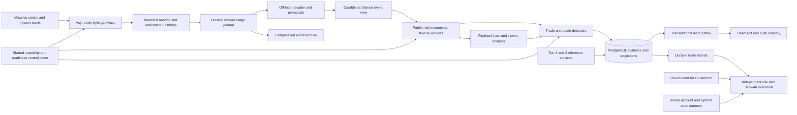

# Advanced Real-Time Three-Tier System Design Specification

Status: approved for tracked offline implementation; operational activation remains unapproved.
Date: 2026-10-03.
Scope: Stocks Advanced, Options Advanced, cross-asset detectors, and a shared
capability/readiness control plane using Massive, formerly Polygon.io, with
prospective Charles Schwab Individual Trader API execution.

Implementation planning refinement:
[Windows-first implementation plan](ADVANCED_REALTIME_IMPLEMENTATION_PLAN.md).
The follow-up selects a separate PostgreSQL database for migration/cutover,
Windows-native development, and process-restart durability. Its concrete model
names, transport evaluation and migration work packages refine Sections 5, 7 and
11 below; neither document authorizes implementation or activation.

Specification map: Tier 1 is Section 5, Tier 2 is Section 8, portal projection
and manual local simulation are Tier 2.5 in Section 8.5, and Tier 3 is Section 10.
Shared capability gates, physical models, rollout and verification remain in
Sections 6, 7, 11 and 12 and the implementation plan.

## 1. Agreed Scope and Recommendation

- Monitor 400 equity tickers.
- Start with 50 fixed option underlyings, with a path to 100. These are
  underlyings, not individual option contracts. Rotation is deferred.
- Optimize ingestion, incremental materialization, analysis, and detection of
  activity consistent with aggressive institutional positioning.
- Compare a lean deployment with a horizontally scalable target.
- Cover entitlements, quotas, data quality, database capacity, and per-strategy
  readiness. Include a migration plan for existing and proposed strategies.
- Start with regular trading hours using instrument-specific exchange calendars.
- Include a future broker-execution architecture, but keep live execution disabled
  until separately authorized and independently qualified.
- Target native Schwab iron-condor, four-leg iron-butterfly and standard 1:2:1
  butterfly tickets. Broker acceptance is a gate, not inferred from JSON syntax.
- Conservative models exclude upcoming earnings within seven calendar days either
  side of expiration and any earnings inside the planned holding interval.
  Aggressive models may propose explicitly risk-qualified event strategies.

Recommendation: retain PostgreSQL as the durable evidence and serving store; add
a durable, bounded event-ingestion path and incremental in-memory feature workers.
Keep entitlement checks and slow analysis outside the per-event critical path.
Introduce a broker only when measured load or recovery/availability requirements
justify it. More services alone do not establish lower latency.

Public trades and quotes do not identify institutions, beneficial owners, opening
versus closing positions, or linked parent orders. Outputs must describe observed
aggression and positioning evidence with uncertainty, not assert institutional
identity. Aggressor side, directional exposure, and institutional attribution are
three separate concepts.

Offline implementation status and bounded disposable validation are recorded in
[the implementation tracker](ADVANCED_REALTIME_IMPLEMENTATION_TRACKER.md). This
document alone authorizes no production migration, paid-provider probe, data
acquisition, worker change, replay, publication, paper trading or broker access.
Existing manifests, evidence, bars, configuration and execution gates remain intact.

## 2. Existing Design Anchors

| Existing owner | Design implication |
| --- | --- |
| [Equity materialization design](EQUITY_ANALYSIS_MATERIALIZATION_DESIGN.md) | Retain incremental processing, immutable bar revisions, sparse evidence, durable work, and atomic read projections. |
| [Advanced options decision register](OPTION_ADVANCED_UPGRADE_REGISTER.md) | Preserve versioned valuation, quote-dependent gates, and explicit limitations of aggressor inference and open interest. Dated decisions are not proof of current entitlement. |
| [Options detector context](agent-context/options-alerts.md) | Preserve O1/O2/O3 and S1/S2 identities, exact source lineage, prospective manifests, and observation/execution separation. This is context, not a runtime audit. |
| [Equity stream adapter](../backend/equity/polygon_stream.py) | Current adapter subscribes to `AM.<ticker>` minute aggregates. Trade/quote microstructure needs an additional adapter path. |
| [Options capability validator](../backend/options/data/base.py) | Current Developer validation explicitly rejects quotes and real-time capability. Add an Advanced profile; do not weaken Developer validation. |
| [Developer provider tests](../backend/tests/options/test_polygon_developer.py) | Preserve pagination, quarantine, redaction, and batch-completeness contracts in the new ingestion path. |
| [Migration 059](../backend/migrations/059_option_advanced_quote_monitoring.sql) | Reuse current quotes, sparse samples, stream sessions, and monitor evidence where their contracts fit. They are not a complete raw-event journal. |
| [Pending migration planner](../backend/scripts/apply_pending_migrations.py) | Future schema rollout must respect canonical-baseline bookkeeping, target confirmation, and reviewed numbered migrations. No migration is performed here. |
| [Stock forward decisions](../backend/research/stock_idea_forward.py) and [tests](../backend/tests/test_stock_idea_forward.py) | Preserve completed-bar decisions, actual availability, immutable daily geometry, and independent strategy state. Existing delayed dispatch is not an Advanced latency policy. |
| [Dual-origin decisions](../backend/options/dual_origin.py) and [tests](../backend/tests/options/test_dual_origin.py) | O1 activity does not establish aggressor direction; O2 remains nondirectional. Advanced inputs require explicit new contracts, not relabelled old evidence. |

Working hypothesis: the primary latency improvement will come from removing
provider polling, full-chain recomputation, and database round trips from each
detector evaluation, while preserving durable causal evidence. Faster minute-bar
delivery alone cannot support trade-time aggression classification.

Discriminating check for a later implementation: replay the same bounded,
timestamped trade/quote fixture through existing-compatible and incremental paths;
compare source lineage, gate outcomes, and receipt-to-durable-alert latency. If
incremental state cannot preserve causal results under disorder and restart, the
architecture has not passed, regardless of average throughput.

## 3. Provider Contract and Subscription Budget

Public documentation reviewed for this proposal:

- [Options quotes](https://massive.com/docs/websocket/options/quotes): Options
  Advanced provides real-time quotes; maximum 1,000 contracts per connection.
- [Options trades](https://massive.com/docs/websocket/options/trades): Advanced
  trades are real-time; Developer trades are delayed. Sequences increase per
  ticker but need not be contiguous. The documented WebSocket timestamps are
  milliseconds.
- [Stocks quotes](https://massive.com/docs/websocket/stocks/quotes): Stocks
  Advanced supplies real-time NBBO. Quote sides may be absent. SIP and optional
  participant timestamps have distinct meanings; sequences reset by session.

Product names are not capability evidence. Stocks and Options entitlements must
be verified independently for the actual account, endpoints, feeds, session,
connection allocation, and licensed use. Do not infer a historical lookback,
unlimited bandwidth, additional connections, redistribution rights, or broker-use
permission from the word Advanced. Confirm these before activation.

### 3.1 Fixed Underlyings, Bounded Contracts

Use one reviewed, versioned subscription manifest per session. It specifies all
400 equity instruments and every options contract, not merely underlying names.
The 50 option underlyings must be included in the equity universe or consume
explicitly approved additional equity capacity.

Planning envelope for one verified options quote connection:

| Stage | Fixed option underlyings | Primary quote slots | Reserved slots | Total ceiling |
| --- | ---: | ---: | ---: | ---: |
| Initial | 50 | Up to 16 per underlying: 800 | 200 | 1,000 |
| Expanded, shallow | 100 | Up to 8 per underlying: 800 | 200 | 1,000 |
| Expanded, same depth | 100 | 1,600 | Explicitly sized | Requires additional provider-approved capacity; otherwise BLOCKED |

These allocations are proposed application budgets, not vendor entitlements or
proof of analytical sufficiency. Reserve slots for all legs of retained alerts,
future positions, and required confirmations. Existing positions eventually take
priority over new opportunity subscriptions. Never evict their monitoring to fit a
new candidate. Without execution, reserve use is limited to reviewed alert needs.

Choose contracts before the session using explicit DTE, strike/delta band,
liquidity, expiry, and strategy-leg rules. An initial implementation must publish
the selected strikes/expirations and excluded coverage. Balanced put/call or
expiry coverage may require fewer supported underlyings. No silent intraday
rotation or unlimited whole-chain subscription is allowed.

Bounded REST snapshots/reference data may discover and warm contracts outside
the live quote set, but such contracts are discovery-only, not quote-qualified.
The first low-latency trade subscription set should match the admitted quote set.
Wider trade-only coverage requires a separate throughput budget and reports
aggressor classification as unavailable without a contemporaneous quote.

The full target requests stock `T`, `Q`, and `AM` channels for the 400 admitted
tickers, subject to verified access and measured capacity. Stock quotes are needed
for stock-side aggression; minute aggregates alone are insufficient. Connection
allowance is an account-level preflight input, not assumed to be one per process.
Standby workers must not authenticate additional connections without allowance.
Full-chain snapshots and open-interest context run on separate bounded REST
budgets; neither historical nor intraday open interest is inferred from live trades.

## 4. Latency Contract

Proposed engineering targets, not measured performance or provider guarantees:

| Stage | Initial target |
| --- | --- |
| Complete WebSocket message returned to bounded raw-byte handoff | p99 < 1 ms under the admitted workload; best-effort local target, not a hard realtime guarantee |
| Local socket receipt to durable journal acceptance | p95 <= 25 ms; p99 <= 100 ms |
| Receipt to usable incremental feature state | p95 <= 75 ms; p99 <= 200 ms |
| Last required event received to committed detector evidence and alert outbox | p95 <= 500 ms; p99 <= 1,000 ms |
| Committed outbox to connected portal delivery | p95 <= 250 ms; p99 <= 500 ms |
| Finalized bar available locally to lightweight dependent strategy result | p95 <= 1 s; p99 <= 3 s |

Measure the end-to-end distributions directly; percentiles of individual stages
do not add into an end-to-end percentile. Cluster-window duration, allowed
lateness, and required bar close are intentional decision delays and must also
appear in trigger-to-alert reporting. A strategy requiring a completed 30-minute
bar cannot become a sub-second-from-first-trade strategy without changing identity.

Retain source event time and precision, local received time, durable-acceptance
time, feature-ready time, decision time, commit acknowledgement, and delivery time.
Use a monotonic local clock for processing durations and synchronized UTC for
cross-process observations. Measure provider-event-to-receipt lag separately;
do not promise a provider-event-to-alert bound before measuring feed/network lag.

Sub-millisecond handoff is not sub-millisecond disk persistence, provider delivery,
or order execution. Python on ordinary Windows/Linux, TLS processing, storage
flushes and public networks cannot guarantee those bounds. No finite architecture
can promise zero loss from an unbuffered feed during an arbitrary outage or
unbounded overload. The contract is measured capacity, bounded buffers, durable
acceptance, explicit gaps and fail-closed dependent actions, never silent drops.

## 5. Tier 1: Data Ingestion Engine



- Ingest each subscribed feed once. Fan out locally; never give each strategy its
  own provider connection or independent REST poll loop.
- Partition options and equity features by underlying for causal joins. Resolve
  identifiers and subscription membership in the off-loop normalization stage,
  before analytical admission, not by parsing every tick in the network loop.
- Append events durably before evidence can be published. Acknowledge only after
  the local journal flush or configured broker durability condition is satisfied.
- Maintain bounded quote history, rolling trade statistics, bar accumulators,
  and cached slow features in memory. Evaluate only affected dependencies.
- Retain all admitted raw events in the journal. Coalesce only latest-state
  projection writes; never coalesce away the quote history needed for trade-side
  classification or threshold transitions.
- Keep IV solving, full surfaces, REST reconciliation, archival compression,
  historical research, and schema maintenance outside the socket callback.
- Commit immutable decision evidence, referenced feature state, read projection,
  and alert outbox atomically. Publish only committed outbox entries.
- Run the API as a reader. Requests must not trigger provider fetches, chain
  rebuilds, or detector computation.

### 5.1 Lean and Scale-Out Options

| Concern | Lean baseline | Scale-out target |
| --- | --- | --- |
| Deployment | Current Python/PostgreSQL ecosystem on a measured host; Windows remains supported | Linux services with independent ingestion, features, detectors, and storage |
| Durable transport | Proven embedded append-only log, provisionally SQLite WAL in a dedicated writer process with FULL durability and bounded transactions | Kafka-compatible durable broker, evaluated as Kafka or Redpanda; partition by underlying and use replicated acknowledgements |
| Compute | Separate feed I/O and bounded CPU worker processes; shared computation before detector fan-out | Stable-key partitions, consumer groups, explicit rebalance/checkpoint protocol |
| Serving | PostgreSQL current projections plus committed push delivery | PostgreSQL serving/evidence, with replicas only for staleness-tolerant reads |
| Archive | Compressed local segments on separate bounded storage, with backup | Object storage with immutable manifests and lifecycle policies |
| Trade-off | Few services; single-host failure domain and disk contention | Better fault isolation and independent scaling; more operational cost and network hops |

The SQLite choice is a benchmark candidate, not a commitment to a custom queue.
Before adoption, prove journal throughput, bounded retention, crash recovery, and
concurrent read/checkpoint behavior. If it fails, use the broker path rather than
removing durability. Do not use PostgreSQL per-tick inserts as the default raw
quote journal or make Redis Pub/Sub the sole durable source.

### 5.2 Causal Event and Feature Contract

Every normalized event carries provider/feed/channel, canonical instrument,
provider trading session, source sequence/ID when available, native timestamp
and unit, received-at UTC, local monotonic receipt, connection ID, payload hash,
schema version, subscription manifest, and durable journal partition/offset.
Preserve higher precision if a REST source supplies it; a UTC database timestamp
must not silently replace a nanosecond source identifier.

Deduplicate using the documented provider event identity scoped to instrument,
channel and source session, not the local reconnect ID. Retain corrections with
their changed payload and correction lineage. Where event identity is ambiguous,
do not collapse distinct same-price/same-size prints or claim perfect deduplication.
Sequence gaps alone are not evidence of data loss, and quote/trade sequences are
not assumed to define one total ordering across channels or assets.

For aggression classification, select the latest eligible quote whose source time
is at or before the trade and whose receipt is known by the actual decision time.
Never join to the current quote if it came after the trade. Equal millisecond
timestamps without reliable ordering remain ambiguous. Keep that ambiguity in the
classification; do not invent sub-millisecond precision.

Proposed starting parameters for new fast-detector policies: a bounded 50 ms
reordering window, maximum quote-at-trade age of 1 s, maximum current option/spot
age of 1 s, and maximum option/spot time skew of 250 ms. These are calibration
candidates, not changes to existing policies. Retain distributions and rejection
rates; approve a new version for any threshold revision. Quote inactivity, feed
silence and a disconnected feed are different states.

One-sided, crossed, stale, zero-size, condition-ineligible, or timing-ambiguous
quotes cannot qualify an aggressor verdict. Locked markets require explicit
policy handling because bid/ask-side direction is ambiguous. Missing prices are
null/unknown, never fabricated zeros. A bad latest update invalidates readiness
even when a prior valid quote remains available for historical display.

Build bars from one declared authoritative path, initially provider `AM` events
with finality/reconciliation rules. Do not add trade-derived volume to provider
aggregate volume. A trade-built bar implementation would require condition-aware
parity qualification. No-trade intervals are not filled with invented bars.
Incomplete lookbacks and a delayed first completed bar remain unavailable.

Reuse authoritative local Greeks/IV methodology and its valuation policy. Cache
slow inputs and update only dirty contracts with bounded solver work; record input
age, solver status, mark source, and model hash. Provider Greeks are diagnostics.
Midpoint valuation is not an executable price. American exercise, dividends,
near-expiry instability and adjusted deliverables remain explicit model risks.

### 5.3 Backpressure and Recovery

1. Bound every queue by bytes, events and age. First defer optional surface
  refreshes, archival analytics and discovery, not admitted raw evidence.
2. Preserve every admitted event until durable archival/checkpoint handoff. It is
  acceptable to batch writes; it is not acceptable to sample away trade-time NBBO.
3. If the durable writer cannot keep up, revoke the affected readiness scope,
  record the last durable offset, and perform controlled disconnect/recovery.
  Lost socket events become an explicit gap, never silent successful ingestion.
4. Restore version-matched feature checkpoints and replay durable offsets before
  re-admitting a detector. Commit checkpoint progress after output persistence;
  replay before acknowledgement must not create duplicate logical alerts.
5. After a feed gap, obtain a fresh state and, when separately authorized, bounded
  historical repair. Fresh state alone does not restore missing rolling windows.
  Re-enable only when each dependency is recovered or has aged beyond its required
  window. No provider replay guarantee is assumed.
6. Late corrections produce new bar/feature revisions and superseding evidence.
  They do not mutate earlier decisions or backdate newly discovered alerts.

Use a fenced owner per provider connection and processing partition. Fencing is
checked again at durable publication to reject a stale worker after takeover.
Guarantee idempotent logical processing and delivery, not end-to-end exactly-once
WebSocket reception. The lean log can target zero loss of acknowledged events
across process crashes, but not across loss of its only disk/host. Stronger RPO/RTO
requirements select replicated infrastructure and tested restore procedures.

### 5.4 Async Python Receive Contract

Use a pinned, tested version of `websockets.asyncio.client.connect` with `asyncio`.
Run independent supervised gateway processes for the admitted stocks and options
feeds so CPU starvation or reconnect on one does not stop the other. Each connection
has exactly one receiver; do not concurrently call `recv()` from multiple tasks.
Use TLS certificate/hostname validation and explicitly configured proxy behavior.

Provisional settings: `open_timeout=10`, `ping_interval=20`, `ping_timeout=10`,
`close_timeout=5`, `max_size=2 MiB`, and `max_queue=8`, all benchmark inputs rather
than provider guarantees. `max_queue` controls library frame buffering, not the
whole application byte budget. Oversized messages fail with an explicit reason;
inspect their legitimate size before prospectively changing the limit. Never use
unbounded `max_queue=None` or unlimited application queues to hide lag.

Receive complete messages with `await websocket.recv(decode=False)` so raw JSON
stays as immutable bytes. A provider message may contain an array of many ticks;
preserve it without splitting/decoding in the network loop. The receive loop does
only receipt timestamping, a local message counter, byte-budget admission, and
`put_nowait` into a bounded handoff. No JSON parsing, per-tick hashing, pandas,
database call, disk flush, option pricing, strategy evaluation, broker request,
token refresh, synchronous logging, or REST lookup is permitted there.

The receive path is soft realtime: `put_nowait` means no waiting for free queue
capacity, not a lock-free or constant-latency guarantee. Start with a bounded
thread-safe bytes queue to a dedicated I/O bridge; the bridge batches and sends
bytes to the journal process over a Windows-supported pipe. Blocking pipe writes
and serialization never run in the event-loop thread. Avoid one `create_task`,
thread-pool submission, Python dict tree or pickle operation per tick. Retain
references to bytes until ownership transfers; do not claim zero-copy across TLS
and process boundaries. Shared-memory slabs are an optional measured optimization
requiring a proven ownership protocol, not a hand-written lock-free prerequisite.

Start compression negotiation disabled (`compression=None`) to bound event-loop
CPU, then measure actual wire traffic. If network bandwidth is the bottleneck,
test negotiated compression with its CPU/memory/tail-latency cost explicitly;
do not assume either setting is universally faster. Archive compression runs
outside the gateway. All loggers redact authentication messages and avoid raw
WebSocket debug payloads, which could expose the provider key.

### 5.5 Raw Journal, Decode and Buffer Budgets

This refines the earlier normalized-event-first sketch: persist raw received
messages first, then normalize off-loop. The raw key is `(stream_session_id,
message_number)` with local UTC/monotonic receipt, payload bytes and length; its
durable coordinates include journal generation and offset. The writer computes
checksums, frames records, and group-commits on a bounded time/byte budget.
Only its commit acknowledgement means durable acceptance.

The decoder reads committed raw ranges, parses once with a tested byte-oriented
JSON parser, validates provider conditions/identity, and creates compact normalized
records with `(raw_message_id, event_index, normalizer_version)`. Raw bodies are
referenced rather than copied into every normalized row. Persist normalized output
and decoder progress atomically in the local journal where possible. On a broker
deployment, use equivalent durable raw/normalized topics and idempotent progress.
Quarantine invalid messages with retained raw bytes; never silently skip them.

Materializers consume normalized partitions owned by underlying. Persist exact
raw-to-event lineage, because reconnect IDs are not provider trade identities.
The extra normalized view and decode pass have measurable I/O and latency costs;
include both in the Tier 1 benchmark and retention watermark. No analytical
consumer may publish from an uncommitted raw/normalized range.

Admission bounds include library buffers, handoff bytes, bridge in-flight bytes,
journal backlog, normalized backlog, and decoded state. An initial 64 MiB handoff
ceiling per gateway is a test setting, not a sufficient-capacity assertion.
Size usable buffer bytes as peak byte rate times tolerated writer stall times a
safety factor; account separately for messages/frames and Python object overhead.
For example, 20 MB/s times 0.25 s times 4 needs 20 MB before other overhead.

Queue-full/byte-budget exhaustion immediately revokes the feed's dependent live
readiness and requests a controlled disconnect. Retain the last durable and last
received coordinates, record the uncertain interval when the control store is
available, and alert the operator. Do not discard the oldest queue element or
continue reporting healthy ingestion. TCP flow control/library backpressure may
slow reads but cannot require the upstream provider to replay missed data.

### 5.6 Keepalive and Reconnect State Machine

Lifecycle: `DISCONNECTED -> CONNECTING -> AUTHENTICATING -> SUBSCRIBING ->
WARMING -> LIVE`, with `BACKOFF`, `BLOCKED` and `STOPPING` branches.

1. Acquire the feed-owner lease; verify entitlement, subscription and local
  capacity before connecting. Reuse the approved endpoint/manifest, never a
  whole-market wildcard as an accidental fallback.
2. Authenticate through a serialized control sender. Parse bounded control/status
  responses outside the market receive callback; await success before subscription.
  Record acknowledged membership where the provider supplies it. Subscribing is
  not evidence of quote freshness or complete warmup.
3. Use WebSocket protocol ping/pong, recording RTT and last successful pong. Track
  data age separately: no trades in an illiquid contract is not a failed socket,
  and a healthy socket does not make its old NBBO fresh.
4. Retry transient DNS/TCP/ping timeout/server failures with full-jitter exponential
  backoff, provisionally random delay from 0 to `min(30 s, 0.5 s * 2^attempt)`.
  Use an async timer, not blocking sleep. Reset the attempt only after a stable
  authenticated period, provisionally 60 s; avoid reconnect storms.
5. Treat invalid credentials, denied entitlement, over-budget subscriptions and
  invalid configuration as BLOCKED requiring remediation, not endless retries.
  Honor provider retry hints. Intentional shutdown/session closure must not
  trigger automatic reconnection.
6. On reconnect create a new stream session, reauthenticate and resubscribe once;
  never run overlapping owners beyond the verified connection allowance. Retain
  the gap and rebuild/reconcile dependent state before returning to LIVE.

The library's reconnect iterator may supply transient-error classification, but
application authentication, ownership, rate-limit and warming policies still apply.
Use one retry authority per connection, not nested independent retry loops.
The reviewed API reference is
[websockets asyncio client](https://websockets.readthedocs.io/en/stable/reference/asyncio/client.html);
pin the actual installed version before translating settings into code.

## 6. Shared Advanced Capability Preflight

Separate deployment preflight from continuous runtime readiness. Preflight
produces an immutable profile with checked-at/expiry times, configuration hash,
schema fingerprint, universe/subscription manifest, and per-check evidence.
Runtime readiness maintains small scoped leases and revisions, consumed locally
by workers. No SQL or provider request is required for every gate evaluation.

| Gate | Required evidence | Failure scope |
| --- | --- | --- |
| Entitlement and licensing | Verified endpoint/feed capabilities, recency, account limits, approved use | Product and every dependent strategy |
| Subscription capacity | Contract-level manifest fits acknowledged connections and all required legs | Over-budget launch or dependent instruments |
| Schema and permissions | Required objects, constraints, partitions, role privileges, schema fingerprint | Affected capability |
| Ingestion capacity | Measured event/byte-rate envelope, disk headroom, durable writer latency, bounded queues | Overloaded partition or feed |
| Data identity | Canonical instruments, contract terms, multiplier, sessions, source mapping | Instrument or package |
| Data quality | Causal freshness, trade/quote alignment, condition classification, gap state | Dependent detector only |
| Materialization | Required lookback, source watermark, feature/model/policy versions, no future evidence | Strategy and instrument |
| Operational readiness | Healthy journal/archive/DB, clock bounds, active fenced owner, valid readiness lease | Relevant failure domain |
| Action authorization | Separate alert, paper, risk, and broker permissions | Requested action; never bypassed by data readiness |

Check states: `PASS`, `FAIL`, `UNAVAILABLE`, `EXPIRED`, and `NOT_APPLICABLE`.
Missing evidence is not a pass. `NOT_APPLICABLE` must be justified by a declared
strategy dependency, never used to hide a failed check. Aggregate readiness
reports `READY`, `DEGRADED`, or `BLOCKED` with an explicit scope and reason codes.
Readiness is never a platform-wide boolean that blocks unrelated healthy tickers.
Multi-leg packages and cross-asset signals require all of their dependencies.

Passive mode reads configuration and retained evidence only. Active probes are a
separately authorized, bounded operation with request/subscription budgets and no
schema changes. Outside a relevant open session, live recency remains unverified;
successful authentication alone does not prove a real-time feed.

### 6.1 Readiness Lifecycle and Evidence

Proposed lifecycle: `CONFIGURED -> PREFLIGHT_VERIFIED -> WARMING -> READY`, with
transitions to `DEGRADED` or `BLOCKED` on a scoped failure. A successful deployment
probe does not skip live warming. Distinguish future session readiness from live
readiness, and `NO_MATCH` from `NOT_EVALUATED` in all coverage reports.

Each check records its subject, required capability, verdict/reason, observation
time, expiry, measured value, policy limit, and sanitized evidence reference.
The result binds provider account alias (never secret), product, endpoint, schema,
code/configuration/model/valuation hashes, universe, and exact subscription set.

Propose a 500 ms health evaluation cadence and a 2 s maximum runtime readiness
lease for the fast path. Enforce per-event source-age checks independently; a
healthy lease cannot make stale input fresh. Push revocations immediately and
use lease expiry as the fail-closed bound on a lost health channel. Recheck the
readiness epoch, lease validity and owner fencing in the alert commit transaction.
This is a per-decision check, not a database query per incoming tick.

Re-run affected preflight checks on entitlement/subscription/configuration/schema
changes, reconnect, session transition, and evidence expiry. A schema change must
invalidate readiness before incompatible readers proceed. Keep active probe
request rates, retries/backoff, response sizes and total wall time bounded; honor
provider throttling rather than retrying through an overloaded feed.

Example: missing O2 smile coverage disables O2 for that expiry, but does not block
an independently valid O1 observation. A missing leg disables the entire associated
package. A database outage blocks durable publication across affected writers even
if in-memory detectors still compute candidates. No stale source fallback can turn
any of those cases into `READY`.

## 7. Database Design Direction

Use typed, narrow columns for joins and hot predicates; use JSONB for sparse
diagnostic payloads, not the core event/feature query path. Preserve exact prices
and contract multipliers. Reuse existing canonical instruments and contract IDs.

| Logical relation | Grain and ownership | Persistence rule |
| --- | --- | --- |
| Capability profile/check evidence | One immutable preflight and its checks | Versioned deployment evidence |
| Subscription manifest/member | One reviewed session membership and contract budget | Immutable membership; prospective revisions only |
| Stream session/gap/segment | Connection lifecycle, interval gap, archive segment | Retain continuity and recovery evidence |
| Runtime readiness | One current dependency scope and readiness epoch | Small mutable projection plus transition history |
| Market current state | One provider/feed/instrument current quote or trade | Batched, monotonic upsert; cache for serving, not replay truth |
| Feature current/checkpoint | One underlying/contract/feature bundle and durable offsets | Incremental current state; immutable decision-referenced checkpoints |
| Detector event/evidence | One trigger and its causal input/model identity | Append-only decisions and later superseding corrections |
| Alert outbox | One committed delivery event and destination | Transactional insert, idempotent delivery and bounded retries |
| Slow bars and analytical context | Existing immutable source revisions and derived lineage | Finalization/revision events, not per-tick rewrites |

Raw ticks live in the durable log and archive; PostgreSQL stores manifests and
decision evidence. Sparse quote samples cannot substitute for a historical NBBO
tape. The following names are proposed logical models, not executable DDL.

### 7.1 Keys and Query Paths

| Proposed model or existing extension | Primary/unique identity | Important access path |
| --- | --- | --- |
| `market_capability_profiles` | `profile_id`; unique canonical profile hash | Immutable profile lookup; checks keyed by `(profile_id, check_name, scope_key)` |
| `market_subscription_manifests` and members | `manifest_id`; member `(manifest_id, feed, channel, instrument_id)` | Underlying/channel budget totals and membership validation |
| Existing stream sessions plus common gap/segment manifests | Session/segment/gap ID; unique `(partition_id, first_offset, last_offset)` for segments | `(partition_id, first_offset)`; unresolved gaps by instrument/time; checksum and archive location |
| `market_readiness_current` | `(scope_type, scope_id, capability)` | Point lookup of epoch, lease, status, owner token, source watermark |
| Existing `option_quote_current`; equivalent stock state | Existing `(provider, contract_id)` or `(provider, instrument_id)` | Primary-key latest-state lookup; event sequence/time/payload and quality status retained |
| `market_feature_current` | `(instrument_id, feature_bundle_hash)` | Point lookup; current revision, watermark, validity, configuration and input offsets |
| `market_feature_checkpoints` | `checkpoint_id`; unique content/lineage hash | Referenced snapshot and restart checkpoint by shard/model; immutable source references |
| Common envelope extending existing detector/evaluation evidence | `(decision_date, event_id)` when partitioned; stable logical dedup key | `(instrument_id, decision_at DESC)` and `(detector_id, decision_at DESC)` |
| `market_alert_outbox` | `outbox_id`; unique `(event_id, destination, message_kind)` | Small partial index on pending `(next_attempt_at, outbox_id)` |

Use existing option evaluation, plan and outcome repositories as the domain
owners; add a shared causal envelope instead of building a second competing alert
history. A stable decision dedup key includes canonical trigger identity, detector
version, source/configuration/valuation policy, and subscription cohort. Worker
restart IDs, delivery retries, and readiness refreshes must not change that key.
Persist readiness epoch and owner token as evidence, not duplicate-alert generators.

For date-partitioned tables, every database-enforced unique key includes the
partition key. Derive the date deterministically from the original trigger/decision
contract so replay cannot change it. Use a small unpartitioned dedup ledger if a
required uniqueness rule crosses dates. Foreign keys to partitioned evidence must
carry its complete identity; UUID alone is not a global uniqueness guarantee.

Migration 059's non-null, ordered bid/ask columns describe a valid quote, not all
raw market updates. Retain malformed/one-sided events in the raw journal and
extend current-state quality metadata/readers so the last valid row is not
mistaken for the latest usable market. Keep invalid raw source clocks intact;
quarantine clock anomalies instead of clamping them to satisfy existing checks.

### 7.2 Write and Storage Policy

- Batch latest-state flushes initially every 50-100 ms, keeping the newest
  provider-ordered update per instrument. The alert transaction persists its exact
  quote evidence even if the general current-state flush has not happened yet.
- Guard upserts against older sequence/time within the declared source scope.
  Changed corrections use a revision path; do not rank across incompatible
  sessions, feeds or ambiguous sequences using arrival time alone.
- Use `COPY` into bounded staging batches for backfill/bulk persistence and
  parameterized bulk upserts for current projections. Reconciliation and research
  use separate low-priority pools and bounded statement/lock timeouts.
- Keep current tables small and unpartitioned. Avoid indexes on frequently changing
  prices/timestamps unless an observed query requires them; preserve eligibility
  for PostgreSQL HOT updates and tune fillfactor/autovacuum from measurements.
- Prefer B-tree indexes for point/history reads and BRIN on large append-time
  histories. Do not add blanket JSONB GIN indexes or wide covering indexes to
  every high-write table. Confirm actual reader plans before changing old indexes.
- Keep existing monthly sparse option sample partitions. Prefer daily partitions
  for new high-volume event/transition histories only when measured volume warrants
  them. Provision current/next partitions through a maintenance role, never a tick
  callback. Missing required partitions fail preflight.
- Preserve existing exact `numeric` prices at the evidence boundary. Validated
  scaled integers may accelerate internal calculations, with explicit price scale,
  overflow checks and unchanged rounding semantics. Never hard-code multiplier 100
  for nonstandard option deliverables.
- Persist feature snapshots at meaningful transitions, decision references, and
  periodic recovery checkpoints, not one full analytical matrix per quote.
- Use separate bounded connection pools for ingestion metadata, evidence writes,
  and API reads. Avoid serializable transactions or long database locks for each
  market event; keep the decision/outbox transaction short and atomic.

New-path retention proposal: a journal recovery window of at least two hours plus
all unarchived/uncheckpointed offsets; seven complete sessions of raw archive;
30 sessions of sparse samples/checkpoints; one year of alert evidence and referenced
inputs, subject to licensing, budget and explicit approval. Never remove referenced
evidence when generic TTLs expire. Extract exact decision inputs into retained
evidence bundles before raw expiry, and state that these bundles cannot replay
unretained alternative strategies. Archive checksums and minimum consumer offsets
gate truncation. Existing historical data is not subject to these new TTLs.

## 8. Tier 2: Strategy Detector

Register each detector's inputs, scope, minimum coverage, source-age/skew limits,
warmup, cadence, model/policy hashes, output kind and allowed actions. Shared
features compute once; detectors consume immutable views of a coherent revision.
Coherence uses a vector of dependency watermarks and bounded skew, not a global
barrier over every ticker. Multi-leg and cross-asset dependencies remain atomic.

### 8.1 Preserve Existing Strategies

| Existing family | Advanced adaptation | Timing and restrictions |
| --- | --- | --- |
| Stock range acceptance, failure, relative-trend resumption | Incremental canonical bar features; cache daily/structural context; preserve independent state | Trigger after required completed bar; keep exact entry, invalidation and geometry contracts |
| Stock discovery and daily/swing variants | Reuse materialized daily context and completed intraday confirmations | Discovery remains watch-only; retain daily horizons and frozen geometry |
| O1 option participation | Maintain condition-eligible cumulative day volume and dated OI; attach fresh stock context through a versioned adapter | Participation alone stays nondirectional; quote-backed aggression is a separate new detector |
| O2 IV-surface observation | Recompute dirty, coherent expiry/side groups from versioned local IV under Advanced | Slower lane; minimum valid strike coverage and consistent marks required; initial Developer fallback disables O2 globally rather than extrapolating sparse delayed marks |
| O3 credit-range detection | Reuse range context and exact activity contract; require coherent quotes for every proposed spread leg | Preserve O3's own sign semantics; quotes change valuation eligibility, not institutional intent |
| S1 stock-first range acceptance | React to completed stock setup plus exact matched option activity | Missing matched contract disables this signal, not unrelated stock strategies |
| S2 stock-first trend resumption | React to completed pullback/resumption evidence and exact option confirmation | Preserve episode identity, source expiry, and repeated-confirmation deduplication |

The existing O2 tests exercise at least seven valid strikes per smile group. A
16-contract per-underlying budget can already be tight for multiple sides/expiries;
an 8-contract budget cannot be represented as broad surface coverage. The new
readiness manifest must declare insufficient *live coverage* without reinterpreting
historical O2 `NOT_DETECTED` outputs under a new contract.

O1 cumulative volume requires a complete session baseline. Mid-session startup
cannot assume the first received trade starts at zero. Use a qualified session
bootstrap/reconciliation contract or leave cumulative-volume/OI detectors warming;
bounded-window aggression can become ready independently. Snapshot volume and
subsequent streamed trades must not be double-counted.

Batch-oriented `RawOptionBatch` remains a snapshot/reconciliation contract. Add a
distinct normalized event contract and a versioned adapter for coherent decision
views; do not fabricate a `COMPLETE` full-chain batch from one quote update. Preserve
canonical checksums and actual receipt clocks across both paths.

### 8.2 New Detector Priority

| Priority / proposed detector | Evidence and incremental features | Claim and limitation |
| --- | --- | --- |
| P1: Quote-backed aggressive premium burst | Eligible trades joined to causal NBBO; ask/bid-side premium, trade count, spread, size and same-time-of-day baseline | Buying/selling pressure on the observed contracts; no institutional ownership or opening-position claim |
| P1: Persistent directional flow with stock confirmation | Repeated independent windows; signed delta exposure using versioned Greeks; stock return/VWAP/volume response | Cross-asset positioning consistent with a directional thesis; not proof of who traded or their net portfolio |
| P2: Multi-venue sweep-like cluster | Closely timed same-contract prints across venues, aligned aggressor estimates and price progression | Sweep-like activity only; feed prints do not reconstruct parent-order routing |
| P2: Aggression/price-response divergence | Repeated classified flow without expected stock response, quote replenishment and later invalidation | Possible absorption or failed follow-through; NBBO cannot prove hidden liquidity or order-book depth |
| P3: Flow-confirmed IV/skew repricing | Persistent local-IV changes across adequately covered coherent groups plus trade-side evidence | Volatility demand observation; unavailable without sufficient strikes/expiries, not a sparse-chain extrapolation |

Start with the first two detectors and the existing-strategy adapters. Reuse trade
condition classification; cancel/correct/complex-order conditions must be handled
explicitly. Possible multi-leg/stock-option prints cannot be treated as independent
outright directional bets merely because individual legs print near the ask.

Record evidence dimensions separately: side classification and confidence,
classified/unclassified premium, directional delta estimate, persistence, liquidity,
quote/underlying alignment, coverage, baseline availability, and ambiguity reasons.
Large notional alone is not institutional evidence. Daily volume/OI does not prove
opening flow; next-day OI is contextual and cannot be backdated into the decision.

Scores initially express versioned rules, not calibrated probabilities. Avoid
double-counting correlated burst/sweep/persistence features as independent votes.
Compare challengers against existing detectors on the same fixed subset, session,
contract manifest and availability clock. Begin with bounded exploratory studies;
report missing coverage and costs without requiring a whole-market backtest first.
Outcome calibration, strategy promotion, paper eligibility and execution approval
are separate steps. Hypothetical NBBO prices are not guaranteed fills.

### 8.3 Process Model and Whale Evaluation

Use a bounded multiprocessing pool with stable underlying-shard ownership, started
with Windows `spawn` semantics. Initialize database/log readers in each child;
do not share live sockets, database connections, or mutable detector state across
processes. Threads serve bounded I/O/bridge work; CPU-bound Python analysis does
not become parallel merely by adding threads. Limit numerical-library internal
thread counts to avoid multiplying cores across workers.

Within each shard, process quote/trade events serially into versioned rolling
state, then run lightweight eligible detectors. Slower surfaces/completed-bar
strategies use the separate durable job pool. Feature and detector input views
are immutable for the duration of one evaluation. Persist effects/progress with
fencing and stable logical dedup; no shared mutable global NBBO dictionary.

Proposed `whale_tick_v1` sequence:

1. Admit a condition-eligible, noncancelled USD option print with positive price
  and integer contract quantity, exact contract identity, source precision and
  a validated standard 100-share multiplier. Unsupported adjusted contracts do
  not silently use 100. Distinct equal prints and corrections remain distinct.
2. Calculate premium notional using exact decimal arithmetic:

  $$N = \text{trade size} \times \text{trade price} \times 100.$$

  The first gate is $N \ge 100{,}000$ USD for this individual print. This is
  option premium, not underlying-equivalent notional or dollar delta. Clustering
  smaller prints is a different detector and cannot silently change this rule.
3. Read the immutable baseline for the exact contract and previous exchange
  trading session, not yesterday's calendar date. Require that its source,
  settlement-session basis and receipt were known by decision time. Evaluate
  `trade_size > baseline_open_interest` strictly; equality does not pass. Missing
  or incorrectly dated OI is UNAVAILABLE; zero OI is valid only with positive
  evidence that it is an observed zero, never missing-value substitution.
4. Record `PRINT_EXCEEDS_PRIOR_OI` when step 3 passes, with
  `position_creation_status=UNVERIFIED`. This is a positioning proxy, not
  verification of newly opened contracts. Prior-session OI cannot reveal intraday
  openings/closings, both counterparties' intent, linked hedges, or institutional
  ownership. Later OI cannot retrospectively change the original inference.
5. Select the causally current NBBO at the trade's source time, known by actual
  decision time. At/above the ask indicates likely premium buying; at/below the
  bid indicates likely premium selling, subject to a versioned off-market-price
  tolerance. Prints too far outside NBBO, inside the spread, with ambiguous
  same-millisecond ordering, or with stale/one-sided/locked/crossed quotes yield
  UNKNOWN rather than fabricated direction. Do not compare to a later quote
  merely because it is current when the worker processes the print.
6. Attach classification confidence, spread, quote age/skew, condition/complex-
  trade ambiguity, baseline OI, notional and source references. Bought puts are
  not bullish merely because their premium was bought. Net stock direction
  requires the explicit contract/side/delta model and supporting stock context.
7. Apply the model's earnings policy, coverage, liquidity and risk prerequisites.
  Emit an immutable observation/candidate plus a durable trade intent only if
  that action is separately authorized. Execution risk checks remain in Tier 3.

Example boundary: 501 contracts at $2.00 gives $100,200. Against observed prior OI
of 500, both numeric gates pass; against OI of 501 the strict OI gate fails. Neither
case identifies the owner or proves position creation. A quote-less print can
remain a whale-size observation but cannot become an aggression-qualified order.

### 8.4 Earnings-Aware Strategy Families

Agreed policy uses calendar dates in the issuer's event timezone: for an upcoming
earnings event, `abs(earnings_date - expiration_date) <= 7 calendar days` is near
expiry. Separately test whether the planned entry-to-exit interval crosses the
announcement. Include before-open/after-close timing, holidays, expiration's actual
last trading time, and date-only uncertainty. For uncertainty, test the whole
possible event interval rather than inventing midnight precision.

| Model profile | Near-expiry or holding-period earnings | Required behavior |
| --- | --- | --- |
| `CONSERVATIVE_NO_EARNINGS` | Either condition true | Exclude new opportunities and trade intents completely; retain only audit reasons. Do not suppress protective monitoring or exits for existing positions. |
| `AGGRESSIVE_EARNINGS_DEFINED_RISK` | Known qualified event | May propose a versioned multi-leg candidate; never automatically trade merely because earnings are near expiry. |
| Either profile | Missing, stale, conflicting or unqualified event calendar | UNAVAILABLE for earnings-sensitive new entries; no assumption that missing means no earnings. |

Aggressive candidate families may include directional debit butterflies or spreads,
and neutral iron condors/iron butterflies only with an explicit range/volatility
thesis, coherent quotes and event-risk stress results. A directional whale print
does not itself justify selling a neutral short-volatility package. Reuse local
IV methodology; measure expected move, skew, gap scenarios, IV crush and liquidity
after the announcement. Keep calibrated outcome claims separate from heuristics.

Every candidate carries earnings revision/known-at time, days to expiry, planned
hold, structure/legs, net limit, max loss, stress exposure, assignment/dividend
risk, model/risk-policy hashes and reasons. Restrict initial execution to standard
same-expiry defined-risk packages. Date revisions revoke stale candidates and are
rechecked immediately before order submission. Existing admitted strategy policies
change only through new prospective versions, never retroactive filtering.

Upcoming earnings coverage is an independently qualified reference capability;
Stocks/Options Advanced is not assumed to include a complete earnings calendar.
The seed daemon publishes retained revisions and explicit known-no-event coverage.
An ETF's nonapplicability must be explicit; it is not a missing issuer event.

## 8.5 Tier 2.5: Portal Projection and Manual Local Simulation

Portal projection is an explicit boundary between detector evidence and any broker
work. Tier 2 first commits detector evidence, current alert projections and a
transactional portal outbox. A separately supervised publication worker builds the
existing screening, equity, Stock Alerts and Options Alerts response contracts from
committed `stocks_realtime_v1` data. The API remains read-only: it performs no
provider fetch, detector evaluation, mock fill or broker request.

Projection qualification precedes manual mock execution. The portal must first show
complete visible source tier, as-of/watermark, coverage, readiness, policy/cohort and
unavailability reasons. Portal delivery is at-least-once with receiver deduplication;
one fenced publisher owns each cohort. Existing page rendering and response shapes are
preserved while realtime history starts prospectively.

After projection is qualified, every option alert may display an execute icon. The
icon is always visible in the initial development experience, but clicking it never
bypasses validation. A qualified alert creates a local mock-order request; missing,
stale, incoherent or unsupported inputs produce a terminal `MOCK_UNAVAILABLE` result
with visible reasons. No defaults, contract legs, prices, earnings facts or fills are
fabricated merely to make the button succeed.

Initial mock execution is entirely local and user initiated:

1. Bind the clicked alert, exact package legs, cohort, policy/valuation identities and
  one retained coherent quote view.
2. Re-run package, earnings, quote coherence and bounded mock-risk validation without
  granting paper or live execution permission.
3. Build a schema-candidate Schwab payload where the structure is supported. The
  payload is not described as broker validated.
4. Apply a versioned deterministic slippage/fee/fill policy to the retained quotes;
  persist the request, validation disposition, mock lifecycle and simulated fills.
5. Display `MOCK_FILLED`, `MOCK_REJECTED` or `MOCK_UNAVAILABLE` and their assumptions
  in the same portal; no automatic detector action invokes this path.

The authenticated Schwab specification was unavailable during review and the public
secondary client documents placement, cancellation and replacement but no confirmed
nonplacing preview endpoint. A future `BrokerPreviewTransport` remains
`BLOCKED_UNVERIFIED_ENDPOINT` until sanitized authenticated documentation proves the
endpoint, nonplacing semantics, request/response schema, permissions and rate limits.
The local mock path contains no Schwab credentials, OAuth, account lookup or network
call and cannot be promoted by changing configuration alone.

Detection reference seeds remain earlier dependencies: contract identity, prior OI,
earnings/calendar coverage, corporate actions and rates are required before Tier 2
and portal qualification. Broker-specific account hashes, symbol mappings, OAuth
generations, risk reservations and position/order supervision remain later Tier 3
seed/execution work after portal projection and local mock validation.

## 9. Capacity, Observability and Operations

Ticker count is not a throughput model. Measure stock trade/quote and option
trade/quote rates separately, especially liquid names at the open and close.
Record mean, p95/p99 one-second rate, peak 100 ms bursts, decoded/wire bytes,
contract skew, invalid events, and strategy evaluation frequency.

Sizing formula: daily raw bytes = mean events/second x average encoded bytes/event
x admitted session seconds. For a 23,400-second session and 250-byte event, 5,000
events/s is 29.25 GB/day; 50,000 events/s is 292.5 GB/day before compression,
indexes, journal framing, replication, WAL, backup, and headroom. These are
illustrations, not observed traffic. Compression ratios must be measured.

Provisional lean benchmark host: 8-16 CPU cores, 32-64 GB RAM, NVMe storage with
separate journal/PostgreSQL I/O budgets, and reliable network connectivity. Inventory
the actual host before choosing hardware. Keep at least 30% usable disk headroom;
size memory from rate x retained join-window duration x decoded-event size, including
Python object overhead. Bound hot-key state independently of total universe size.

Advance to the broker deployment if the lean path fails the tail-latency target,
cannot isolate research/archive I/O, cannot catch up without losing freshness, or
cannot meet approved recovery/availability objectives. More underlyings or a broker
cannot bypass the provider's connection/contract ceiling.

Operational metrics: event-to-receipt lag; journal acknowledgement latency; queue
age/depth/bytes; gap scope; freshness/unknown-side rate; warmup coverage; feature and
detector latency; solver time/failures; DB pool/commit latency; outbox lag; disk/WAL
growth; replay catch-up rate; actual evaluated and rejected counts by strategy.
Report both eligible-event latency and all-input time-to-terminal-disposition so
dropped or blocked work cannot disappear from performance statistics.

Use sampled traces keyed by partition/decision rather than logging every payload.
Never emit API keys, raw authorization URLs or broker secrets. Apply least-privilege
roles, encrypted transport, secret-store integration and separate provider/broker
credentials. Treat market-data storage and downstream delivery as licensed uses.
API responses include `as_of`, source watermark, coverage, readiness and policy
identity; stale cached results must be visibly stale.

## 10. Tier 3: Schwab Execution and Broker Seed Daemon

Charles Schwab Individual Trader API is the selected broker integration target.
This is a specification for future implementation; no account is connected and
no orders, token refreshes or seed fetches are authorized by this document.
The Individual Trader product is for the approved user's own eligible account;
institutional engineering controls do not imply institutional market access,
redistribution rights, advisor permissions, guaranteed fills or direct exchange access.

### 10.1 Independent Execution Worker

The worker consumes durable trade intents, not transient Pub/Sub notifications or
every whale-sized print. Tier 2 commits evidence and an intent atomically only for
an authorized output mode. Tier 3 runs in separate processes with separate HTTP
pools, credentials, rate budgets and database roles. Broker slowness cannot block
the market socket, materializer or detector. Data preflight never grants trading
authority: `OBSERVATION -> ALERT_QUALIFIED -> PAPER_QUALIFIED -> LIVE_AUTHORIZED`
requires separate policy and approval at each transition.

Execution sequence:

1. Claim a bounded intent with lease/fencing; reject expired or already handled
  identity. Reconcile working/unknown orders and actual positions on startup
  before accepting new risk. Use the explicitly selected account hash, never
  assume the first account returned by the API is the trading account.
2. Bind exact broker-recognized symbols to canonical contract terms, expiry, option
  type, multiplier and deliverables. Preserve padded broker symbols; removing
  Massive's `O:` prefix alone is not sufficient symbol verification.
3. Recheck all leg quotes at one coherent decision view, source age/skew, spread,
  size, contract eligibility, earnings revision, model expiry, risk policy and
  requested action. Obtain fresh account permissions, buying power and reconciled
  exposure under approved freshness budgets. No broker quote request per raw tick.
4. Serialize account-risk reservation in PostgreSQL: account exposure plus working
  orders plus pending reservations must satisfy portfolio/underlying concentration,
  maximum loss, daily loss, open-order count and position limits. Reserve once
  under a unique intent ID; release only on a reconciled terminal result. A
  database lease timeout alone cannot release possible live exposure.
5. Build one immutable package payload with an exact decimal net limit and absolute
  per-leg contract quantities. Validate leg signs/ratios, equal expiry, strike
  geometry, package economics, session and approved broker strategy mapping.
6. Persist the request hash, risk approval, token generation (not token), attempt
  ID and `SUBMITTING` state before sending one native order request. No database
  lock is held during HTTP. All SDK/middleware automatic retries for mutating
  requests are disabled unless the broker's idempotency contract is verified.
7. Submit to `POST /trader/v1/accounts/{accountHash}/orders` on the approved
  `api.schwabapi.com` host. A typical successful placement returns 201 and an
  order resource in the `Location` header, not an order JSON body. Confirm this
  against the authenticated schema; retain the broker order ID and reconcile it.
  Acceptance is not a fill. Do not forward bearer credentials to an untrusted
  redirect or arbitrary `Location` host.
8. Process account activity if entitled and reconcile through bounded order/account
  reads. Persist actual executions, quantities, fees and position changes. Cancel,
  replace, close and assignment handling follow their own durable state transitions.

Internal state contract:
`PENDING -> RISK_APPROVED -> SUBMITTING -> ACKNOWLEDGED -> WORKING ->`
`PARTIALLY_FILLED/FILLED/CANCEL_PENDING/CANCELED/REJECTED/EXPIRED`, with
`SUBMISSION_UNKNOWN` and `MANUAL_REVIEW` branches. These are internal states;
normalize actual Schwab status/activity responses rather than assuming a one-to-one
enum mapping. An expired claim on SUBMITTING becomes UNKNOWN, never PENDING.

Use stable *internal* intent/request IDs for deduplication. Do not assume Schwab
supports a client-supplied idempotency key or invent an API `clientOrderId` field.
After timeout, connection loss, ambiguous 5xx, or a crash around send/commit, query
bounded order history and reconcile account/package/quantity/price/time/attempt
evidence. A missing immediate result is not proof of nonacceptance. If uniqueness
cannot be established, retain the reservation and require manual reconciliation;
do not submit again merely to discover whether the first request worked.

429 responses respect verified broker throttling and intent expiry. Authentication
failure requests a daemon refresh/reload without initiating another refresh in the
order worker. Retry any mutation only when nonacceptance is established under the
broker contract. Reserve request capacity for cancellations, reconciliation and
position supervision rather than exhausting it with new orders.

### 10.2 Native Multi-Leg Payload Contract

Use `orderStrategyType: SINGLE` for one native complex order; `SINGLE` does not
mean one option leg. `complexOrderStrategyType` describes the option package, not
an OCO/trigger tree. Do not split the package into four independent market orders,
and do not express its legs as `childOrderStrategies`.

The examples below are synthetic schema fixtures, not trade recommendations,
validated market prices, guaranteed listed contracts, or broker-certified requests.
All option symbols must be replaced by matched broker-returned symbols before
qualification. Examples use one package: each iron leg has quantity 1; the standard
butterfly's center leg has quantity 2. For multiple packages multiply each leg's
ratio by package count exactly once. Do not add an unverified top-level quantity.

| Internal structure | Explicit proposed Schwab tag | Gate |
| --- | --- | --- |
| Iron condor, four distinct legs/strikes | `IRON_CONDOR` | Confirm native tag/geometry and account permission against current Schwab schema |
| Standard call/put butterfly, three unique legs in 1:2:1 | `BUTTERFLY` | Same type/expiry, equal wings; four contracts is not four unique legs |
| Iron butterfly, four distinct contracts with shared short strike | `CUSTOM` as a candidate mapping | Dedicated `IRON_BUTTERFLY` tag is not established by the reviewed enum. Keep submission BLOCKED until Schwab confirms the supported native mapping. Never disguise it as a standard butterfly. |

The existing [package validator](../backend/options/alert_qualification.py) requires
distinct strikes and has no iron-butterfly signature. The
[package tests](../backend/tests/options/test_outcome_contracts.py) cover condors
and standard butterflies. Add a separate versioned iron-butterfly domain/valuation/
risk contract later; do not loosen the global distinct-strike rule for every model.

Iron condor: long 560 put, short 565 put, short 605 call, long 610 call,
same expiration. Desired net credit is $1.20 per share-equivalent package unit,
or $120 for one standard package before costs, not $1.20 per leg.

```json
{
  "orderStrategyType": "SINGLE",
  "complexOrderStrategyType": "IRON_CONDOR",
  "orderType": "NET_CREDIT",
  "session": "NORMAL",
  "duration": "DAY",
  "price": "1.20",
  "orderLegCollection": [
   {"instruction": "BUY_TO_OPEN", "quantity": 1, "instrument": {"symbol": "SPY   261120P00560000", "assetType": "OPTION"}},
   {"instruction": "SELL_TO_OPEN", "quantity": 1, "instrument": {"symbol": "SPY   261120P00565000", "assetType": "OPTION"}},
   {"instruction": "SELL_TO_OPEN", "quantity": 1, "instrument": {"symbol": "SPY   261120C00605000", "assetType": "OPTION"}},
   {"instruction": "BUY_TO_OPEN", "quantity": 1, "instrument": {"symbol": "SPY   261120C00610000", "assetType": "OPTION"}}
  ]
}
```

Iron butterfly: long 590 put, short 600 put, short 600 call, long 610 call.
Four unique contracts, three strike levels. The following `CUSTOM` payload is a
mapping candidate only; its explicit broker-compatibility gate remains unresolved.

```json
{
  "orderStrategyType": "SINGLE",
  "complexOrderStrategyType": "CUSTOM",
  "orderType": "NET_CREDIT",
  "session": "NORMAL",
  "duration": "DAY",
  "price": "3.50",
  "orderLegCollection": [
   {"instruction": "BUY_TO_OPEN", "quantity": 1, "instrument": {"symbol": "SPY   261120P00590000", "assetType": "OPTION"}},
   {"instruction": "SELL_TO_OPEN", "quantity": 1, "instrument": {"symbol": "SPY   261120P00600000", "assetType": "OPTION"}},
   {"instruction": "SELL_TO_OPEN", "quantity": 1, "instrument": {"symbol": "SPY   261120C00600000", "assetType": "OPTION"}},
   {"instruction": "BUY_TO_OPEN", "quantity": 1, "instrument": {"symbol": "SPY   261120C00610000", "assetType": "OPTION"}}
  ]
}
```

Standard call butterfly: buy one 590 call, sell two 600 calls, buy one 610 call.
Keep three leg objects; do not duplicate the center contract to force four rows.

```json
{
  "orderStrategyType": "SINGLE",
  "complexOrderStrategyType": "BUTTERFLY",
  "orderType": "NET_DEBIT",
  "session": "NORMAL",
  "duration": "DAY",
  "price": "2.00",
  "orderLegCollection": [
   {"instruction": "BUY_TO_OPEN", "quantity": 1, "instrument": {"symbol": "SPY   261120C00590000", "assetType": "OPTION"}},
   {"instruction": "SELL_TO_OPEN", "quantity": 2, "instrument": {"symbol": "SPY   261120C00600000", "assetType": "OPTION"}},
   {"instruction": "BUY_TO_OPEN", "quantity": 1, "instrument": {"symbol": "SPY   261120C00610000", "assetType": "OPTION"}}
  ]
}
```

For the illustrative equal-width credit packages, theoretical expiry maximum loss
is `(wing_width - credit) * 100 * packages`, plus fees. For the long equal-wing
butterfly it is `debit * 100 * packages`, plus fees. Validate the whole payoff,
broker buying-power requirement, dividend/assignment exposure and expiry process;
the payoff bound is not a guarantee against operational losses or temporary stock
exposure after early assignment. Use explicit net-credit/net-debit direction with
positive price strings and verified allowed increments; never guess rounding.

Native package submission avoids application-side legging but does not promise a
fill, instantaneous all-leg reporting, all quantities filled, or complete protection
from assignment. Do not assume ALL_OR_NONE/FILL_OR_KILL is supported for every
complex ticket. Track per-leg fills and remaining package quantities, reconcile
out-of-order activity, and pause new risk on unexplained imbalance. Closing a
package uses corresponding BUY_TO_CLOSE/SELL_TO_CLOSE instructions and an approved
net limit, not an automatic reversal of a stale opening signal.

Schwab's authenticated
[order specification](https://developer.schwab.com/products/trader-api--individual/details/specifications/Retail%20Trader%20API%20Production)
returned a login page during this design session. The public
[schwab-py order reference](https://schwab-py.readthedocs.io/en/latest/order-builder.html)
and [client reference](https://schwab-py.readthedocs.io/en/latest/client.html)
are secondary, partly reverse-engineered evidence, not broker certification.
Before activation, verify tags, prices, symbols, quantities, permissions and
response semantics against the current authenticated schema and sanitized accepted
order fixtures. Use a documented nonplacing validation facility only if available;
never send a live order as an implicit schema test or assume a sandbox exists.

### 10.3 Out-of-Band OAuth Token Refresh Daemon

Run one supervised refresh owner per Schwab authorization, in its own process and
HTTP pool, independent of gateway, detector, execution and reference-seed work.
Use a maintained OAuth library, such as Authlib, for protocol handling; never store
Schwab login credentials or attempt to bypass interactive consent/MFA.

The public [authentication reference](https://schwab-py.readthedocs.io/en/latest/auth.html)
describes approximately 30-minute access tokens and an approximately seven-day
refresh authorization lifetime. Confirm with actual token response and current
Schwab documentation. Schedule from `expires_in`/verified expiry, not a blind
`sleep(1800)`: refresh about 2-3 minutes before expiry with small earlier jitter,
typically around minute 27 for a 30-minute token. This meets the intent of the
30-minute lifecycle without racing requests against expiry.

1. Acquire an exclusive refresh-owner lease and encrypted-store generation. Load
  the approved client credentials/refresh token only in this process. Record
  original authorization age separately from the latest access-token issuance.
2. Send the documented refresh-token grant to
  `https://api.schwabapi.com/v1/oauth/token` using verified client authentication,
  form encoding, TLS, timeout and redaction. Refresh retries use bounded jittered
  backoff within the remaining safe lifetime. Do not use the market event loop.
3. Validate the response, token type and positive lifetime. Persist the complete
  updated token envelope, including a rotated refresh token when returned, as
  one encrypted, atomic generation. If no replacement refresh token is returned,
  retain the existing one only as allowed by the verified OAuth contract.
4. Use a DPAPI-protected store/Windows secret facility with service-user ACLs
  locally and a managed secret store later. Atomic replacement/CAS prevents
  partial reads or an older writer overwriting a newer generation. The secret
  store is authoritative; PostgreSQL stores only generation, expiry, status and
  secret reference. Reconcile metadata after crash, since the store and database
  are not one atomic transaction.
5. Publish a nonsecret generation-change notification. Execution workers obtain
  read-only short-lived access-token snapshots over an ACL-protected local
  channel and replace their reference atomically; requests capture one immutable
  generation at construction. No refresh token, client secret or access token
  travels on the market bus, logs, trace payloads or normal database tables.
6. Execution rejects new submissions without sufficient token lifetime for its
  request budget. A valid old access token may continue only under the verified
  overlap semantics; do not assume refreshing guarantees both generations remain
  valid. A 401 triggers generation reload/daemon signaling, not concurrent refresh
  by every worker or blind order replay.

Daemon states: `VALID`, `REFRESH_DUE`, `REFRESHING`, `DEGRADED`, `EXPIRED`, and
`REAUTH_REQUIRED`. Transient failure leaves usable credentials until their actual
expiry; once unusable, block new broker actions and alert the operator while data
ingestion and evaluation continue. Reconciliation/cancel requests also need usable
auth; an independent runbook must provide manual broker access for unmanaged risk.
No software daemon can guarantee uninterrupted trading through broker/auth outages.

Refreshing access does not extend authorization forever. Warn ahead of refresh-
authorization expiry, schedule human reauthorization outside trading, and stop
retries on revoked/invalid grants after classification. Preserve the active record
until a replacement is securely committed; never automatically delete tokens or
open an interactive browser inside a live worker. If rotation succeeded remotely
but its response was lost, do not assume the old refresh token is reusable; follow
the provider contract or enter REAUTH_REQUIRED.

The usual `schwab-py` convenience clients refresh on demand and warn against sharing
one token file between clients. Do not instantiate auto-refreshing clients in every
worker. Order-building utilities can be reused, while broker HTTP uses a read-only
bearer snapshot and all OAuth ownership remains in the daemon; qualify this adapter
explicitly. Tokens and provider keys are separate credentials with separate owners.

### 10.4 Broker Seed Daemon and Position Supervision

Tier 1 and Tier 2 reference services already own canonical contracts, prior-session
OI, earnings revisions/coverage, exchange calendars, condition maps, rates and bar
lookbacks before detector and portal qualification. Tier 3 must consume those
immutable generations; it does not move or duplicate their ownership into an
execution daemon.

Run broker seeding separately from OAuth refresh so account or symbol discovery
cannot delay credential maintenance. Load only approved account hashes, permissions,
broker-recognized contract symbols/terms, working orders and positions. Publish an
immutable broker seed generation with source-specific completeness/freshness states;
readers switch atomically and no in-place partial seed is allowed. Exact broker terms
must reconcile to the canonical P4 contract generation before an intent can qualify.

All broker discovery/account requests use separate concurrency/time/byte/rate
budgets. Keep live quote capacity reserved for retained package/position legs. On
feed gaps or Tier 2 failure, a separately supervised position/order monitor continues
broker reconciliation where auth/network permits, blocks new entries and follows
approved reduce-risk/manual procedures. It must not wait for another detector event
to supervise an existing position.

### 10.5 Execution Safety and Operational Gates

Start with network-isolated contract tests, then local paper simulation, followed
only by separately approved broker connectivity and a tightly bounded live canary.
No default position size, loss limit or live account is inferred from this design.
Risk parameters and account eligibility must be explicit and reviewed. Separate
kill switches cover global entries, account, strategy, underlying and broker access;
none silently disables data capture or protective monitoring.

Monitor intent age, risk reservations, submit/ack latency, UNKNOWN orders, per-leg
fill imbalance, reconciliation lag, token time-to-expiry, refresh failures,
authorization age, seed age and provider/broker rate limits. Never label a request
timeout as rejected or compute realized P/L from quote marks. Redact secrets and
account identifiers from ordinary logs; retain a least-privilege immutable audit
trail binding trigger -> inputs -> risk -> request -> broker order -> fills.

## 11. Phased Migration Plan

The [implementation plan](ADVANCED_REALTIME_IMPLEMENTATION_PLAN.md) places schema
creation and shadow cohorts in a separate database, preserving the current database
until explicit cutover. "Additive" below refers to preserving existing contracts
and history, not permission to install the new models into the current database.

| Phase | Deliverable | Exit gate / rollback |
| --- | --- | --- |
| 0: Contract and bounded benchmark | Approve exact universes, strategy dependency/contract budget, account capabilities, SLO clocks and transport candidate | No live activation; reject infeasible contract depth before schema work |
| 1: Additive schema and passive preflight | Common metadata/envelopes, required indexes/partitions, role grants, compatibility readers and read-only reports | Validate on a disposable schema; existing readers/Developer gates unchanged; disable new path on failure |
| 2: Isolated Advanced ingestion | One feed owner per admitted product; authorized canary then 400 stocks/50 option underlyings; journal/gap/recovery evidence | No alert or execution publication; measure traffic, precision and completeness without claiming historical continuity |
| 3: Incremental shadow and strategy adapters | Current strategies on coherent Advanced views; new P1 detectors in separate cohorts | Compare semantic parity on equivalent inputs and explain expected delayed/real-time differences; rollback by stopping only new consumers |
| 4: Prospective alert cutover | Reviewed new manifest with effective time, quote-backed valuation, API projections and committed outbox | Explicit opt-in; preserve old history and execution disabled; revert reader routing without relabelling old data as live |
| 5: Expand to 100 underlyings or scale out | New contract-depth/capacity manifest and benchmark; provider-approved extra capacity if needed | Re-pass per-strategy coverage and latency gates; retain 50-underlying configuration as rollback |
| 6: Paper then broker work | Independently approved risk, simulation, order lifecycle and reconciliation design/implementation | Separate paper/live gates, controlled canary and tested kill/reconciliation procedures |

For every schema phase, review the actual canonical baseline and recorded migrations
on the explicitly confirmed target database. Add new migration versions; do not edit
already-applied SQL to disguise a new shape. Validate both fresh bootstrap and upgrade
from the current baseline, including grants and existing data constraints. Use additive
columns/tables and compatibility reads first; defer destructive cleanup until after
cutover, retention review and proven rollback. Migration application is a separate
authorized operation from its plan or validation.

Do not dual-publish equivalent alerts from old and new workers. Select one publisher
per cohort with fencing and retain both shadow results for comparison. On rollback,
incompatible Advanced data remains an immutable historical cohort; a delayed source
cannot inherit the Advanced readiness label. Do not rewrite past outcomes to look
quote-backed, reset original receipt timestamps, or amend frozen launch manifests.

## 12. Verification and Open Decisions

This session checks documentation and references only. The following are required
future implementation gates, not tests or experiments already performed:

| Focused verification | Required result |
| --- | --- |
| Preflight fixtures: wrong plan, delayed feed, revoked access, over-budget quotes, missing schema/grants, expired lease | Correct scoped `FAIL`/`UNAVAILABLE`/`EXPIRED`; no false `READY` or accidental provider access |
| Trade/quote fixtures: future/equal-time quote, one-sided/crossed market, old OI, unknown condition, complex trade, duplicate/correction | Causal joins and explicit ambiguity; no fabricated side, volume, institutional owner or source timestamp |
| Current detector regression fixtures | Existing O1/O2 directionlessness, S1/S2/O3 identity, exact-package rules, bar finality and stock geometry retained under unchanged policies |
| Dependency isolation and membership | Bad IV on one underlying cannot block independent valid models; missing package leg or changed contract universe blocks the dependent signal |
| Fault injection: journal failure, full disk, DB outage, slow consumer, disconnect, crash after commit/before acknowledgement, stale owner | No silent loss claim or duplicate logical alerts; fail-closed publication; repeatable checkpoint recovery and explicit gaps |
| Query plans and storage workload | Bounded hot reads and batch writes; no full-history scan or per-tick full-chain transaction; retention cannot delete referenced evidence |
| Equivalent-input incremental/batch comparison | Equal policy decisions and source lineage where contracts are identical; prospective versioning for intended semantic differences |
| Capacity replay | Approved 400-stock/50-underlying contract set; open/close traffic, hot-key skew, 2x measured sustained rate and 5x measured p99 one-second rate for 10-second bursts |
| Tail latency and recovery | Meet Section 4 targets over at least one representative complete session; no unbounded queues; report catch-up/recovery time and blocked fraction separately |
| Alert reader and future execution boundaries | Latest/history/as-of semantics retained; outbox redelivery idempotent; detector credentials cannot submit orders |
| Raw-byte gateway and overload | No heavy application work in receive callback; measured handoff p99; separate durable-acceptance latency; byte/age ceilings; no silent queue eviction |
| Whale numeric boundaries and causality | Exactly $100,000 passes notional; equal trade size/OI fails; Friday baseline for Monday; missing OI/quote stays unavailable; no verified-opening claim |
| Earnings policy | Inclusive +/-7 calendar-day boundary and holding overlap; conservative exclusion; aggressive risk gate; unknown/date-only/rescheduled events handled causally |
| Schwab payload fixtures | Four distinct condor/iron-fly contracts, standard 1:2:1 three-leg butterfly, correct quantities/signs/net limit; unsupported mapping blocked, no accidental live validation |
| Broker lifecycle faults | Crash or timeout around send enters UNKNOWN with risk retained; no blind resubmit; cancellation/replacement/partial fills reconciled without duplicate exposure |
| OAuth and seed failure isolation | One refresh owner; atomic token rotation; clock skew/expiry/revocation/response-loss cases; no shared auto-refresh clients; market evaluation continues while broker entry is blocked |

Synthetic traffic can establish transport capacity, not market-data integrity or
strategy profitability. Use authorized retained data for the first bounded causal
study; when adequate historical quotes are absent, label that limitation and qualify
prospectively rather than manufacturing an Advanced-equivalent backtest. Extend to
multiple independent sessions for strategy evaluation and opening/closing edge cases.

Decisions still needed before implementation:

- Exact 400 equity and initial 50 option-underlying lists; 100-underlying expansion
  criteria and whether retaining contract depth matters more than breadth.
- DTE/strike/expiry allocation, reserved-leg capacity and minimum live surface
  coverage per enabled strategy. Automatic underlying rotation remains deferred.
- Account-specific products, REST/stream limits, extra-connection entitlement,
  licensed retention and downstream/broker use. No account capability was probed.
- Host resources, deployment preference, storage budget, raw retention, and
  acceptable single-host failure exposure versus replicated infrastructure.
- Measured feed lag/event rates and acceptance of the proposed local-latency SLOs;
  readiness/quote-age/skew thresholds require prospective policy approval.
- Schwab account permissions, authenticated schema and accepted complex-order
  mappings, especially iron butterfly; independently reviewed order/risk limits
  and OAuth reauthorization procedure. Nothing here enables paper or live execution.

Recommended first implementation work package, after design approval: passive
preflight contracts and fixtures plus an offline bounded transport benchmark.
Do not begin with a full schema rewrite or live strategy activation.