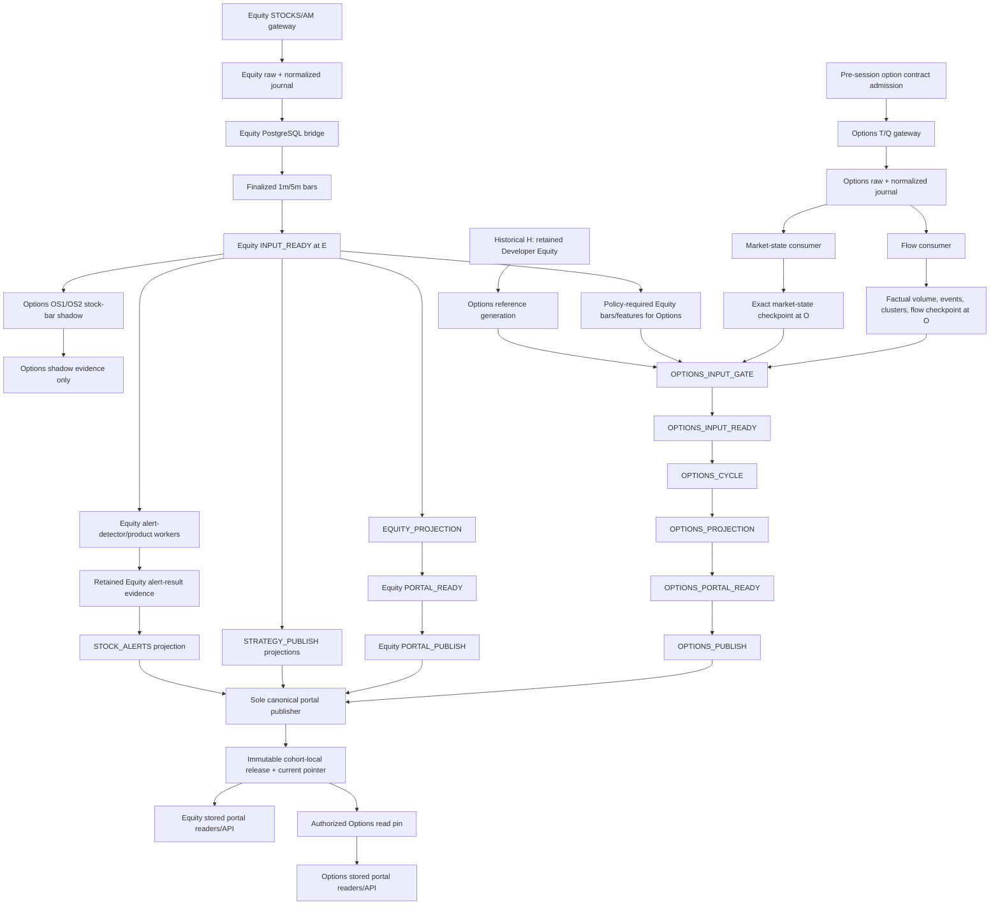

# Realtime V3 Pipeline Reference

Status: **CANONICAL CONTINUOUS-WORKER DESIGN AND IMPLEMENTATION CHECKPOINT**

Updated: 2026-10-31 UTC

## Purpose And Authority

This is the single current design, decision, integration and implementation-status
reference for Advanced Equity and Advanced Options V3. It replaces the earlier
one-session artifact-driven runtime direction with a simple local/Docker continuous
worker model.

The target is a personal development platform:

- workers remain available across sessions;
- XNYS dates and interval boundaries are derived from the clock and calendar;
- code or image changes require an ordinary rebuild/restart, not software
  qualification;
- normal startup does not require a daily authorization package, freeze report,
  session bundle, qualification report or manually supplied session date;
- Equity, sector ETF and Options membership changes are made while the market is
  closed, then automatically backfilled and warmed before the next market run;
- a market-hours restart starts live capture immediately, catches recoverable history
  up to the current finalized interval and continues current ingestion;
- missing raw stream time remains an explicit gap, but does not block unrelated
  tickers, lanes or future intervals;
- provider limits, bounded memory, durable writes, leadership and visible errors are
  ordinary runtime correctness, not an external approval system.

Qualification, replay and frozen evidence tools remain useful optional diagnostics.
They are not prerequisites for normal local or Docker execution. Delivery, broker and
trading effects remain outside this runtime.

## Document Map

Use this map instead of loading several dated reports to discover the current design.

### Canonical Platform And Runtime References

| Document | Current role |
| --- | --- |
| [README.md](../README.md) | Canonical developer startup and current worker behavior. |
| [DEPLOYMENT.md](DEPLOYMENT.md) | Current native/Docker startup, environment, backup and restore procedures. |
| This document | Canonical V3 decisions, lifecycle, integration assessment, implementation status and work packages. |
| [REALTIME_SCHEMA_V2_DESIGN.md](REALTIME_SCHEMA_V2_DESIGN.md) | Canonical `stocks_realtime_v2` schema, durable boundaries, retention classes and orchestration model. |
| [ADVANCED_REALTIME_SCALING_PLAN.md](ADVANCED_REALTIME_SCALING_PLAN.md) | Capacity model, buffer/session-budget distinction, scale milestones and measurements; not a startup gate. |
| [AGENT_CONTEXT.md](AGENT_CONTEXT.md) | Compact context and handoff rules. |
| [Advanced realtime checkpoint](agent-context/advanced-realtime.md) | Current implementation phase, exact anchors and next focused check. |

### Current Subsystem Design References

| Document | Current role |
| --- | --- |
| [OPTIONS_ADVANCED_V3_IMPLEMENTATION_PLAN.md](OPTIONS_ADVANCED_V3_IMPLEMENTATION_PLAN.md) | Detailed H/E/O, Options lane and P8 implementation reference. Its artifact/authority lifecycle is legacy runtime scaffolding unless retained here. |
| [ADVANCED_OPTIONS_FLOW_POLICY.md](ADVANCED_OPTIONS_FLOW_POLICY.md) | Option-print retention, factual volume, aggression, profiles and clusters. |
| [OPTION_PACKAGE_STRUCTURE_AND_STRATEGY_EVALUATION.md](OPTION_PACKAGE_STRUCTURE_AND_STRATEGY_EVALUATION.md) | Package construction, coherent legs, economics and strategy evaluation. |
| [ADVANCED_REALTIME_TECHNICAL_EVIDENCE_PERSISTENCE.md](ADVANCED_REALTIME_TECHNICAL_EVIDENCE_PERSISTENCE.md) | Immutable Equity technical evidence, source windows and stored-reader contracts. |
| [STOCK_ALERT_CONTEXT_ENHANCEMENT_DESIGN.md](STOCK_ALERT_CONTEXT_ENHANCEMENT_DESIGN.md) | Sector, market and event context lineage. Canonical V3 sector/event owners remain deferred. |
| [ADVANCED_REALTIME_FORWARD_INGESTION.md](ADVANCED_REALTIME_FORWARD_INGESTION.md) | Developer/Advanced acquisition boundaries and reusable ingestion contracts. |

### Historical Foundations And Evidence

These retain useful rationale or test evidence but do not control normal V3 startup:

- [ADVANCED_REALTIME_PREFLIGHT_DESIGN.md](ADVANCED_REALTIME_PREFLIGHT_DESIGN.md):
  original three-tier architecture and provider-capacity analysis.
- [ADVANCED_REALTIME_IMPLEMENTATION_PLAN.md](ADVANCED_REALTIME_IMPLEMENTATION_PLAN.md):
  original Windows-first implementation plan.
- [ADVANCED_REALTIME_IMPLEMENTATION_TRACKER.md](ADVANCED_REALTIME_IMPLEMENTATION_TRACKER.md):
  earlier Developer-forward implementation history.
- [ADVANCED_REALTIME_CONTINUOUS_SERVICE.md](ADVANCED_REALTIME_CONTINUOUS_SERVICE.md):
  earlier target-local Developer-forward service, not the current V3 owner.
- [ADVANCED_EQUITY_V2_AUTONOMOUS_DOCKER_ROLLOUT.md](ADVANCED_EQUITY_V2_AUTONOMOUS_DOCKER_ROLLOUT.md):
  V2 rollout evidence and reusable recovery lessons; its external authorization
  gates are not the current runtime direction.
- [ADVANCED_REALTIME_V3_PRODUCTION_VALIDATION_EXECUTION_PLAN.md](ADVANCED_REALTIME_V3_PRODUCTION_VALIDATION_EXECUTION_PLAN.md):
  optional historical full-session validation playbook, not a runtime checklist.
- [ADVANCED_REALTIME_V3_HOLISTIC_REVIEW_2026-10-30.md](ADVANCED_REALTIME_V3_HOLISTIC_REVIEW_2026-10-30.md):
  dated review that identified lifecycle defects.
- [ADVANCED_REALTIME_V3_REMEDIATION_HANDOFF_2026-10-30.md](ADVANCED_REALTIME_V3_REMEDIATION_HANDOFF_2026-10-30.md):
  dated implementation handoff and provider-free evidence.
- [ADVANCED_REALTIME_V3_FULL_SESSION_QUALIFICATION_RUNBOOK_2026-10-28.md](ADVANCED_REALTIME_V3_FULL_SESSION_QUALIFICATION_RUNBOOK_2026-10-28.md)
  and [ADVANCED_REALTIME_V3_LIVE_SESSION_PLAN_2026-10-29.md](ADVANCED_REALTIME_V3_LIVE_SESSION_PLAN_2026-10-29.md):
  historical session attempts and evidence expectations.

## Consolidated Decisions

| Concern | Decision |
| --- | --- |
| Runtime model | Persistent self-reconciling worker group in native development or Docker. |
| Session selection | Derive the current/next XNYS session; never require a date-specific task or operator argument for normal startup. |
| Code changes | Rebuild/restart and resume durable state. Source/image hashes may be logged but do not gate startup. |
| Runtime state | PostgreSQL rows, journal generations, watermarks, leases and receipts are authoritative. JSON files are optional diagnostics/exports. |
| Equity and ETF onboarding | Change desired membership only during market-close maintenance; backfill and warm each member independently before open. |
| Options onboarding | Change desired underlyings during maintenance; refresh catalog/OI, discover configured contracts and prepare subscription shards before open. |
| Market-hours restart | Start live capture first, determine the durable gap, backfill recoverable bars concurrently, finalize catch-up in order and join the current interval. |
| Missing raw stream time | Record a gap. REST bars or snapshots may repair derived coverage but never claim reconstructed raw T/Q evidence. |
| Work priority | Current live ingestion and current finalized intervals outrank historical catch-up. |
| Failure scope | One ticker, underlying, detector or publication failure must not stop unrelated work. Database or journal durability failure may pause the affected writer. |
| Publication | Catch-up results keep original cutoffs and cannot replace a newer current pointer. Stale recovered alerts are stored but not delivered by default. |
| Scaling | Desired membership, worker concurrency and subscription shard size are configuration. Hard provider connection/contract limits remain runtime constraints. |
| Qualification | Optional diagnostic/replay tooling only; never a routine startup or membership-change gate. |
| Trading | Dispatch, broker and trading remain disabled and separate. |

## Target Continuous Worker Lifecycle

```text
START OR RESTART
  -> acquire one simple worker-group leadership lease
  -> derive current XNYS phase and session
  -> load desired universe and durable watermarks
  -> reconcile references, history, catalog and OI
  -> start or resume Equity and Options live capture
  -> repair recoverable gaps without stopping current capture
  -> finalize due bars and stage receipts
  -> run independent Stock Alert, strategy and Options consumers
  -> publish stored projections monotonically
  -> drain at close
  -> run maintenance and prepare desired next-session membership
  -> wait for the next XNYS session
```

The resident group may use separate processes/containers for ingress, bridge,
finalization, scheduling, detectors, publication and retention. "One worker group"
means one lifecycle owner and desired state, not one monolithic process.

### Market-Close Maintenance And Membership Changes

Normal membership changes occur after the market closes.

For a new Equity or sector ETF member:

1. record it in the mutable desired-universe configuration;
2. resolve its security/reference identity;
3. backfill adjusted daily and required native intraday bars;
4. derive required higher intervals and technical warmup;
5. refresh corporate-action and sector mappings;
6. mark the member `LIVE_READY` only when its declared inputs are ready;
7. include it in the next session's automatically generated immutable membership
   snapshot and live subscription set.

For a new Options underlying:

1. require the underlying Equity member and history;
2. refresh option catalog, prior OI and required reference inputs;
3. discover contracts using configured DTE, strike, liquidity and maximum-contract
   rules;
4. build subscription shards within the actual provider connection limit;
5. mark each underlying independently ready or warming;
6. activate ready shards at the next market open without blocking existing shards.

Desired state is mutable for easy maintenance; every session still snapshots the
effective members and contracts so durable bars, gaps, evaluations and publications
remain attributable. The snapshot is created by the worker, not prepared manually.

### Market-Hours Startup And Catch-Up

When the platform starts after the opening boundary:

1. derive the current session and current finalized interval;
2. start the Equity and Options sockets immediately so the missing interval does not
   keep growing;
3. load the last durable acquisition/finalization watermark per member and lane;
4. classify the interval between that watermark and the live handoff;
5. fetch recoverable REST bars/reference facts with explicit repair lineage while
   the live journal continues to grow;
6. merge stream and REST bars by immutable identity and verify chronological closure;
7. finalize recovered intervals in order, while prioritizing current live work;
8. retain explicit raw-stream gaps for unavailable T/Q evidence;
9. move each member/lane from `CATCHING_UP` to `LIVE_READY` independently;
10. continue ordinary latest-interval ingestion and execution.

Catch-up results retain their original market cutoffs. They may populate historical
evidence and stored views, but they cannot advance a current pointer over a newer
release. Historical alert delivery is suppressed by default; current decisions resume
after the member reaches the latest finalized interval.

## Deep Integration Assessment

The current source contains most data-plane pieces. The main challenge is consolidating
two control paths: an older continuous Advanced Equity path that already rolls sessions
and supports hybrid repair, and a newer V3 path built around one-session files,
qualification identities and exact target-9/four-contract scope.

| Boundary | Reusable implementation | Required integration or challenge |
| --- | --- | --- |
| Desired universe | `UniverseManifest`, subscription manifests/members and slot-set versions already model exact membership. `AdvancedEquityControlPlanePlan` accepts 1-400 symbols. | Add one simple mutable desired-universe source in `stocks_realtime_v2`; automatically snapshot it per session. Remove target-9 validation as a general Options prerequisite. |
| Resident lifecycle | `run_realtime_v2_advanced_equity_scheduler.py` already discovers due windows, rolls to the next XNYS session and continues siblings after failed windows. | Remove required initial date/cutoff/authorization arguments for normal startup. Reconcile the process-group and V3 daily-supervisor paths into one persistent owner. |
| Equity live acquisition | Gateway, bounded buffer, SQLite journal, journal pump, bridge, bar writer and interval finalizer are implemented. | Load membership from desired/session state, allow restart against the active generation, and isolate per-member readiness instead of requiring exact target-wide readiness. |
| Equity catch-up | `advanced_ingress_controller.py` has live-first hybrid startup; `advanced_gap_repair.py` has gap and cold-start planning; the scheduler prioritizes live over blocked backfill. | Remove external repair-authorization blocking, generalize beyond the current two-session cold-start scope, and drive repair from durable watermarks automatically. |
| Reference/history | V2 reference tables, cohort history bindings and existing Developer repair code provide historical inputs. | Run one maintenance reconciler that detects exact missing sessions/members. Avoid cross-database reads in hot detector paths; copy or bind required facts before use. |
| Options discovery/admission | Current selection sources preserve catalog identity, quote validity, exact call/put choice and request accounting. | Replace hard-coded QQQ/SPY and one-call/one-put assumptions with configured underlyings and contract policy. Keep an initial simple policy while making counts generic. |
| Options acquisition | Acquisition runtime has independent heartbeat, paced status, durable budget recovery, reconnect and explicit gaps. | Generalize exact-four binding validators, partition memberships into subscription shards and replace manually mounted binding files with database-derived session state. |
| Options residents | P8 INGRESS, MARKET_STATE, FLOW and WINDOW roles, resident barriers and restart rehydration are implemented. | Keep the roles resident across sessions. Replace package/bundle file mounts and downstream binding files as runtime coordination with durable database lookups/receipts. |
| Equity-to-Options decision | H/E/O identities and per-window E binding prevent time-travel and mixed inputs. | Retain these as data lineage, not operator grants. Generate bindings automatically when E and O are ready. Missing dependent context blocks only that Options lane. |
| Canonical Stock Alerts | Receipt-bound batches/evaluations/state, stored projection and readers are implemented. | Replace exact-nine count assumptions with session membership. Add sector ETF and event-risk owners later; keep missing context `UNAVAILABLE` and non-actionable. |
| Projection/publication | Canonical publisher, immutable releases, pointer rollback and stored-only readers are implemented. | Enforce cutoff-monotonic current pointers during catch-up. A publication failure must not stop acquisition or erase the prior readable release. |
| Leadership/restart | PostgreSQL leases, owner epochs, durable stage receipts and journal checkpoints exist. | Use one simple group leadership lease and per-role leases. Retire coordinator output directories as ownership. Detect an already-running child before resuming after supervisor restart. |
| Docker | Compose already separates controller, ingress, bridge, scheduler, finalizer, detectors, alerts, Options residents, API, frontend and retention with persistent volumes. | Convert date/file-bound commands to long-lived desired-state readers; use `restart: unless-stopped`; do not start/stop the topology every session. |
| Retention/archive | Partition creation, retention executor, session archive verification and a dedicated Compose service exist. | Configure one ordinary maintenance cadence, measure disk/WAL/archive growth and keep maintenance failures isolated from live ingestion. |
| Backup/restore | Deployment scripts create verified dumps and restore into an isolated database. | Add periodic operator-friendly backup scheduling and retain a simple restore check; do not make backup evidence a daily startup gate. |
| Observability | Stage health, journal offsets, gaps, provider usage and readiness transitions exist across current components. | Consolidate a small status view by member/lane: `WARMING`, `CATCHING_UP`, `LIVE_READY`, `DEGRADED`, `FAILED`. Do not equate quiet markets with failed processes. |
| Capacity expansion | Equity control supports up to 400; generic manifests support option members; broader-stream diagnostics enforce the 1,000-contract connection ceiling. | Current V3 exact-four and broad-stream code still hard-code QQQ/SPY. Add measured sharding and configuration without blocking small-scope development on full-scale qualification. |

### Key Cross-Stage Challenges

1. **One desired-state owner:** avoid separate configuration, manifest, package and
   authorization sources that can disagree.
2. **Live-first recovery:** start capture before a long historical repair, then merge
   by immutable bar identity without allowing repair to overwrite newer stream facts.
3. **Monotonic downstream clocks:** a recovered old interval may complete after a newer
   interval; publication and detector state must not regress.
4. **Per-member readiness:** exact-universe barriers remain useful for a product that
   explicitly requires all members, but ordinary ingestion and unrelated products must
   continue for ready members.
5. **Generic counts:** current exact-nine Stock Alert and exact-four Options assertions
   are embedded in bindings, captures, scheduler verdicts and tests.
6. **Options sharding:** membership above one provider connection's contract limit needs
   deterministic shards, independent reconnect state and one aggregate readiness view.
7. **Catalog/OI timing:** contract selection depends on same-day catalog/quote facts and
   prior OI; maintenance can warm known inputs, but final contract selection remains a
   session-time responsibility.
8. **Gap semantics:** repaired bars can restore bar-based detectors; they cannot restore
   missing raw quote/trade flow, aggression or opening-sequence evidence.
9. **Restart ownership:** supervisor restart must not launch a second coordinator or
   socket while the original child remains alive.
10. **Schema evolution:** normal numbered migrations remain necessary as code evolves,
    but runtime workers must never require source/image qualification after each change.

## Implementation Status Matrix

| Capability | Status | Notes |
| --- | --- | --- |
| XNYS-derived regular/short-session windows and DST clocks | `IMPLEMENTED` | Reuse directly. |
| Durable Equity and Options journals/checkpoints | `IMPLEMENTED` | Reuse directly. |
| Equity bridge, 1m/5m finalization and derived intervals | `IMPLEMENTED` | Integrate into one lifecycle. |
| Equity continuous scheduler and next-session rollover | `IMPLEMENTED_PARTIAL` | Works with fixed initial identity arguments. |
| Live-first Equity hybrid repair | `IMPLEMENTED_PARTIAL` | Current scope and authorization coupling need simplification. |
| Options reconnect, heartbeat and explicit transport gaps | `IMPLEMENTED_OFFLINE` | Needs resident multi-session integration. |
| P8 resident stages and durable rehydration | `IMPLEMENTED_OFFLINE_DOCKER` | File/package runtime coupling remains. |
| Canonical Stock Alert persistence and stored readers | `IMPLEMENTED` | Exact-nine assumptions and missing context remain. |
| Canonical portal publication and rollback | `IMPLEMENTED` | Add catch-up monotonicity coverage. |
| Retention and archive components | `IMPLEMENTED_NOT_MEASURED_CONTINUOUSLY` | Simplify activation and measure on the real volume. |
| Mutable desired-universe reconciliation | `NOT_IMPLEMENTED` | Required for low-effort Equity/ETF/Options changes. |
| Automatic off-hours onboarding/warmup | `NOT_IMPLEMENTED_END_TO_END` | Reuse existing repair/reference components. |
| Generic Options underlyings/contracts and sharding | `NOT_IMPLEMENTED` | Exact-four and QQQ/SPY are hard-coded across current V3. |
| One simple native/Docker V3 worker group | `NOT_IMPLEMENTED` | Existing services are split across two control models. |
| Mid-session catch-up through current interval across all lanes | `NOT_IMPLEMENTED_END_TO_END` | Equity primitives exist; Options/current publication integration remains. |
| Sector ETF and event-risk context owners | `DEFERRED` | Continue explicit non-actionable `UNAVAILABLE`. |
| Software qualification as a runtime gate | `TO_RETIRE` | Keep optional diagnostic commands only. |
| Daily artifact/freeze/package preparation as a runtime gate | `TO_RETIRE` | Replace with automatic database session state. |

## Implementation Planning Inputs

These packages are the assessed sequence, not additional approval gates:

1. **Unify lifecycle ownership**
   - select the existing continuous Equity controller/scheduler as the base;
   - add one group leadership identity;
   - remove normal runtime dependence on the V3 daily supervisor, dated task and
     coordinator output directory.
2. **Add desired-universe reconciliation**
   - provide one simple maintenance command/API for Equity, sector ETF and Options
     underlying membership;
   - snapshot desired state automatically into existing manifest/cohort structures;
   - expose per-member warmup/readiness.
3. **Complete continuous Equity recovery**
   - derive startup session and cutoffs automatically;
   - run live-first catch-up from durable watermarks;
   - support longer offline gaps in bounded chunks while prioritizing current data.
4. **Generalize Options membership**
   - remove exact-four/QQQ-SPY validators from generic runtime contracts;
   - retain a configurable simple selection policy;
   - add deterministic subscription shards and aggregate readiness.
5. **Move Options coordination to durable state**
   - load session membership, barriers and E/O bindings from PostgreSQL;
   - keep file artifacts only as optional exports;
   - keep residents alive across sessions.
6. **Integrate products and publication**
   - derive expected counts from session membership;
   - isolate lane failures;
   - prevent catch-up pointer regression and stale delivery.
7. **Simplify Docker and maintenance**
   - run long-lived services with persistent journal/report/retention volumes;
   - configure ordinary retention, disk status and backup cadence;
   - keep maintenance failures off the capture hot path.
8. **Focused verification**
   - off-hours add/remove membership;
   - market-hours restart with concurrent live capture and catch-up;
   - multi-session rollover;
   - process/container restart without duplicate sockets;
   - per-member failure isolation;
   - scale curves for configured Equity and Options shard sizes.

## Implementation Consolidation Plan

### Consolidation Goal

Consolidate lifecycle ownership and runtime state without rewriting the verified V3
data plane. The safe boundary is:

```text
change:
  startup, desired state, session discovery, ownership, state loading,
  catch-up coordination and Docker lifecycle

preserve:
  provider adapters, journal formats, normalization, H/E/O lineage,
  stage receipts, P8 resident logic, detector inputs, immutable projections,
  publication transactions and stored readers
```

The first consolidated implementation must produce the same durable domain objects as
the current bounded V3 path. A simpler lifecycle is not permission to silently change
bar identity, option-flow meaning, detector results or portal payloads.

### Migration Rules

1. **No big-bang rewrite.** Introduce one compatibility seam at a time.
2. **No dual live provider owner.** Provider-free planners may run side by side, but
   only one Equity socket owner and one owner per Options subscription shard may be
   live.
3. **Add before removing.** New database readers/adapters and continuous commands land
   before file-driven entrypoints are retired.
4. **Preserve current entrypoints during parity.** Existing one-session commands remain
   usable for replay and regression until the consolidated path produces equivalent
   durable outputs.
5. **Prefer additive schema.** Reuse `subscription_manifests`, `subscription_members`,
   `slot_set_versions`, `service_plans`, `window_runs`, `stage_runs`, receipts,
   checkpoints and leases. Add only the minimal mutable desired-state relation if no
   current relation owns that concept.
6. **Do not fork orchestration.** New work must use the canonical V2 service/window/
   stage lifecycle rather than add another coordinator table or report-file state
   machine.
7. **Keep immutable evidence immutable.** Existing journals, receipts, releases and
   failed windows are never rewritten during migration.
8. **Keep rollback executable.** Every package has an old-path fallback until the new
   path passes its defined parity check.
9. **Do not confuse metadata with gates.** Source/image/package hashes can remain in
   existing records for compatibility and diagnosis, but the new worker does not block
   merely because code changed.
10. **Delete last.** Daily-supervisor, scheduled-task and package-file runtime code is
    removed only after no Compose service, task, test or supported command references
    it.

### Preserve, Adapt, Replace, Retire

| Surface | Disposition | Consolidation treatment |
| --- | --- | --- |
| `AdvancedGateway`, bounded buffers and journal writers | Preserve | Keep transport, backpressure, reconnect and raw-before-derived behavior. |
| SQLite journal format and recovery | Preserve | Do not change format during lifecycle consolidation; retain persistent-volume compatibility tests. |
| Equity journal bridge and interval finalizer | Preserve | Keep independent resident workers and durable checkpoints. |
| `run_realtime_v2_advanced_equity_scheduler.py` | Adapt as lifecycle base | Remove fixed initial date/cutoff inputs; derive session and desired cohort from durable state. |
| `run_realtime_v2_advanced_controller.py` | Adapt as acquisition/catch-up base | Replace external authorization arguments with automatic session budget/state creation while preserving leases and counters. |
| `advanced_ingress_controller.py` hybrid repair | Preserve and extend | Keep live-first repair semantics; generalize gap duration and per-member progress. |
| `advanced_gap_repair.py` | Adapt | Drive from durable watermarks automatically and chunk long gaps; use current work priority. |
| `stage_graph.py` `stages_v5` | Preserve initially | Consolidated orchestration must write the same stage IDs and external E/resident prerequisites. |
| `advanced_realtime_session_scheduler.py` domain objects | Preserve as compatibility contracts | Keep window, capture and publication result models while removing exact membership counts from generic validation. |
| `run_advanced_realtime_session_scheduler.py` | Replace as normal owner | Retain as optional bounded diagnostic until continuous parity; do not let it manage normal daily containers. |
| `advanced_realtime_daily_supervisor.py` and its CLI | Retire from runtime | Preserve only until continuous session rollover and restart tests pass. |
| Windows dated task registration | Retire | Normal worker startup becomes one persistent native/Docker command. |
| Options acquisition heartbeat/reconnect/status | Preserve | Keep durable reservation accounting and explicit transport gaps. |
| Options exact-four acquisition binding | Adapt behind an interface | First load existing exact-four state through the new repository, then parameterize membership. |
| P8 pre-open/downstream binding objects | Preserve as immutable domain records | Move their authoritative storage from mounted files to PostgreSQL without changing hash semantics in the first step. |
| `P8DownstreamBindingStore` | Replace as runtime store after parity | Keep file implementation for replay/diagnostics; add a database repository with equivalent append/replay tests. |
| P8 INGRESS/MARKET_STATE/FLOW/WINDOW roles | Preserve | Keep role boundaries, barriers, rehydration and lane isolation. |
| Package/bundle file mounts | Replace | Database-derived resident/session state becomes normal; optional export recreates the same documents for diagnostics. |
| Canonical Stock Alert producer/repository | Preserve | Parameterize expected membership and add context owners separately. |
| Portal publisher/read pin/stored readers | Preserve | Add catch-up monotonicity and stale-delivery tests; do not add a second publisher. |
| Retention/archive/backup components | Preserve and simplify activation | Run as ordinary maintenance, not as daily runtime qualification. |

### Temporary Compatibility Seam

Introduce one internal session-state loading boundary rather than modifying every
consumer at once:

```text
SessionRuntimeStatePort
  -> LegacyArtifactSessionStateAdapter
       reads current package/bundle/binding files for existing diagnostics
  -> PostgresContinuousSessionStateRepository
       reads desired membership, effective session snapshot, budgets,
       journal generation, resident state and window bindings
```

Both adapters return the existing typed V3 domain objects. This preserves current
hashing, validation, resident and reader behavior while lifecycle ownership moves to
PostgreSQL. Source/image fields remain populated as diagnostic metadata during the
transition, but the continuous repository does not treat a changed source hash as a
reason to refuse otherwise compatible durable state.

The compatibility seam is temporary. Once all supported runtime entrypoints use the
database repository, file adapters remain only in replay/diagnostic commands.

### Desired-State Storage Decision

The database needs one mutable owner for operator intent and existing immutable
owners for effective runtime identity:

```text
mutable desired state:
  Equity members
  sector ETF members
  Options underlyings
  selection policy reference
  effective-next-session marker
  enabled/disabled state

automatic immutable session snapshot:
  subscription manifest and members
  Options slot-set versions and contract members
  cohort/session identity
  journal generations and watermarks
```

Before adding a new table, inspect current control-plane relations for an unambiguous
mutable desired-state owner. Do not misuse an immutable subscription manifest as a
row to edit. If a new relation is required, it should be a small configuration table,
not a parallel cohort, authorization or orchestration system.

Membership edits are accepted only while the exchange is closed. If a desired-state
revision arrives during market hours, record it for the next session; do not mutate
the active subscription or cohort.

### Consolidated Process Topology

Retain the current independent service boundaries:

| Resident | Responsibility |
| --- | --- |
| Lifecycle controller | Leadership, XNYS phase, desired-state reconciliation, automatic session snapshot and overall status. |
| Equity ingress | One fenced STOCKS/AM owner, live-first startup, journal writes and reconnect gaps. |
| Equity bridge | Drain current and abandoned journal generations into canonical 1m bars/checkpoints. |
| Equity finalizer | Finalize 5m and derived intervals. |
| Window scheduler | Discover due windows from durable state, prioritize live work and retry failed windows without stopping siblings. |
| Equity detectors/Stock Alerts | Consume exact ready Equity inputs independently. |
| Options admission | Refresh catalog/OI and produce configured contract membership during maintenance/pre-open. |
| Options acquisition shards | One fenced T/Q owner per deterministic contract shard. |
| Options residents | Preserve P8 INGRESS, MARKET_STATE and FLOW state across windows and sessions as appropriate. |
| Options window workers | Consume automatic E/O bindings and durable resident barriers. |
| Canonical publisher | Sole release/pointer owner for completed product snapshots. |
| Retention/archive | Independent maintenance cadence and status. |
| API/frontend | Stored-only readers. |

The native launcher and Compose must describe the same topology. They may differ in
process hosting, not stage ownership or data contracts.

### Phased Implementation And Preservation Checks

#### C0 - Freeze The Regression Baseline

Purpose: record the tests and durable output shapes that must survive consolidation.

Actions:

- run the current provider-free suites for the continuous Equity scheduler/controller,
  V3 calendar/session scheduler, Options acquisition, P8 production roles, canonical
  Stock Alerts, portal publication/readers and deployment;
- record current schemas and representative payload hashes, not source qualification
  identities;
- inventory every supported CLI, Compose service, environment variable, file mount
  and database relation used by either control path;
- classify failures as pre-existing rather than weakening expectations.

Exit:

- one baseline test matrix with current pass counts;
- one ownership map proving which process can open each provider socket, advance each
  checkpoint and publish each pointer;
- no runtime or schema change.

Rollback: not applicable; this package is read-only plus tests.

#### C1 - Add Session-State Interfaces Without Behavior Change

Purpose: isolate package/bundle/binding loading from domain execution.

Actions:

- define the session-state port;
- implement the legacy file adapter by delegating to current parsers;
- route the existing bounded scheduler and P8 roles through the port;
- keep all current exact target-9/four-contract validations;
- add contract tests proving the adapter returns byte-for-byte equivalent payloads and
  identical typed objects.

Exit:

- all existing V3 suites pass unchanged;
- no Docker command, provider behavior, stage receipt or stored output changes;
- direct file reads are contained behind the adapter.

Rollback: switch constructors back to the current direct parsers.

#### C2 - Add Mutable Desired State And Automatic Session Snapshot

Purpose: replace manual daily membership artifacts while preserving immutable session
lineage.

Actions:

- select or add the minimal desired-state storage;
- add a maintenance command that validates ticker/underlying identities and records an
  effective-next-session revision;
- build the next session's existing manifest/cohort/slot-set objects automatically;
- keep target-9/exact-four as the first default configuration;
- expose per-member `WARMING`, `READY` and `FAILED` state.

Exit:

- changing desired membership during market close creates a new immutable next-session
  snapshot without source edits;
- changing it during market hours defers it to the next session;
- existing active session membership remains unchanged;
- replaying the same desired revision is idempotent.

Rollback: disable desired-state reconciliation and use the legacy artifact adapter.

#### C3 - Consolidate Equity Lifecycle

Purpose: make the existing continuous Equity controller/scheduler the normal lifecycle
owner.

Actions:

- derive initial session and first cutoff from XNYS plus durable watermarks;
- remove normal CLI dependence on authorization ID, session date and first cutoff;
- generate finite session budgets internally from configuration and reset them only at
  the derived session boundary;
- pin the first selected plan and budgets for a session so a restart or same-day
  configuration change cannot create a second usage ledger;
- separate provider acquisition cutoff, current-session processing drain and
  next-session preparation clocks;
- automatically reconcile a pending effective desired revision after member
  preparation changes, without requiring a manual reconcile command;
- retain and recover the current session's durable processing after market close while
  preparing the next session independently;
- assign capability refresh/revalidation ownership and keep expired-only state visibly
  blocked rather than copying expired capability into a new session;
- retain current lease/owner epoch, journal generation and cumulative counters;
- make native and Docker launchers start the same resident set;
- keep current one-session scheduler disabled but available for diagnostics.

Exit:

- cold start before open waits and starts the correct session;
- market-hours start captures live data first and begins catch-up;
- post-close process remains alive, performs drain and selects the next session;
- two lifecycle owners cannot both start;
- current Equity scheduler/controller/database tests and journal tests pass.

Rollback: select the legacy bounded runtime mode; no durable data conversion required.

##### C3 Review Findings And Resolutions

Status: `IMPLEMENTED_PROVIDER_FREE_REVIEWED`; manual/runtime validation remains
separate before C4.

| ID | Finding | Resolution | Status |
| --- | --- | --- | --- |
| C3-R1 | A current desired revision can remain `MISSING_SNAPSHOT` after its members become ready. | The bounded lifecycle owner automatically reconciles pending effective intent on readiness change/startup; no separate operator reconcile step. | `RESOLVED_PROVIDER_FREE` |
| C3-R2 | Acquisition close, processing drain and next-session selection are conflated. | Provider acquisition, current processing drain and future preparation use distinct clocks; existing identical plans remain recoverable after close. | `RESOLVED_PROVIDER_FREE` |
| C3-R3 | Changing same-day configured budgets can mint another authorization/usage ledger. | The first session plan/budgets/counters are pinned and reused; changed configuration applies at the next session boundary. | `RESOLVED_PROVIDER_FREE` |
| C3-R4 | Direct-controller continuous mode can wait inside ingress while its lifecycle lease expires. | Normal continuous mode requires the independently fenced external ingress resident; direct child execution remains diagnostic-only. | `RESOLVED_PROVIDER_FREE` |
| C3-R5 | A copied capability profile can expire before the next session closes. | An independent resident verifies exact intended `STOCKS/AM` WebSocket subscription scope, schedules one TTL-valid bounded probe, records exact accepted/rejected membership and remains visibly waiting/degraded on failure. The probe has an explicit deadline and cumulative control-byte ceiling. | `RESOLVED_PROVIDER_FREE` |
| C3-R6 | Continuous health can prefer a future snapshot and report `IDLE` while today's plan is stalled. | Health reports current acquisition, unfinished prior processing and future preparation separately and evaluates stream heartbeat freshness. | `RESOLVED_PROVIDER_FREE` |
| C3-R7 | Readiness update and snapshot materialization are not serialized per revision. | A shared revision lock serializes readiness/reconcile and reconcile/reconcile; equivalent concurrent callers return the first committed snapshot while real identity conflicts still fail. | `RESOLVED_DISPOSABLE_DB` |
| C3-R8 | Rollover intent can be rolled back together with a `REFRESH_REQUIRED` reconciliation result, leaving the refresh worker pointed at the prior session. | Target-session desired intent is committed before capability-dependent reconciliation, so refresh observes the new session even when snapshot creation waits. | `RESOLVED_DISPOSABLE_DB` |
| C3-R9 | Capability refresh can open a second Stocks WebSocket while live ingress owns the account's default single Stocks connection. | Live ingress and capability probe share one database-fenced account/Stocks connection owner; a probe waits while ingress owns the default connection. | `RESOLVED_DISPOSABLE_DB` |
| C3-R10 | Subscription acknowledgements may arrive across frames, while a generic `success` does not prove exact member acceptance. | The bounded probe accumulates explicit accepted/rejected/unconfirmed membership across frames; generic success alone is not exact-membership PASS. | `RESOLVED_PROVIDER_FREE` |
| C3-R11 | Processing drain can end at close plus completion budget while the final window deadline also includes finality delay. | Processing ownership is derived from the actual final-window deadline and any longer provider drain. | `RESOLVED_PROVIDER_FREE` |
| C3-R12 | Lifecycle, refresh, scheduler and health coordination can repeat more often than their state can change. | Lease heartbeat is separated from expensive reconciliation; capability/scheduler work is paced by pointer, expiry, retry and next-window times; immutable session state is cached and health stays scoped to active work. | `RESOLVED_PROVIDER_FREE` |

#### C4 - Complete Equity Catch-Up And Off-Hours Warmup

Purpose: make missing historical data self-healing and support arbitrary configured
Equity/ETF membership without delaying established work.

Actions:

- expand hybrid repair from the current limited scope into bounded chunks derived from
  acquisition/finalization watermarks;
- preserve explicit REST repair lineage and stream precedence;
- make one off-hours desired-membership change the only operator action: workers
  resolve stored identity, backfill history, derive intervals, track readiness and
  create the effective manifest/cohort/session state automatically;
- never require the operator to create a snapshot, cohort, hash, authorization or
  dated session file for a newly configured member;
- replace the fixed `1/9/25/50/100/200/400` runtime-profile ladder as a membership
  validity constraint; any configured membership inside the supported 1-400 bound must
  receive a deterministic runtime configuration without source edits;
- keep immutable intended membership separate from changing operational readiness;
- reconcile new Equity/ETF members independently;
- derive technical warmup and per-member readiness;
- prevent one new `WARMING` or failed optional member from suspending already-ready
  members or unrelated lanes;
- automatically reconcile a member into the next effective snapshot when its required
  warmup becomes ready;
- expose stored backfill coverage and readiness in the portal while a member warms,
  then include the ready member in normal stored projections without a manual publish
  step;
- retry failed backfill from its durable watermark/attempt state without discarding
  completed intervals or restarting established members;
- persist recovered detector results at their original cutoffs;
- suppress stale delivery and pointer regression.

Exit:

- restart after minutes, hours and multiple sessions catches recoverable bars up to the
  current finalized interval;
- live journal offsets continue advancing during repair;
- one missing member blocks only products that explicitly require complete membership;
- adding a tenth, eleventh or other non-ladder member is accepted without choosing a
  fake larger universe or weakening resource bounds;
- a newly configured member's available historical data/readiness becomes visible in
  the portal during preparation and its ready projections appear automatically;
- interrupted/failed backfill resumes from durable progress and does not replay
  completed work;
- current pointer and detector state remain monotonic.

Rollback: stop automatic repair and retain explicit gaps; live capture continues.

#### C5 - Move Options Session State To PostgreSQL

Purpose: remove mounted package/bundle/binding files from normal Options coordination
without changing P8 domain behavior.

Actions:

- implement the database session-state repository returning current P8 typed objects;
- persist pre-open/session and downstream E/O bindings transactionally;
- revalidate session-specific contract membership, catalog versions, prior OI and
  reference freshness before creating the session acquisition state; carrying
  yesterday's slot set forward is not evidence of today's valid subscription set;
- keep the file adapter and export command for replay;
- start Options residents from effective session state and keep them waiting when no
  window E exists;
- preserve current append ordering, resident barriers, journal offsets and rehydration.

Exit:

- existing exact-four provider-free workflow produces equivalent P8 bindings, receipts,
  resident completions, projections and readers through the database repository;
- crash between binding persistence and consumer observation is recoverable;
- no mounted package/bundle/downstream directory is required by the consolidated
  Docker profile.

Rollback: use the legacy file adapter against the same immutable session snapshot.

#### C6 - Generalize Options Membership And Sharding

Purpose: support maintenance-time additions without weakening current exact-four
behavior.

Actions:

- replace hard-coded QQQ/SPY/four-member validation with configured membership;
- retain the exact-four selection policy as one supported default;
- generalize scheduler expected counts and stored-reader coverage;
- calculate account-wide connection capacity before shard construction, including
  concurrently active Equity and Options owners, reconnect headroom and provider
  entitlement limits;
- build deterministic contract shards within the configured/provider maximum;
- give every shard independent owner, journal generation, counters and reconnect gaps;
- aggregate readiness without hiding a failed shard;
- extend fixtures from four contracts to representative 1/9/50-underlying plans.

Exit:

- exact-four tests still pass;
- a larger provider-free membership partitions deterministically and rehydrates;
- adding one Options underlying during maintenance backfills catalog/OI and becomes
  ready without changing existing shard identities unnecessarily;
- the session refuses an over-capacity shard plan explicitly rather than truncating
  contracts or discovering the connection limit during live startup;
- removing an underlying affects the next session only and retains old evidence.

Rollback: configure the exact-four default membership; generic schema remains additive.

#### C7 - Integrate Products, Publication And Context

Purpose: make outputs membership-driven and catch-up-safe.

Actions:

- derive canonical Stock Alert expected evaluations from the effective Equity snapshot;
- preserve explicit `UNAVAILABLE` for sector/event context;
- keep Options lane independence and H/E/O source requirements;
- add monotonic publication guards for late catch-up completion;
- ensure publication failure does not stop acquisition;
- retry failed projection/publication from durable receipts/outbox state without
  recomputing provider input or requiring a manual release/pointer operation;
- merge a newly ready member into the next canonical stored release while preserving
  established members and the prior readable release until the new publish commits;
- keep stale catch-up alerts stored but non-delivered.

Exit:

- existing nine-member/eight-lane fixtures retain equivalent results;
- variable membership produces exact expected rows without count constants;
- a late old window cannot replace a newer pointer or current detector state;
- missing context remains visible and non-actionable.

Rollback: disable variable-membership products while retaining consolidated ingestion.

#### C8 - Consolidate Docker, Maintenance And Status

Purpose: provide one understandable local/Docker operating path.

Actions:

- create one consolidated Compose profile using long-lived services and persistent
  journal/report/retention volumes;
- remove required date, package, bundle and binding mounts from that profile;
- use `restart: unless-stopped` for resident roles and preserve graceful drain;
- isolate provider, processing, API and frontend failures so an API/frontend exit does
  not stop healthy acquisition or processing children;
- replace bounded restart exhaustion for long-lived residents with per-role degraded
  state, bounded backoff and explicit operator-visible terminal conditions;
- expose one status summary with per-service, per-shard and per-member readiness;
- configure ordinary partition creation, retention and archive cadence;
- document one startup, status, stop, backup and restore workflow.

Exit:

- native and Docker paths produce the same stage ownership and durable results;
- process/container restart does not duplicate sockets or publications;
- maintenance failure leaves live ingestion running;
- backup/restore verification succeeds against consolidated state.

Rollback: retain old Compose profiles until parity and use them only one at a time.

#### C9 - Retire Duplicate Control Paths

Purpose: remove hidden alternate behavior only after replacement parity.

Actions:

- prove no supported launcher, Compose profile, task or test uses the daily supervisor,
  dated task or normal package-file runtime;
- move retained replay helpers under explicit diagnostic naming;
- delete obsolete runtime branches and duplicated lifecycle status code;
- remove temporary runtime-mode switch and compatibility adapter if no diagnostic
  still needs it;
- update README and deployment commands last.

Exit:

- repository search finds one normal Advanced V3 lifecycle owner;
- all provider-free baseline and consolidated tests pass;
- historical evidence remains readable;
- no current document tells users to start the retired path.

Rollback: perform deletion only in a dedicated commit that can be reverted without
reverting schema or data-plane changes.

### Verification Matrix

| Scenario | Required proof |
| --- | --- |
| Before-open cold start | Correct XNYS session, no manual date, ready members subscribe once. |
| Market-hours cold start | Live capture begins first; recoverable gap catches up; raw gap remains explicit. |
| Readiness completes after startup | Pending desired intent reconciles automatically; no manual reconcile command is required. |
| Weekend/holiday/DST/half day | Correct next session, open/close and dynamic window count. |
| Restart during post-close drain | Existing plan is reused; current final window completes through its full deadline while next-session preparation remains separate. |
| Rollover requires capability refresh | Target-session desired intent remains committed/visible even when snapshot reconciliation waits for fresh capability; refresh never targets only the prior session because of controller rollback. |
| Same-day configuration change | Current plan/budgets/usage remain pinned; new values apply only to the next session. |
| Add Equity/ETF after close | History/warmup progresses per member; next session snapshot includes only ready/effective state as designed. |
| Add non-ladder Equity/ETF member | Any supported 1-400 count receives a deterministic profile; ready existing members continue while the new member warms. |
| Automatic member onboarding | One desired-state edit triggers history repair, derived warmup, readiness, immutable session state and portal inclusion with no manual snapshot/cohort/hash/authorization step. |
| Warming member with established universe | Established acquisition, detectors and portal releases continue; the warming member exposes partial stored coverage/readiness independently. |
| Backfill interruption | Retry resumes from the member's durable watermark/attempt and preserves completed intervals. |
| Add Options underlying after close | Catalog/OI/history reconcile; deterministic contracts/shards; existing members unchanged. |
| Options next-session rollover | Contract/catalog/OI/reference evidence is revalidated for the new session; stale prior slot membership is not reused as current proof. |
| Equity ingress crash | Same journal generation/owner recovery or explicit new fenced generation; no duplicate bars. |
| Options shard crash | Only that shard reconnects; gaps/counters survive; other shards continue. |
| Lifecycle supervisor crash | Existing live children are detected; no second coordinator/socket starts. |
| Capability profile expires | Refresh owner performs one bounded exact-scope `STOCKS/AM` subscription probe within the valid pre-session window, supplies a fresh profile or leaves lifecycle visibly blocked; validity is never silently extended and weekends do not cause repeated premature provider calls. |
| Capability refresh while ingress is live | No second Stocks connection is opened under the default account limit; ingress evidence is reused or a probe waits for the shared asset-class connection owner. |
| Split subscription acknowledgements | Explicit acknowledgements accumulate across frames; accepted, rejected and unconfirmed members are distinct at deadline. |
| Final window drain | Processing ownership remains on the current session through the exact final-window deadline including finality delay plus completion budget. |
| Current stalled plus future prepared | Health reports the stalled current session, unfinished prior processing and future preparation independently. |
| Bounded coordination overhead | Lease heartbeat, desired/capability reconciliation, scheduler progress and health queries run on separate bounded cadences driven by their next possible state change, not each message or tight poll. |
| Database interruption | Journals remain bounded/durable; consumers resume from checkpoints. |
| Concurrent readiness/reconcile | One revision lock yields one immutable snapshot; concurrent callers return the same first committed identity. |
| Journal partial write/corrupt tail | Recovery stops at verified durable boundary and surfaces the error. |
| One failed window | Immutable failure retained; later windows continue. |
| Catch-up completes late | Historical evidence persists; newer current pointer/state does not regress. |
| Publication failure | Prior release remains readable; acquisition and unrelated products continue. |
| New-member publication failure | Durable projection/publication retry resumes without re-fetching provider data or manually advancing a pointer. |
| Retention/archive failure | Alarm/status visible; source rows and live ingestion remain intact. |
| Exact-four regression | Current validated QQQ/SPY path remains equivalent. |
| Larger membership | Deterministic sharding, bounded memory, visible partial readiness and no silent truncation. |

### Focused Regression Suites To Preserve

The implementation phase should start by resolving exact commands from repository
tasks, then retain these test surfaces:

- continuous Advanced service selection and secret scoping;
- Advanced controller, ingress plan, stale-owner fencing, journal replay and hybrid
  repair;
- Advanced Equity scheduler rollover, retry and live-over-backfill priority;
- V3 calendar/session scheduler, missed-window continuation and coordinator recovery;
- Options selection source, acquisition heartbeat/reconnect/budget recovery;
- P8 package/runtime/resident barriers, downstream append recovery and role health;
- canonical Stock Alert batches/evaluations/readers;
- canonical portal publication, rollback and stored readers;
- Docker deployment/source inventory and persistent-volume behavior;
- retention/archive/partition and backup/restore behavior.

Do not replace strong exact-scope regressions with only generic-count tests. Add generic
tests beside them, then remove exact constants from implementation while retaining the
exact-four and target-9 fixtures as known examples.

### Hidden-Issue Register

| Risk | Required treatment before cutover |
| --- | --- |
| Both old and new supervisors start | Mutually exclusive runtime mode plus one durable group leadership lease. |
| Old child survives supervisor restart | Record/inspect active owner and process/container identity before spawning or resuming. |
| File and database session state diverge | One adapter is authoritative per run; compare during provider-free parity but never merge live writes. |
| Code change invalidates legacy binding hashes | Preserve legacy diagnostic metadata while the database repository stops using source hash as a startup gate. |
| Active membership changes intraday | Defer desired revisions to the next XNYS session. |
| Backfill overwrites stream bars | Immutable source identity, explicit precedence and overlap verification. |
| Long repair starves current work | Current live windows have scheduler priority; repair runs in bounded chunks. |
| Catch-up emits stale alerts | Store with original cutoff; disable delivery by default. |
| Old catch-up release wins pointer race | Compare cutoff/generation in the sole publisher transaction. |
| Exact count assumptions remain in readers | Inventory validators, health, result counts, tests and UI summaries before generic activation. |
| Options membership exceeds one connection | Deterministic shards; no truncation; explicit over-limit status. |
| One Options shard blocks all products | Per-shard and per-underlying readiness with product-declared completeness. |
| Intended membership and readiness collapse | Immutable desired membership remains intact while operational readiness changes independently. |
| P8 file append guarantees are lost in DB move | Transactional append sequence, previous hash and idempotent replay tests. |
| Session rollover resets cumulative usage after crash | Session-keyed counters persist independently of process lifetime. |
| Same-day budget change creates another plan | First session plan/budgets remain pinned; changed configuration is next-session intent. |
| Provider close switches processing too early | Separate acquisition, processing-drain and future-preparation clocks retain the current final window through completion. |
| Rollover rollback hides capability demand | Pending target-session intent is durable before capability-dependent snapshot reconciliation. |
| Capability probe competes with live ingress | One shared account/asset-class connection owner serializes live ingress and subscription probes. |
| One-frame subscription assumption | Bounded multi-frame acknowledgement accumulation retains accepted/rejected/unconfirmed membership. |
| Coordination churn grows despite quiet market | Heartbeats remain cheap and separate from desired/profile/window/health reconciliation. |
| Future snapshot masks current health | Health selects current acquisition/processing by clock and reports future preparation separately. |
| Readiness races immutable snapshot creation | Shared revision serialization and first-writer timestamp semantics prevent divergent equivalent snapshots. |
| Retention drops data still needed by catch-up | Open pins/watermarks prevent drop; maintenance stays separate from live scheduling. |
| Existing uncommitted V3 source changes are overwritten | Implement from the current working tree, preserve user changes and commit coherent packages only. |

### Consolidated Definition Of Done

The consolidation is complete when:

1. one normal native command and one normal Compose profile start the same continuous
   V3 topology;
2. neither requires a session date, qualification report, package, bundle, freeze file
   or dated scheduled task;
3. desired membership changes during maintenance and becomes an immutable automatic
   next-session snapshot;
4. new members backfill and expose available portal data automatically without manual
   snapshots, cohorts, hashes, authorizations or publication actions;
5. one warming member never blocks established members unless a product explicitly
   declares complete-universe membership;
6. backfill and publication retries resume from durable progress;
7. the platform catches up after downtime while continuing current capture;
8. exact current V3 journal, receipt, H/E/O, P8, detector, publication and reader
   contracts remain covered by their regression suites;
9. exact-four QQQ/SPY remains a supported configuration while larger configurations
   shard deterministically;
10. restart cannot create duplicate provider owners, stage completion or publication;
11. old runtime control paths are removed or clearly diagnostic-only;
12. status makes missing history, raw gaps, warming members, failed shards and stale
   publications visible without stopping unrelated work;
13. README, deployment, canonical design and compact checkpoint all name only the
    consolidated normal runtime.

## Existing Detailed Pipeline Reference

The remainder of this document records the current detailed V3 data path and source
contracts. References to external authorization files, freeze artifacts, exact target-9
or exact-four scope describe the existing bounded implementation, not the target normal
startup contract. Preserve the useful H/E/O lineage, journal, receipt and publication
semantics while replacing external gates with automatically created durable runtime
state.

## Data And Recovery Invariants

1. Raw provider evidence is durable before normalization or derived writes.
2. Equity and Options acquisition can run concurrently, but their decision cycles are
   independently fenced.
3. Historical Equity `H`, completed live Equity `E`, and Options cutoff `O` remain
   distinct immutable identities.
4. `E <= O`, both are in the same market session, and the package-bound maximum age is
   initially 300 seconds.
5. Every session snapshots its exact Equity, sector ETF, Options-underlying and
   contract membership. Target-9 and exact QQQ/SPY are current implementation scopes,
   not universal runtime limits.
6. Options consumes the exact policy-declared Equity bars or technical features visible
   under `E`. Equity owns no S1/S2 model or detector-completion prerequisite.
7. Factual option volume accounting precedes per-print retention. Small eligible
   prints can update cumulative volume without becoming retained flow events.
8. Flow events and clusters are observations. Only registered detectors and package
   builders can freeze coherent ordered legs.
9. A completed database stage is recoverable from durable state. In-process handoffs
   are caches, never restart authority.
10. The canonical portal publisher is the only release and pointer owner.
11. Transient lag is retried without blocking unrelated members. Data divergence,
    invalid configuration and inability to persist required evidence fail visibly for
    the affected owner.
12. No evidence, package, publication, or historical result grants execution
    permission.

## What "Serial Equity To Options" Means

Seriality applies to the immutable decision boundary, not to all market-data capture.

If the Options WebSocket starts only after the Equity cutoff, the system misses the
opening option tape. It also cannot honestly claim complete 900-second accumulation
evidence and can lose the strongest opening volume/OI context.

The V3 target therefore uses:

```text
Pre-session:
  freeze H and Options references
  select/admit exact option contracts
  arm a non-serving session acquisition authorization

Market open through E:
  STOCKS/AM acquisition ----------------------+
                                                +--> run concurrently
  OPTIONS T/Q acquisition and flow accounting -+

At E:
  complete target-9 Equity INPUT_READY
  freeze the exact Equity bar/technical-input identity required by Options
  allow Options OS1/OS2 stock-bar shadow evaluation to continue independently

Between E and O:
  continue the already-running Options residents
  require O - E <= 300 seconds

At O:
  freeze exact Options checkpoints, flow state, marks, and native inputs
  run the serial Options cycle, projection, and publication path
```

The bounded P8 canary may still use a later Options socket start. If it does, its
evidence must explicitly classify opening inference and long-window accumulation as
incomplete or unavailable. A late-start canary does not qualify the production
opening-flow path.

### Existing Bounded Path: Two Lifecycle Clocks

Opening capture and the E-bound decision cycle cannot use one immutable input identity:
E does not exist before the opening socket must start. The existing bounded
implementation represents these identities as authorization artifacts. The continuous
worker must create the equivalent durable session and window records automatically;
they are not operator approvals or startup files.

The two data clocks remain:

1. **Session acquisition authorization**
   - prepared before the opening capture boundary;
   - binds exact contracts, T/Q slots, provider budgets, journal identity, start/stop
     clocks and zero serving authority;
   - authorizes only bounded discovery/admission and T/Q capture;
   - does not authorize an Options cycle, release, pointer, dispatch, delivery, broker,
     or trading effect.
2. **Window cycle authorization**
   - prepared only after exact E exists and before O;
   - binds exact H, E, O, age policy, source checkpoints, build and target window;
   - authorizes only the explicitly granted cycle/projection/publication effects;
   - grants no new provider request or socket scope.

If E never completes, session acquisition evidence remains immutable non-serving
evidence and the cycle authorization is never created.

## Session Timeline

| Phase | Equity | Options | Durable result |
| --- | --- | --- | --- |
| Prior close / pre-session | Final daily history and reference continuity | Prior OI, policy, rates, dividends, catalog and exact slot proposal | Immutable `H`, reference generation and admission plan |
| Before open | Target-9 authorization/profile/cohort ready | Exact contract catalog, T/Q slot set, frozen Options reference and session acquisition authority ready | No cycle/publication authority |
| Open to `E` | STOCKS/AM socket, journal, bridge, 1m and finalized 5m bars | T/Q socket, journal, market state, factual volume, events and clusters | Independent checkpoints and gap evidence |
| Equity cutoff `E` | `INPUT_READY` and exact policy-required bar/technical inputs | Residents and OS1/OS2 shadow evaluation continue | Immutable live Equity source |
| `E` to `O` | No Options-owned Equity work | Continue T/Q capture; close eligible flow windows | `O - E <= 300s` |
| Options cutoff `O` | E remains immutable | Freeze reference/rolling/mark/native/input closure | `OPTIONS_INPUT_READY` |
| Post-`O` | Equity projections proceed independently | Cycle, Options projections, canonical publication | Cohort-local release and pointer |

## End-To-End Flow



The Equity projection branches are independent siblings after `INPUT_READY`.
Equity alert-detector/product workers retain their exact result evidence before
`STOCK_ALERTS` consumes it; `STOCK_ALERTS` does not run detectors during projection.
`STRATEGY_PUBLISH` and the core
`EQUITY_PROJECTION` likewise perform no provider acquisition. The core projection
seals `PORTAL_READY` before `PORTAL_PUBLISH`; alert and strategy snapshots may be
merged independently into the same Equity release under their own completed
input/evidence contracts.

All Equity and Options publication operations invoke the same canonical publisher.
They do not own separate release or pointer implementations. Equity stored readers
may read an authorized current Equity release directly. Advanced Options stored
readers additionally require the exact post-publication read pin; enabling that pin
does not authorize provider, detector, publication, delivery or execution work.

## Equity Acquisition And Materialization

### Ingress

- One fenced STOCKS/AM socket owner writes to a bounded raw-message buffer.
- The raw journal commit precedes normalization and PostgreSQL writes.
- Raw append must not wait on detectors, portal projection, or Options.
- Pending AM finality may delay normalization, but must not block raw durability.

### Bridge

One bounded bridge transaction owns:

- exact stream-session and journal-generation verification;
- unresolved-gap checks for the covered offsets;
- immutable 1m bar revisions/current heads;
- consumer checkpoint advancement.

Checkpoint advancement and covered bar writes are atomic.

### Equity materialization

The materialization owner:

1. drains pending bar jobs;
2. finalizes exact 5m bars;
3. verifies reference generation and Advanced input-gate identity;
4. seals one `INPUT_READY` receipt.

Temporary checkpoint/finalizer lag is `DEFERRED`, not a terminal policy block. The same
window can retry with bounded backoff until its original deadline.

Higher-interval derivation remains part of the initial V3 implementation unless
target-9 measurements show that it materially delays detector and Options readiness.
If it is split later, portal/strategy stages must own their additional interval
requirements without weakening `INPUT_READY`.

### Canonical Equity Stock Alerts

The V3 Stock Alerts product is owned by one resident canonical Equity detector,
not by the legacy intraday/swing forward workers. For each exact `INPUT_READY`
receipt it:

1. loads finalized current-session raw 5m bars as of the receipt creation clock;
2. retains the exact evaluated-security and SPY bar revision/payload membership;
3. computes market trend only from the receipt-bound SPY window;
4. retains sector trend and event risk as explicit `UNAVAILABLE` context until
   separately implemented and qualified;
5. persists one immutable batch plus one evaluation per exact cohort member;
6. advances revisioned detector state only for ready `MATCH` or `NO_MATCH`
   decisions; and
7. exposes `UNAVAILABLE` evaluations as non-actionable Stock Alert rows with
   exact reason codes and no trigger, stop, target or execution permission.

Migration 038 owns the canonical batch/evaluation-to-`INPUT_READY` binding. V3
does not read or write the legacy `stock_alert_result_*` relations or filesystem
result directories. The legacy product remains separately versioned until its
later deletion.

### Options stock-bar shadow

OS1/OS2 consume finalized Equity 5m bars only after the matching Equity
`INPUT_READY`, but they are Options models. Each shadow event retains its exact
source bar revision IDs and payload hashes for the Options product.

The shadow is not an Equity detector product or an Options-cycle prerequisite.
A delayed, blocked, or complete-zero shadow outcome does not suppress Options lanes
whose cycle-local inputs are complete. Likewise, another Options failure never
rewrites or retries an already retained OS1/OS2 shadow result.

Detector polling should evolve from one serializable transaction per
instrument/detector to one bounded detector/shard transaction as the universe grows.

### Equity technical context for Options

Options policy declares the minimum Equity context required by each detector or package
strategy. The initial implementation should load exact bar revisions or already-owned
technical evidence under the bound E receipt and hash that membership into
`OPTIONS_INPUT_READY`.

Every requirement declares its source and shape:

- `H` or `E`;
- interval and adjustment basis;
- session count or current-session range;
- finality and availability requirements;
- cutoff/known-by clock;
- accepted missing/degraded behavior.

Prior-session adjusted reference history normally belongs to H and the frozen Options
reference generation. Current-session finalized technical context belongs to E. A
consumer must not choose a source cohort merely from interval or availability mode.

Do not add a mandatory shared feature relation merely to avoid a small pure
calculation. Prefer:

1. exact materialized Equity bars from E;
2. a pure cycle-local Options context adapter;
3. a shared immutable technical-feature snapshot only after multiple measured consumers
   justify its separate owner.

If an Options strategy reuses breakout or pullback/resume logic, it receives a distinct
Options context/evaluation identity. It does not read or recreate an
`ADVANCED_OPTIONS_OS1` or `ADVANCED_OPTIONS_OS2` event lifecycle.

The accepted stock-first Options identities are `OS1` (range-breakout acceptance
plus exact matching option participation) and `OS2` (relative-trend resumption plus
exact matching option participation). Their H/E bar membership comes directly from
the Equity receipt and exact bar lineage; Equity has no S1/S2 models.

## Options Acquisition And Packet Processing

### When the WebSocket runs

For the production V3 target, the authorized Options T/Q resident starts at or before
the opening capture boundary after pre-session contract admission. It runs concurrently
with Equity ingestion and continues until `O`.

The socket does not wait for E. The Options decision cycle does wait for E.

If E never completes:

- T/Q raw and canonical flow evidence remain immutable non-serving evidence;
- no `OPTIONS_INPUT_READY`, package publication, delivery, or execution occurs;
- provider usage remains charged to its independent authorization.

### Prospective opening admission

The exact opening slot set must be complete before the capture boundary. It cannot be
selected from flow that occurs after the socket starts.

Initial V3 uses one immutable pre-session slot version for the opening interval. A
later make-before-break rotation requires separate policy, capacity and coverage
evidence. Newly admitted contracts cannot claim opening completeness for time before
their subscription became active.

If same-day catalog or reference facts are unavailable before open, the opening-flow
capability is unavailable for that session. A late subscription does not backfill the
missing tape without separately authorized exact replay.

The current post-E activity-ranked P8 selection remains valid only as a late bounded
canary. It is not the production V3 opening-slot selection path.

### Per-packet processing order

The flow owner applies this exact order:

1. Verify exact admitted contract, channel, generation, sequence and catalog identity.
2. Apply reviewed condition semantics.
3. Update factual per-contract/session volume for every volume-eligible trade.
4. Compare the trade with the causal quote/NBBO.
5. Classify aggression and confidence once.
6. Route the print into zero or more versioned retention profiles.
7. Update bounded event-time cluster windows.
8. Persist qualifying events, profiles, cluster members/revisions and checkpoints.
9. Expose retained facts to detector/screener policy.
10. Allow package construction only after exact contracts and causal marks are selected.

The order is normative. Per-print filtering must never occur before factual volume
accounting.

## Flow Retention Profiles

V3 preserves the frozen `advanced-options-flow-v1` concepts. Exact thresholds remain
in [ADVANCED_OPTIONS_FLOW_POLICY.md](ADVANCED_OPTIONS_FLOW_POLICY.md).

| Profile | DTE scope | Evidence shape | Cluster horizon |
| --- | --- | --- | --- |
| `ULTRA_SHORT` | 0-2 DTE | Strict large short-horizon activity; directional only with accepted side/confidence | 5 seconds |
| `BLOCK` | 5-60 DTE | One sufficiently large print; cluster not required | None |
| `SWEEP` | 5-21 DTE | Causal multi-print/multi-exchange burst | 5 seconds |
| `ACCUMULATION` | 5-60 DTE | Repeated bounded evidence with premium, volume and exchange diversity | 180 or 900 seconds |

Every profile uses:

```text
retain member when:
    contracts >= tier.minimum_contracts
    OR premium >= tier.minimum_print_premium
```

One retained event can carry several profile labels but retains one event identity.

### Aggression

Aggression is classified from the quote current at the trade's market time:

- at/above ask;
- at/below bid;
- inside spread;
- no quote;
- stale quote;
- crossed/locked quote;
- unlisted/missing slot;
- excluded complex evidence.

This is quote-relative evidence, not proof of buyer or seller identity. A later quote
cannot rewrite the historical classification.

### Opening and volume/OI inference

Opening inference requires:

- causal prior-session OI;
- complete cumulative eligible volume;
- reviewed conditions;
- causal fresh quote evidence;
- premium evidence;
- accepted aggression/confidence when direction is claimed;
- no unresolved affected gap.

It produces an inference label, score and reasons. It is not an exchange-provided
open/close flag.

If the Options feed starts after the session opening boundary or a prior interval is
missing, opening inference remains incomplete/unavailable unless separately authorized
replay proves exact coverage.

### Cluster finality

Clusters use event-time windows and a watermark:

- 1 second;
- 5 seconds;
- 60 seconds;
- 180 seconds;
- 900 seconds.

Only complete `FINAL` cluster revisions at `O` can satisfy a detector/package gate.
`PROVISIONAL` clusters may be retained as context but cannot be promoted as final
evidence. Late prints and cancels create immutable superseding revisions; they never
rewrite the cycle frozen at `O`.

## Detector, Screener, And Package Boundary

The flow layer answers:

> What unusual activity occurred, under which versioned profile, with what direction,
> completeness, cluster membership, volume/OI context, and retained evidence?

The detector/screener layer applies:

- cumulative-volume and volume/OI thresholds;
- profile, aggression and confidence requirements;
- cluster print/exchange/premium thresholds;
- quote, OI, reference and gap completeness;
- native O1/O3 and only the policy-declared Equity technical context for each lane;
- explicit unavailable outcomes such as O2.

The package layer alone freezes:

- exact ordered legs;
- BUY/SELL, ratio and multiplier;
- marks and quote evidence;
- spot, rates, dividends, IV/Greeks and clocks;
- debit/credit, payoff, collateral, breakevens and costs;
- selected flow event/cluster IDs and policy hashes;
- every degraded/unavailable reason.

An activity observation cannot manufacture package legs.

## Algorithmic Filter Status

The seven conceptual filters in
[OPTION_PACKAGE_STRUCTURE_AND_STRATEGY_EVALUATION.md](OPTION_PACKAGE_STRUCTURE_AND_STRATEGY_EVALUATION.md#implement-the-7-algorithmic-filters-the-processing-consumers)
must not be silently treated as complete V3 admission rules.

| Filter | V3 status |
| --- | --- |
| Volatility crush | `UNAVAILABLE` until accepted live IV percentile/HV and support/resistance evidence exists |
| Gamma squeeze | Partial research context only; current profile clusters are not the proposed sub-50ms model, and short-interest/float gates are not accepted |
| Silent accumulation | Current intraday 180/900s accumulation is retained; proposed multi-day 120-730 DTE LEAP logic is not implemented by the current 0-60 DTE policy |
| Term-structure skew | `UNAVAILABLE`; O2 remains `O2_MODEL_NOT_ACCEPTED` |
| Dark-pool convergence | `UNAVAILABLE`; no accepted Equity TRF/dark-pool owner |
| Put-call parity | Not an accepted production detector/package lane |
| VIX/VVIX capitulation | `UNAVAILABLE`; required feeds/model are not admitted |

Current accepted Options-native lanes are O1, O3, OS1 and OS2. OS1/OS2 reuse the accepted pure
breakout/pullback-resume algorithms under distinct Options policy, input and
evaluation identities; Equity owns only their bar inputs, not detector events. O2 remains
explicitly unavailable. Flow profiles remain evidence/context unless a registered
detector and package builder consume them.

## Product Detector Dependency Matrix

| Consumer | Required Equity dependency | Must not require |
| --- | --- | --- |
| Options O1 | Option flow event, cumulative volume/OI and reference completeness | Equity detector events |
| Options O3 | Option/OI-wall inputs, marks and only its policy-declared stock confirmation context | Equity detector process completion |
| Options OS1 | Prior 15 raw daily H bars, two finalized current 5m E bars and exact matching option participation | Any Equity detector result |
| Options OS2 | Prior 15 raw daily H bars, three finalized current 5m E bars and exact matching option participation | Any Equity detector result |
| Flow observations | T/Q flow, aggression, profiles, clusters and checkpoints | Equity detector outcomes |
| Options package strategy | Exact strategy-declared spot/bar/feature context and ordered option legs | A global all-strategy Equity detector gate |
| Equity portal/alerts | Their own Equity receipts/evidence | Options completion |

The dependency matrix is part of versioned Options policy. Missing technical context
blocks or degrades only the lane that declares it. It does not automatically block O1,
flow observations, unrelated packages, or the Equity product.

### Shared closure versus lane-specific context

`OPTIONS_INPUT_READY` binds the common durable closure:

- exact H/E/O identities and age policy;
- admitted option slots and reference generation;
- market-state and flow checkpoints;
- unresolved-gap verdict;
- exact shared marks and source clocks.

It also records an availability vector for lane-specific Equity context. A missing
breakout, pullback/resume, trend, or support/resistance input does not prevent the
common closure from being sealed when the shared evidence is complete. The affected
lane later records `BLOCKED` or `UNAVAILABLE` in `OPTIONS_CYCLE`.

This preserves the receipt contract that every configured lane has an explicit outcome
without making the most demanding strategy the readiness gate for all observations.

## V3 Stage Ownership

Existing stage catalogs remain immutable. V3 introduces one prospective `stages_v5`
catalog.

The separate Equity cohort retains the existing Equity stage ownership:

```text
Equity window-scoped:
  REFERENCE
    -> EQUITY_INPUT_GATE
    -> EQUITY_MATERIALIZE
    -> INPUT_READY

Equity product siblings after INPUT_READY:
  INPUT_READY + exact retained alert-result evidence
    -> STOCK_ALERTS
  INPUT_READY
    -> STRATEGY_PUBLISH
  INPUT_READY
    -> EQUITY_PROJECTION
    -> PORTAL_READY
    -> PORTAL_PUBLISH
```

`STOCK_ALERTS`, `STRATEGY_PUBLISH` and `EQUITY_PROJECTION` own different immutable
projection contracts. None is an Options prerequisite, and none may perform provider
acquisition. `PORTAL_PUBLISH` owns publication of the core Equity projection after
`PORTAL_READY`; the alert and strategy owners may independently invoke the same
canonical publisher to merge their completed snapshots into the cohort-local release.
Every invocation preserves newer unrelated snapshot entries and advances only the
authorized cohort-local pointer.

The exact source definition must satisfy:

```text
Session-scoped:
  SHARED_REFERENCE -> OPTIONS_ACQUIRE
  OPTIONS_ACQUIRE -> OPTIONS_ADMISSION
  OPTIONS_ACQUIRE -> OPTIONS_REFERENCE

Resident:
  OPTIONS_ADMISSION + OPTIONS_REFERENCE -> OPTIONS_FLOW

Window-scoped:
  external E binding + OPTIONS_REFERENCE + resident completion barrier
    -> OPTIONS_INPUT_GATE
    -> OPTIONS_CYCLE
    -> OPTIONS_PROJECTION
    -> OPTIONS_PUBLISH
```

`OPTIONS_INPUT_GATE` also requires:

- exact target-window E binding;
- complete market-state and flow checkpoints at O;
- gap-free required coverage;
- exact rolling, mark and native-input identities.

Shared input divergence blocks the gate. Lane-specific technical absence is retained as
typed availability evidence for the cycle and blocks only its declared consumer.

It does not depend on a target-cohort `EQUITY_MATERIALIZE` stage. E was completed by
the separate Equity cohort.

Rolling, marks and native loading are internal deterministic owners under the input
gate. They need separate public stages only if measured scheduling or scaling evidence
later justifies them.

## Durable Receipts And Bindings

| Durable object | Meaning |
| --- | --- |
| Session acquisition authorization/receipt | Exact pre-open contracts, T/Q scope, provider budgets and journal with zero serving authority |
| H binding | Options cohort to retained historical Equity source |
| Equity `INPUT_READY` | Exact completed Equity input at E |
| Retained Equity alert-result source | Exact detector-result instances, records, revisions, stream heads and storage identities consumed by `STOCK_ALERTS` |
| Equity `PORTAL_READY` | Exact stored core Equity projection reconstructed from the completed Equity input |
| Equity alert/strategy snapshots | Independently stored product projections bound to their exact Equity input/evidence |
| Options Equity-context identity | Exact E bar/feature membership required by the selected Options policy |
| E-to-Options binding | One Options target window to one completed E receipt and age policy |
| Window cycle authorization/receipt | Exact H/E/O target-window grant with no additional provider scope |
| `OPTIONS_INPUT_READY` | Complete Options closure at O |
| `OPTIONS_CYCLE` | Explicit outcomes for all required lanes |
| `OPTIONS_PORTAL_READY` | Exact stored Options projections |
| Portal release/pointer | Canonical visible snapshot set for the authorized cohort; product publications merge without replacing newer unrelated entries |
| Options read pin | Exact post-publication Options release authorized for stored portal reads |

The E binding is target-window scoped, not target-cohort unique. One daily Options
cohort can therefore execute several windows with different completed E receipts.

## Retry And Failure Semantics

| Condition | Behavior |
| --- | --- |
| Input/checkpoint not yet caught up | `DEFERRED`; bounded same-window retry |
| Retryable PostgreSQL conflict | retry current immutable operation with bounded backoff |
| Missing session acquisition state | controller reconciles it; acquisition waits only when the state is invalid or incomplete |
| Missing E or window cycle state | defer the affected cycle, retain evidence and continue later independent windows |
| Immutable identity divergence | isolate the affected member/lane and surface the error; stop only an owner that cannot write durable evidence safely |
| Gap affecting required evidence | block the affected cycle; do not fake completeness |
| Optional detector unavailable | explicit unavailable lane; continue if policy permits |
| Publication failure | rollback pointer/publication scope; preserve immutable evidence |

For the bounded one-shot Equity start, `catch-up-mode=AUTO` reads the exact
target-cohort `RECONCILED` 1m acquisition watermark after the STOCKS/AM socket
subscribes. It performs no REST request when the watermark already reaches the
socket handoff. Otherwise it repairs only the current-session interval from the
watermark (or session open) through that handoff, including one minute of
overlap, then verifies complete target membership before advancing the durable
watermark. The target-9 policy derives at most two attempts per symbol, an exact
18-request account ceiling and a 1 MiB per-response ceiling. Cross-session
history remains a separate H/reference responsibility.

Before the Equity socket is admitted, the target-9 history binding verifies the
minimum history independently for every cohort member; aggregate coverage across
different tickers is not sufficient. The prior adjusted daily repair is one
grouped exact-nine request. After E, L still uses exactly two QQQ/SPY snapshot
requests but selects the four A-admitted contracts from those responses rather
than reranking to different strikes. Options residents may start while the
independent Equity Stock Alerts/strategy/P11 work completes, but Options
publication still requires the resulting stock-page gates.

The session acquisition receipt is created immediately before its first provider
effect, after pre-session admission/reference checks pass. It becomes terminally
consumed once any authorized provider effect occurs.

The separate window cycle receipt is created immediately before its first target-window
database/stage effect, after exact H/E/O validation. A read-only cycle defer does not
consume that cycle authorization and never broadens the already-running provider scope.

## Restart Contract

Every window stage must support:

```text
in-process handoff present:
  use it

handoff absent after restart:
  load exact durable receipt/evidence
  reconstruct deterministic result
  compare hashes
  continue or fail divergence
```

Resident ingress, market-state and flow completion use a durable database barrier.
JSON status files may remain qualification artifacts but are not production
coordination authority.

The source-qualified V5 WINDOW composition treats all in-memory input, cycle and
projection handoffs as bounded caches. Missing handoffs are reconstructed from
the exact durable input receipt and producer closure, detector dataset/evaluation/
package rows, and portal snapshots. Each reconstructed input, cycle and projection
hash must equal its immutable stage receipt before the next owner may continue.

## Portal Projection And Publication

Equity and Options projections persist immutable snapshots. Publication:

- uses the sole canonical publisher;
- merges product snapshots without replacing newer unrelated entries;
- advances one cohort-local pointer transactionally;
- performs no provider or detector work;
- leaves dispatch/delivery disabled unless separately authorized.

The Equity path is explicit:

```text
Equity INPUT_READY
  |-- -> canonical Equity detector resident
  |       -> exact receipt-bound batch/evaluations/state
  |       -> STOCK_ALERTS stored projection
  |-- -> STRATEGY_PUBLISH projections
  `-- -> EQUITY_PROJECTION -> PORTAL_READY -> PORTAL_PUBLISH

Each completed, authorized branch
  -> sole canonical publisher
  -> cohort-local release/current pointer
  -> stored Equity portal readers/API
```

The three projection branches are siblings. A delayed or unavailable Stock Alerts
result source blocks or degrades that product projection without invalidating the
completed Equity input, the core Equity projection, Options input readiness or an
otherwise complete strategy projection. Publication merges each authorized completed
snapshot set and preserves newer unrelated entries.

Only `MATCH` is actionable. `UNAVAILABLE` and `ERROR` evaluations remain visible
in the Stock Alerts list as non-actionable rows so missing sector/event context is
truthful rather than indistinguishable from a successful empty run. `NO_MATCH`
remains retained evaluation evidence and does not create an alert row.

The Options path is:

```text
OPTIONS_CYCLE
  -> OPTIONS_PROJECTION -> OPTIONS_PORTAL_READY -> OPTIONS_PUBLISH
  -> sole canonical publisher
  -> cohort-local release/current pointer
  -> exact authorized Options read pin
  -> stored Options portal readers/API
```

`OPTIONS_PUBLISH` must perform the authorized canonical publication or be named
`OPTIONS_PUBLISH_HANDOFF`. V3 prefers the former so the durable stage result matches
its name.

V5 uses the direct form: one exact publication authority enters
`OPTIONS_PUBLISH`, and one typed release/current-pointer result leaves it.
Dispatch, delivery, broker and trading remain false. The post-E
activity-ranked P8 late canary remains a separate V4 handoff plus outer
publication path until a later live-service activation checkpoint.

The bounded outer runner enables one exact durable read pin only after
publication. It then reads all four stored projection contracts through the pin
and requires the same cohort/release with zero provider, detector or publication
work. Any failure after pointer advance restores the exact prior read-pin row
first and the exact prior cohort-local pointer second.

## Scaling Model

Build into V3:

- policy-driven target size and required underlyings;
- window-scoped E bindings;
- set-oriented Equity bar/feature context loading;
- durable stage rehydration;
- detector and consumer shard identities;
- per-stage latency, query-count, queue, lag and retry telemetry.

Optimize only after measurement:

- raw-journal reader reuse and independent pending-finality queues;
- multiple Equity bridge shards;
- detector/shard worker pools;
- wider Options underlyings and larger slot sets;
- parallel pure calculations after one frozen input snapshot;
- prewritten immutable portal snapshots with a short final pointer transaction.

Universe expansion updates the mutable desired configuration and creates a new
automatic session snapshot. Backfill and readiness run during maintenance; hard
provider limits or measured resource exhaustion remain visible runtime constraints.
Full-scale measurement informs shard size and concurrency, but it does not block
small-scope development or require a qualification ceremony.

## Optional Bounded Market-Run Validation

The following checks are useful when deliberately collecting a bounded diagnostic or
full-session evidence report. They are not prerequisites for ordinary continuous
worker startup, code changes or membership maintenance:

1. Record the exact effective Equity and Options membership.
2. Exercise the relevant stage path against disposable or retained inputs.
3. Options consumes only its exact policy-declared Equity bar/feature context under E.
4. T/Q capture timing explicitly states whether opening and 900-second evidence are
   complete or unavailable.
5. OS1/OS2 shadow evaluation can be delayed or blocked without suppressing
   otherwise complete cycle-local Options lanes, and the reverse isolation also passes.
6. Every completed stage rehydrates after a WINDOW process restart.
7. No manual readiness rows or synthetic Equity receipts are used.
8. Record provider selection, WebSocket, database, publication and cleanup effects
   explicitly in the diagnostic report.
9. Delivery, broker and trading remain false.

### Historical Provider-Free Evidence

Provider-free integration checkpoint (2026-10-23): the exact target-9
`STOCKS/AM` plus QQQ/SPY `OPTIONS/T/Q` V5 path passes source and
owned-disposable qualification. WINDOW rehydrates after completed input gate,
cycle and projection from PostgreSQL without rerunning completed stages. The
durable resident barrier is the V5 correctness authority; role JSON remains
diagnostic only. Direct canonical publication preserves the Equity entry,
advances one pointer, replays idempotently and restores the prior pointer after
forced failure. Split authorities are consumed once, terminal/incomplete
resident states and restart exhaustion fail closed, and cleanup is empty.

The exact V3 package/bundle/profile and four-role Compose profile are disabled
by default and require an immutable image plus `--no-build`. The V4 P8
activity-ranked late-canary path remains separate. This checkpoint creates no
live package and makes no market-readiness claim. Read-only production/Docker
identity and overlap evidence, prospective live authorities, opening/900-second
market evidence and separately approved stored-read activation remain blockers.

Final pre-market operations preparation (2026-10-23) is retained under
`backend/.realtime-canary/advanced-options-v3-operations-package-20261023-final`.
The final zero-effect production preflight has semantic SHA
`12edc9ca3d0bb7fdf9783cd1f683afa6611b76bf78746a27a47010ca2119fee9`
and file SHA
`d296e0dc4bd9d305a9b8db672cb4ca7d63a2107628f935ce88c8a7f52cbead41`.
It reports 26 `AVAILABLE` facts, zero missing/stale/ambiguous/provider facts,
and verdict `GO_PROVIDER_AUTHORITY_REQUIRED`.

Current source requires exactly the prior 31 adjusted and prior 15 raw QQQ/SPY
daily sessions for H. O3 requires three finalized current-session QQQ/SPY 5m
`RAW_UNADJUSTED` bars at E; OS1 requires two and OS2 requires three. O1 has no
Equity-context member requirement. None requires an Equity detector completion. Stored
adjusted H is missing QQQ
2026-10-19 through 2026-10-22 and SPY 2026-10-19, 2026-10-20 and 2026-10-22.
Raw daily H remains part of the Monday repair/preflight blocker. QQQ/SPY split
and dividend zero-coverage, the current Treasury curve, four same-day catalog
contracts and four prior-OI baselines are stored. Admission is one call and one
put per underlyer. Free-float and short-interest remain typed `UNAVAILABLE`
context and do not block accepted O1/O3/OS1/OS2; their proposed gamma-squeeze
gates remain unaccepted. Next-session option inventory is optional for this canary.

Migrations 033-035 are applied and the production schema passed 72 structure
and 12 security checks after ownership/grant reconciliation. The two expired
windows and one ended blocked stream were preserved and terminalized. The exact
target-9 profile is active, cohort
`17d139e1-869b-55ff-889e-cc915ed20ee0` is ready, and ingress plan
`21c22f2b-324e-5c3f-ac2b-ce1da159cc16` is prepared. Fresh subscription-only
entitlement proved all nine AM subscriptions before open without claiming
market-data coverage.

The disabled package SHA is
`c5908e26fbb6abe1b984251784bce7de5297bca7033dae31ef60598db6d12821`;
artifact-manifest semantic SHA is
`377223610d20a215dee4e21b8ec700cf1b0386890dc103e80ac723b88a3518b4`
and file SHA is
`1f7590a2f6543fa55a23766912f0acb0f161daae409c6ceaa00bdebd25f8a6e1`.
It binds local image
`sha256:e0c8f4e6503de7c60cf32565560bb65e6669c9622080d31469ad9b1b4c71c976`
and keeps session acquisition, window cycle and canonical publication
`NOT_PREPARED`, stored reads `NOT_AUTHORIZED`, and live package creation false.

The final owned Docker rehearsal is `PASS`: all four roles were healthy, all
three resident completion rows agreed at offset 8, V5 WINDOW completed, and
owned database/roles/containers/volumes/network/secrets were absent after
cleanup. Its retained semantic SHA is
`95b9b4fab2ce6763a49790dad54ad3aad7cad42fb1ba8c9afc7c02a8e739ff93`
and file SHA is
`c98ce4e7734ed36a296bdb09bf586fd0bad241ec4426eb09d7b5c3bf0ef9f455`.
The retained four-contract provider-free qualification has semantic SHA
`fde459d6f02deace7075ab3e8e734f9a9f92c744e37200eb9ef36a7d2acb6654`
and file SHA
`19c3cb188fbc71e54e4f3f1aba4d36e3aed3c16719fa0fddb20ded1db4226976`.
The focused continuous-loop suite passes 53 tests. The widened orchestration,
journal, native-input and lane-isolation suite passes another 64 tests with one
unrelated pre-existing Equity runner test deselected.

Single-package production handoff qualification (2026-10-23):

- `prepare` persists the exact four-contract acquisition enrollment,
  `PRE_SESSION` slot set and session acquisition authority, then writes one
  immutable session package/bundle. The bundle contains only session authority
  plus non-authorizing durable lookup references for the later window.
- `start-residents` starts only INGRESS, MARKET_STATE and FLOW. They remain
  alive for the session, advance their durable offsets as the journal grows and
  write one immutable three-member offset barrier for every authorized window.
  INGRESS consumes session authority immediately before its first provider
  effect; exact replay returns the one durable receipt and a different effect
  is refused.
- `authorize-window` is unavailable until the exact target-9 `INPUT_READY`
  receipt and typed E binding exist. The target window ID is derived from exact
  `(session date, cohort, window key, O cutoff)` identity. Each call persists
  that window's binding and cycle authority with `E <= O <= E+300s`.
- `run-window` starts only one session-scoped WINDOW owner from the original
  immutable bundle. It discovers successive durable cycle grants, loads and
  hash-verifies each exact `(target_window_id, session_authorization_id)`,
  reloads its typed E binding, waits or defers on its resident barrier, and
  derives a per-window canonical publication grant from the durable cycle
  reference. A restart resumes incomplete stage attempts and never recreates
  residents.
- A terminal O3 input outcome is a lane-local cycle result. O1 continues and
  the projection/publication records explicit O3 blockage. Equity
  materialization, OS1/OS2 shadow evaluation and Equity publication remain independent.
- `status` is one derived read over `window_runs`, `stages_v5`, resident
  completions, immutable receipts and the publication pointer. No status
  relation was added. At session close INGRESS seals the journal; MARKET_STATE
  and FLOW drain to final offsets, and the derived final barrier becomes
  `COMPLETE`. Stored reads remain a separate post-publication action.

The owned Docker rehearsal used local image
`sha256:2f4e9cd40227c971e2d558e52842f9ea03f7ca7183905530f1633dd7090acc9c`
and one bundle with SHA
`0a66b46cfc9a5ca2b577b5a7beadcb506c28fa431968c686307e4ebe1da1b619`.
Residents were started once and retained identical container IDs across three
windows. Offsets increased monotonically; window 2 deferred then completed;
window 3 retained O1 while recording O3 blocked. V5 WINDOW completed and
database, roles, containers, volumes, network and secrets cleanup was empty.
The report semantic SHA is
`264339ab73696ffd58ed2f3c224c57211f04226b59187f8f42aaeeb7b0facc3e`
and file SHA is
`dc893f199e5b4ff237df6b50d03014223b5dae67b46f95422cbf158ccbb9d4de`.

This qualifies the provider-free handoff implementation, not a live market
run. A fresh prospective session package, causal post-E cycle authority,
market-hours opening/900-second evidence and separately approved stored-read
activation remain required. Never start all four roles only after E, and never
prewrite cycle authority.

## Historical One-Session Lifecycle Remediation Evidence (2026-10-31)

This section records the provider-free qualification and cross-date work that preceded
the continuous-worker decision. Its source and recovery evidence remain useful; its
workflow manifest, daily artifact and qualification sequence are optional diagnostics,
not the normal runtime path.

The supported provider-free qualification path is now the holistic validator.
In `--workflow-manifest` mode it runs local clock/preflight, sealed admission
replay, disposable host-pipeline restart/rehydration, actual production-role
Docker qualification and final aggregation in one invocation. Provider
credentials are removed from child environments and the fixed command set never
invokes a capture script. Retained REST/WebSocket artifacts remain explicitly
provider-backed evidence, but no provider effect occurs during this workflow.
Aggregate-only arguments remain supported for immutable reports produced
separately. Evidence classes are deliberately separate: fixture/source, retained
replay and provider-free Docker may pass while bounded live, full live session
and multi-session soak remain `UNVALIDATED`.

The workflow manifest is semantic-hash protected and uses this shape (paths may
be relative to the manifest):

```json
{
  "schema": "advanced-realtime-v3-local-workflow-v1",
  "session_date": "YYYY-MM-DD",
  "source_qualification": {"path": "source.json", "file_sha256": "..."},
  "admission_capture": {"path": "admission.json", "file_sha256": "..."},
  "rest_cycles": {"path": "cycles.json", "file_sha256": "..."},
  "websocket_capture": {"path": "websocket.json", "file_sha256": "..."},
  "image_id": "sha256:...",
  "semantic_sha256": "..."
}
```

Run it with `validate_advanced_realtime_v3_local_holistic.py
--workflow-manifest <manifest> --output-directory <new-directory> --execute`.

The live session scheduler contract is v2. Full-session window count, request and
byte budgets, capture stop, decision drain, close seal and success criteria derive
from the XNYS calendar, including shortened sessions. Missed windows retain
terminal evidence and do not create downstream append-sequence gaps. Coordinator
resume requires the exact immutable run identity, rejects partial/active foreign
ownership, reuses completed cycles, continues immutable monitor numbering and
preserves recoverable scope instead of cleaning it prematurely.

Release qualification binds immutable image ID to source qualification, not a
trading date. Daily supervisor plans separately bind the session date, history
through the prior XNYS session, authorization, freeze, package, bundle, acquisition
binding, environment and secrets. The persistent supervisor selects the next XNYS
session after decision drain, reconciles those separately authorized preparation
artifacts, rejects late full-session starts, launches or resumes only an exact
coordinator identity, records immutable launch receipts and rolls forward after
cleanup. Its source is provider-free tested; no task/service installation,
provider execution or continuous multi-session soak is claimed here.

Provider-free actual-role checkpoint (2026-10-31): owned-disposable source
qualification semantic `db32e604a66f3872742a09f949296d7269ccd0563a06a65f7c795d075704a5f5`
passed with empty cleanup. Immutable image
`sha256:eb51c58a9a8ea5525d1511592362e71c3d418d77a8bfd13278fb5e74f676fecf`
then passed the six-role 2026-11-02 qualification under report semantic
`d38c193a06a478a9aeb5862eb8ab7c174bc179138e01b04d918ead12bf8b3f7b`.
Resident offsets were monotonic, acquisition restart and durable rehydration
passed, all forbidden effects were zero, and owned database, roles, containers,
volumes, network and secrets were absent after cleanup. This validates the
provider-free production-role lifecycle, not market timing, provider behavior,
storage capacity, a full session or an unattended multi-session soak.

The Compose retention role and archive/retention implementations remain separate
maintenance owners. Production qualification must still measure partition
creation, journal rotation/archive, disk headroom, database retention, backup and
restore. Passing four-contract replay or unit tests is not scale, storage or live
availability evidence.
